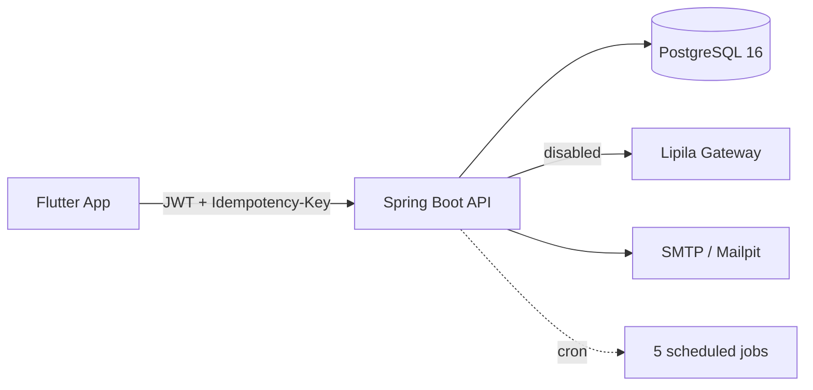

# NovaWallet — D1: Complete Project Discovery & Release Readiness Assessment

**Assessment date:** 2026-10-31 (local)
**Repository root:** `/run/media/ivwananji-silungwe/DEVELOPMENT/PROGRAMMING/PROJECTS/NovaWallet`
**Task type:** Read-only inspection and reporting (no source, config, documentation, dependency, Git or database changes were made during assessment).

---

## 1. Executive Summary

**Overall status: NOT READY to deploy as-is, but close.** The backend is feature-rich, well-tested and containerized; the mobile client in this checkout is a thin, partially-wired shell that does not match the richer client described in the project documentation. The single biggest deployment-readiness gap is that **the local Git metadata is destroyed** (`.git` is a 0-byte file), so the local working tree cannot be diffed, versioned or pushed, and its relationship to the remote cannot be established from local state.

| Area | Status |
|---|---|
| Backend (Spring Boot) | **Implemented and verified.** 144/144 tests pass on H2 (JDK 21). Money movement, idempotency, velocity limits, KYC, admin, notifications, scheduling and audit all present. |
| Mobile (Flutter) | **Partially implemented.** `flutter analyze` clean and `flutter test` passes (1 test). Only auth + wallet-me + transactions list + dashboard + user/profile screens are wired to real HTTP; everything else is demo/mock/placeholder. The checkout's `pubspec.yaml` does **not** contain the Riverpod/go_router/dio stack the docs claim. |
| Database | **Schema defined, not migrated locally.** Flyway V1–V11 SQL present; no persistent DB was touched during this assessment. |
| Security | **Solid foundations, several demo-blockers.** JWT + refresh rotation, BCrypt, HSTS/CSP, rate limiting, email gate. Gaps: no HTTPS config, in-memory rate counters, proxy-unaware remote-addr keying, plaintext verification/reset tokens at rest, no logout endpoint exposed. |
| Testing | **Backend strong (144 pass). Mobile essentially untested (1 pass).** No coverage measurement. |
| Deployment | **Containerization + CI exist but have defects.** Dockerfile healthcheck points at a non-existent path; compose default profile has no SMTP; no CD; no deploy target. |

**Recommended D1 outcome: `READY AFTER SPECIFIC BLOCKERS`** — the backend can realistically be deployed as a Docker container against managed PostgreSQL once a short list of blockers (below) is cleared. The first public demo should use **synthetic/demo funds only**, with live payment integrations remaining disabled.

---

## 2. Repository and Git Status

### 2.1 Actual directory structure (verified)

```
NovaWallet/                                    (no root README.md)
├── .git                                       # 0-byte file — NOT a git repository
├── .gitignore                                 # 1283 bytes, entirely NUL (0x00) — corrupted
├── .serena/                                   # project.yml, memories, cache
├── docs/                                      # 8 Markdown files (see §3)
├── lib/                                       # 37 Dart files — stale near-duplicate of novawallet_mobile/lib
│                                                (diff: only splash_page.dart + welcome_page.dart differ)
├── novawallet-api/                            # Spring Boot backend (6.6 MB)
│   ├── .github/workflows/ci.yml
│   ├── Dockerfile, docker-compose.yml, .dockerignore, .gitignore
│   ├── .env.example (4 keys), SECURITY.md, HELP.md, pom.xml, mvnw
│   ├── report/PHASE_0_REPORT.md
│   ├── src/main (179 Java files) + src/test (24 test classes)
│   ├── src/main/resources/db/migration (V1–V11)
│   ├── target/ (5.2 MB, pre-built classes + surefire reports)
│   └── uploads/kyc/
└── novawallet_mobile/                         # Flutter app (398 MB incl. build/ + .dart_tool/)
    ├── lib/ (37 Dart files), test/ (1 test), pubspec.yaml, pubspec.lock
    ├── android/, ios/, linux/, macos/, web/, windows/
    └── README.md (default Flutter template)
```

### 2.2 Git state (verified)

- **No Git repository.** `git status` → `fatal: not a git repository (or any of the parent directories): .git`. `.git` is a 0-byte file; no nested `.git` exists in `novawallet-api/` or `novawallet_mobile/`.
- **Consequence:** branch, working-tree diff, staged changes, local commit history and remote-tracking state **cannot be determined locally**. There is no local history to preserve or revert.
- **Remote (GitHub API):** the project's real remote is `ivwananjisilungwe/NovaWallet` (public, default branch `main`, only branch `main`, size 874 KB, language Java). The URL in the task spec (`ivwananji-silungwe/NovaWallet`, with hyphen) **does not exist** (`git ls-remote` → `Repository not found`).
- **Remote last push:** 2026-08-22 (docs-only commits). Local source files are dated 2026-10-19 → 2026-10-31, i.e. ~2 months newer and **unpushed**; provenance is unrecoverable locally because `.git` is destroyed.
- **`.gitignore` (root):** 1283 bytes, entirely NUL — corrupted. **VERIFIED** via `file` → "data".
- **Backend `.gitignore`:** ignores `target/`, `.idea/`, `uploads/`, `.env*`, `session-ses_*.md`, etc. — appropriate.
- **Sensitive-file exposure risk:** no secret values were found in tracked-looking files during this scan; `.env.example` contains only 4 placeholder keys (`APP_ADMIN_EMAIL`, `APP_ADMIN_PASSWORD`, `DB_PASSWORD`, `JWT_SECRET`). **VERIFIED.** Build artifacts (`target/`, `.dart_tool/`, `build/`) are present on disk but ignored by backend `.gitignore`; whether they are committed to the remote cannot be verified locally.

### 2.3 Unfinished work that must be preserved

Because there is no Git, "uncommitted changes" cannot be enumerated. However, the presence of a pre-built `target/` (5.2 MB) and `uploads/kyc/` indicates prior local runs. **Do not delete these.** The local source tree is the only copy of ~2 months of post-remote work.

---

## 3. Documentation Register

Eleven documentation files were read in full.

| File | Purpose | Status | Key information | Conflicts |
|---|---|---|---|---|
| `docs/AI-STRATEGY.md` (~133 lines) | AI/ML roadmap (insights → fraud → assistant → credit) | Current (dated 2026-08-22) | Rules-before-models; advisory only; per-user data boundaries; phases A–D with effort sizes | None found |
| `docs/CARD-ISSUING-RESEARCH.md` (~55 lines) | Research on virtual-card issuing providers | Current | Scale+Mastercard lead; card issuing is a separate domain from payments; Phase 13 deferred | None |
| `docs/COMPETITIVE-ANALYSIS.md` (~183 lines) | Competitor comparison (ChitChat, Zazu, MTN/Airtel, Chipper, Moniepoint) | Current | Lipila primary gateway; Zamtel coverage moat; fee-transparency positioning | Recommends Lipila; `PROJECT-PLAN.md` §11 originally recommended Flutterwave (superseded note present) |
| `docs/DIFFERENTIATOR-FEATURES.md` (~293 lines) | Chilemba/group savings, school fees, split bills | Planned only | All three features are **not built** (no backend entities/controllers found) | Docs imply these are differentiators; code has none |
| `docs/IMPLEMENTATION-PLAN.md` (~230 lines) | 6-week Flutter UI/UX polish plan | Stale/aspirational | Assumes Riverpod, design tokens, 80% widget coverage targets | Claims 0 `flutter analyze` issues and token compliance; actual `flutter analyze` is clean (0 issues) but coverage is ~0% (1 test) |
| `docs/PROJECT-PLAN.md` (~515 lines) | Master phase tracker (0–13) | **Partially outdated** | Claims backend 130/130 tests, Flutter 214/214 tests, `flutter analyze` clean, Postgres parity 26/26, "README documentation ✅ refreshed at repo root" | **No root README.md exists** (contradiction). Test counts differ from verified (144 backend, 1 frontend). Claims Riverpod/go_router/dio in stack but `pubspec.yaml` in this checkout has only `http` + `flutter_secure_storage` |
| `docs/SRS.md` (~249 lines) | Software requirements (MVP complete claim) | Current-ish | Claims MVP ✅ complete; 144 backend tests, 214 Flutter tests, PG parity 26/26; defines T10–T13 (Payment entity, deposit initiation, webhook amount/currency verification, reconciliation) as **required but not implemented** | Test-count discrepancy (214 vs actual 1) |
| `docs/TECHNICAL-REPORT.md` (~127 lines) | Full-stack technical report | **Partially outdated** | Claims Riverpod/go_router/dio, 214 frontend tests, "zero TODO/FIXME/print", Postgres parity 26/26 | Same dependency/test discrepancies as above |
| `novawallet-api/SECURITY.md` (~534 lines) | Security documentation | **Outdated (dated 2026-07-10)** | Lists many gaps as "deferred" that are now implemented (audit logging, refresh-token cleanup cron, admin freeze API, CORS, secrets hardening). Claims React Native/Flutter client. Says JWT expires 1 hour in §2.4 but 15 min in §10 | Contradicts current code on multiple points (see §7) |
| `novawallet-api/HELP.md` (~34 lines) | Spring Boot getting-started (auto-generated) | Boilerplate | References Spring Boot 4.1.0 (incorrect — actual 3.5.3) | Stale template |
| `novawallet_mobile/README.md` (~17 lines) | Flutter default template | Boilerplate | "A new Flutter project" | Not project-specific |

### 3.1 What the documentation says is complete vs. planned (verified against code)

- **Complete (verified in code):** auth (register/login/refresh/PIN/email-verify/password-reset), JWT+refresh rotation, wallets (read-only lifecycle), deposit/withdraw/transfer, transaction history, fees, audit, idempotency (per-user scoped), velocity limits, KYC tiers, admin endpoints, notifications, 5 scheduled jobs, Docker/CI, CORS, security headers.
- **Planned (not in code):** Payment domain entity + unique provider ref (Wave 5 W5.1); deposit initiation endpoint (W5.2); webhook amount/currency verification (W5.3); x100 concurrent webhook stress test (W5.4); reconciliation job (W5.5); bills/airtime/merchant checkout (11.5); digital goods (12); virtual cards (13); Chilemba/group savings, school fees, split bills; FCM push (10.7); AI features.
- **Documentation missing but necessary for deployment:** root `README.md` (none exists, despite PROJECT-PLAN claiming it); deployment runbook for managed PostgreSQL + reverse proxy + HTTPS; secret-rotation procedure; mobile release/build instructions; environment-variable matrix for Flutter (`--dart-define`).

### 3.2 Contradictions to flag (not silently reconciled)

1. `PROJECT-PLAN.md` L10/L14 claims "README documentation ✅ (refreshed at repo root)" — **no root README.md exists.** VERIFIED.
2. `PROJECT-PLAN.md` L8 and `TECHNICAL-REPORT.md` L84 claim Flutter stack includes Riverpod ^2.6, go_router ^14.8.1, dio ^5.11, google_fonts, local_auth, Hive, connectivity_plus. `pubspec.yaml` in this checkout declares only `http ^1.6.0`, `flutter_secure_storage ^11.2.0`, `cupertino_icons ^1.0.8`. **VERIFIED discrepancy.**
3. `PROJECT-PLAN.md` L19 and `SRS.md` L15 claim "214/214 Flutter tests passing"; `flutter test` in this checkout runs **1 test** (test/widget_test.dart) and passes. **VERIFIED discrepancy.**
4. `SECURITY.md` (2026-07-10) lists audit logging, refresh-token cleanup, admin freeze API, CORS and secrets hardening as "deferred production gaps" — all are implemented in code now (V8 audit_logs, `RefreshTokenCleanupJob`, `AdminWalletController`, CORS bean, env-only secrets). **Outdated document.**
5. `SECURITY.md` §2.4 says JWT expires in 1 hour; §10 and `application.yml` L49 set 15 minutes (900000 ms). Minor.
6. `HELP.md` references Spring Boot 4.1.0; actual parent is `spring-boot-starter-parent 3.5.3`. Stale auto-generated template.
7. `COMPETITIVE-ANALYSIS.md` L20 notes `PROJECT-PLAN.md` §11 originally recommended Flutterwave; newer research supersedes toward Lipila. Both are present; the plan's "Zambia rails recommendation" section (L336+) correctly reflects Lipila. Consistent now.

---

## 4. Architecture Overview

```
┌──────────────────────── Flutter App (Material 3) ────────────────────────┐
│ features/{auth,wallet,transaction,user}  (37 Dart files)                 │
│ core: config(AppConfig), network(AuthenticatedHttpClient),               │
│       design(app_theme with brand tokens), storage(SecureSessionStore)    │
└──────────────┬──────────────────────────────────────────────┬────────────┘
               │ HTTP + JWT Bearer + Idempotency-Key           │
               ▼                                               ▼
┌──────────────────────── Spring Boot API ─────────────────────┐
│ SecurityConfig: JwtAuthFilter → IdempotencyFilter → RateLimitFilter │
│ Controllers → Services → Repositories → JPA → PostgreSQL/H2          │
│ payment: PaymentGateway SPI → LipilaGateway (disabled by default)    │
│ Flyway V1–V11 schema · 5 cron jobs · @Audited AOP · Caffeine cache  │
└──────────────┬──────────────────────────────┬─────────────────┘
               ▼                              ▼
        ┌──────────────┐            ┌────────────────────┐
        │ PostgreSQL 16│            │ Lipila (disabled)  │
        │ (managed)    │            │ MoMo + card rails  │
        └──────────────┘            └────────────────────┘
```

**Mermaid:**



**Key design decisions (verified):** BigDecimal scale 2 HALF_EVEN; pessimistic locks with sender-before-receiver ordering; per-user idempotency composite key; velocity limits pre-PIN; async audit writes; BCrypt-hashed refresh tokens; Flyway-owned schema (`ddl-auto: validate` in prod).

---

## 5. Backend Implementation Report

### 5.1 Stack and configuration (verified)

- **Spring Boot 3.5.3**, **Java 17** (`pom.xml` java.version 17), Maven, PostgreSQL (runtime), Flyway (`flyway-core` + `flyway-database-postgresql`), H2 (test only), JPA, Spring Security, SpringDoc OpenAPI 2.8.9, jjwt 0.12.7, Caffeine, Lombok, Logstash encoder 8.0.
- **No `micrometer-registry-prometheus`** dependency, yet prod profile enables Prometheus export (see §7).
- Entry point: `NovawalletApiApplication` (package `com.novawallet.novawallet_api`).
- Profiles: `application.yml` (base, `spring.profiles.active=dev`), `application-dev.yml`, `application-prod.yml`.
- Actuator exposes `health,info` (base), plus `metrics,prometheus` in prod. Health path: `/actuator/health` (verified by Spring Boot default; **not** `/api/actuator/health`).

### 5.2 Endpoint inventory (verified from `@RestController` mappings)

| Method | Endpoint | Auth | Purpose | Status |
|---|---|---|---|---|
| POST | `/api/v1/auth/register` | Public | Register user (returns JWT+refresh) | Implemented |
| POST | `/api/v1/auth/login` | Public | Login (rate-limited 5/15min) | Implemented |
| POST | `/api/v1/auth/refresh` | Public (token in header) | Rotate refresh token | Implemented |
| POST | `/api/v1/password/forgot` | Public | Request reset (always 200) | Implemented |
| POST | `/api/v1/password/reset` | Public | Reset password | Implemented |
| POST | `/api/v1/pin` | JWT | Set PIN | Implemented |
| POST | `/api/v1/pin/change` | JWT | Change PIN | Implemented |
| POST | `/api/v1/email/verify` | Public | Verify email token | Implemented |
| GET | `/api/v1/users/me` | JWT | Current user profile | Implemented |
| PUT | `/api/v1/users/me` | JWT | Update profile | Implemented |
| POST | `/api/v1/users/me/change-password` | JWT | Change password | Implemented |
| GET | `/api/v1/wallets/me` | JWT | User's wallet (404 if none) | Implemented |
| GET | `/api/v1/wallets/{id}/balance` | JWT | Balance | Implemented |
| GET | `/api/v1/wallets/{id}/statements` | JWT | Monthly statement | Implemented |
| POST | `/api/v1/wallets/{id}/deposit` | JWT | Self-credit (simulated funds) | Implemented |
| POST | `/api/v1/wallets/{id}/withdraw` | JWT | Withdraw (PIN+limits+email gate) | Implemented |
| POST | `/api/v1/transfers` | JWT | P2P transfer | Implemented |
| GET | `/api/v1/wallets/{id}/transactions` | JWT | Paginated history | Implemented |
| GET | `/api/v1/transactions/{reference}` | JWT | Lookup by reference | Implemented |
| GET | `/api/v1/fees/estimate` | Public | Fee estimate | Implemented |
| POST | `/api/v1/wallets/{id}/payouts` | JWT | MoMo payout (disabled → 503) | Scaffolded (disabled) |
| POST/GET | `/api/v1/webhooks/lipila/collections` | Public (secret header) | Collection callback | Scaffolded |
| POST | `/api/v1/kyc/documents/upload` | JWT | Upload KYC doc | Implemented |
| GET | `/api/v1/kyc/status` | JWT | KYC status | Implemented |
| POST | `/api/v1/kyc/submit` | JWT | Submit for review | Implemented |
| GET | `/api/v1/notifications` | JWT | List notifications | Implemented |
| GET | `/api/v1/notifications/unread-count` | JWT | Unread count | Implemented |
| PUT | `/api/v1/notifications/read-all` | JWT | Mark all read | Implemented |
| GET | `/api/v1/admin/kyc/pending` | ADMIN | Pending KYC | Implemented |
| GET | `/api/v1/admin/kyc/{userId}` | ADMIN | KYC detail | Implemented |
| GET | `/api/v1/admin/kyc/{userId}/documents/{docId}` | ADMIN | Document download | Implemented |
| POST | `/api/v1/admin/kyc/{userId}/approve` | ADMIN | Approve KYC (+ creates wallet) | Implemented |
| POST | `/api/v1/admin/kyc/{userId}/reject` | ADMIN | Reject KYC | Implemented |
| GET | `/api/v1/admin/users` | ADMIN | List users | Implemented |
| GET | `/api/v1/admin/users/{id}` | ADMIN | User detail | Implemented |
| PATCH | `/api/v1/admin/users/{id}/deactivate` | ADMIN | Soft-delete user | Implemented |
| POST | `/api/v1/admin/wallets/{id}/freeze` | ADMIN | Freeze wallet | Implemented |
| POST | `/api/v1/admin/wallets/{id}/unfreeze` | ADMIN | Unfreeze wallet | Implemented |
| GET | `/api/v1/admin/wallets` | ADMIN | List wallets | Implemented |
| GET | `/api/v1/admin/transactions` | ADMIN | Search transactions | Implemented |
| GET | `/api/v1/admin/audit-logs` | ADMIN | Audit log view | Implemented |
| GET | `/api/v1/admin/fees` (+CRUD) | ADMIN | Fee config CRUD | Implemented |
| — | `/actuator/health`, `/actuator/info` | Public | Health/info | Implemented |

**Not present (verified by grep):** `/logout`, delete-account, deposit/collection initiation, card endpoints, digital-goods, bills, group savings, school fees, split bills, chat, push-notification registration.

### 5.3 Business-flow traces (verified)

- **Registration (`AuthService.register`):** duplicate email/phone check → BCrypt password → save user (no wallet) → verification token → refresh token → async verification email → `AuthResponse`. **Does not create a wallet** (wallet is created only on KYC approval). **VERIFIED.**
- **Login (`AuthService.login`):** no email-verified gate; no explicit rate-limit call inside service (rate limiting is in `AuthController` via `LoginRateLimiter`). **VERIFIED.**
- **PIN brute-force:** `AuthService.verifyPin` increments `pinAttempts` and saves, then throws `BadRequestException` on mismatch; after 3 failures sets `pinLockedUntil +15 min`. **However**, `verifyPin` is called from within `TransactionService`'s class-level `@Transactional` methods (withdraw/transfer), so the failed-attempt increment is **rolled back** when the exception propagates → the lockout never accumulates through those endpoints. **VERIFIED by code reading.** This is a real security gap for live money.
- **Deposit (`TransactionService.deposit`):** find active wallet with lock → ownership check → `amount.setScale(2, HALF_EVEN)` → load user → `enforceDepositWalletLimit` (KYC tier cap) → read balanceBefore → atomic `updateBalance(+amount)` → re-read → write `Transaction` type DEPOSIT status SUCCESSFUL immediately → audit + notify. **No payment provider, no PIN, no email-verified gate, no idempotency of its own** → any authenticated user can self-credit their own wallet (intentional for demo/simulated funds). **VERIFIED.**
- **Withdraw:** lock+ownership, email-verified gate, velocity limits before PIN, PIN verify, daily send limit, fee (WITHDRAWAL), single atomic debit of `-(amount+fee)`, writes WITHDRAWAL row + separate FEE row, audit+notify. **VERIFIED.**
- **Transfer:** findByUserId then lock sender, status checks, self-transfer rejected, lock receiver (sender→receiver order), email gate, velocity, PIN, daily limit, fee (TRANSFER), debit `amount+fee`, credit receiver `amount` only, writes TRANSFER_DEBIT + TRANSFER_CREDIT sharing a reference string but with **different stored references** (debit uses generated `reference`, credit uses a separately generated one), sets `relatedTransactionId` both ways, FEE row, audit both sides, notify both users. **VERIFIED.**
- **Wallet creation:** only in `AdminKycService.approveKyc` (L134–141): userId, generated account number, balance 0.00 (scale 2), ZMW, ACTIVE. **No check for an existing wallet** → re-approval after rejection creates a second wallet → `findByUserId` would throw `IncorrectResultSizeDataAccessException`. **VERIFIED.**
- **KYC:** upload (MIME allowlist jpeg/png/webp/pdf, ≤10 MB, 5 uploads/hour, rejects if APPROVED/PENDING), submit for review, admin approve/reject. Tier limits: Basic 5,000/2,000; Standard 50,000/20,000; Advanced 200,000/100,000. **VERIFIED.**
- **Admin seeding:** `AdminDataInitializer` (CommandLineRunner) seeds admin **only in `dev` profile**, skips if an ADMIN with that email exists, password from `APP_ADMIN_PASSWORD` (never logged). **Prod profile never seeds an admin** → manual DB work required to approve KYC in production. **VERIFIED.**

### 5.4 Financial integrity (verified)

- Money is `BigDecimal` scale 2 HALF_EVEN throughout. **VERIFIED.**
- `WalletRepository.updateBalance` is a native `@Modifying` update with `WHERE id=:walletId AND balance+:amount>=0` returning int — DB-level negative-balance guard. **VERIFIED.**
- Pessimistic locks (`@Lock(PESSIMISTIC_WRITE)`) with sender-before-receiver ordering. **VERIFIED.**
- `@Transactional` on `TransactionService` class → atomicity. **VERIFIED.**
- **Risks found (specific references):**
  - `V6__transactions.sql` L8: `status VARCHAR(15) NOT NULL DEFAULT 'SUCCESSFUL'` — a half-written row would default to success. No CHECK constraint `amount > 0`.
  - `V3__wallets.sql`: `user_id` index is **non-unique** → no DB guarantee of one wallet per user (enables the duplicate-wallet bug above).
  - `V2__users.sql`: `verification_token` and `password_reset_token` stored **in plaintext** with plain (non-unique) indexes → DB read access leaks account-takeover tokens.
  - `V4__refresh_tokens.sql`: no UNIQUE on `token_hash`.
  - Webhook idempotency relies on a `description` string (`[LIPILA:<referenceId>]`) matched via `existsByDescription` — **no DB unique constraint/index** on description → race window (mitigated only by acquiring the wallet pessimistic lock first, which serializes per-wallet).
  - Transfer creates two rows with **different stored references** (debit uses generated `reference`, credit uses a separately generated one) while sharing a `reference` string variable → statement reconciliation by reference is ambiguous. **VERIFIED** in `TransactionService.transfer` (L273 vs L280/L324-325).
  - `V1__init_schema.sql` creates a leftover junk table `schema_version_test`.
  - `AccountNumberGenerator` uses `ThreadLocalRandom` with a check-then-insert race; only the DB unique index on `account_number` guards it (insert would fail, not retry gracefully beyond 10 attempts).

---

## 6. Database and Financial Integrity Report

- **Configuration:** dev profile → `jdbc:postgresql://localhost:5432/novawallet`, `ddl-auto: validate`, Flyway enabled. Prod → `DATABASE_URL`/`DATABASE_USERNAME`/`DATABASE_PASSWORD`, Hikari pool 10, idle 2, `ddl-auto: validate`, Flyway enabled.
- **Migrations:** V1–V11 present, sequential. No migrations were executed during this assessment.
- **Schema ownership:** Flyway. `ddl-auto: validate` in both dev and prod (good — no auto-DDL).
- **Money precision:** `DECIMAL(15,2)` for balance/amount/before/after/fee. **VERIFIED.**
- **Concurrency:** pessimistic write locks + atomic guarded update. **VERIFIED in code.**
- **Postgres parity:** docs claim 26/26 money-path suites green on PostgreSQL 16. **NOT VERIFIED in this assessment** (no DB was started/migrated; H2 suite passed). Marked UNVERIFIED.

---

## 7. Security Findings (severity-ranked)

| # | Severity | Finding | Affected file:lines | Impact | Blocks demo? | Blocks live money? |
|---|---|---|---|---|---|---|
| S1 | **Critical** | Webhook credits amount taken **solely from the callback payload**; no comparison to an initiated payment record; **no currency check** anywhere in the webhook path. Any caller with the shared secret can credit arbitrary amounts. | `WebhookService.java` L93–128, L184–186 | Arbitrary wallet credit | No (Lipila disabled) | **Yes** |
| S2 | **Critical** | PIN attempt counter is rolled back by the enclosing `@Transactional` on withdraw/transfer → brute-force PIN lockout never accumulates through money-out endpoints. | `TransactionService.java` (class L51–53), `AuthService.verifyPin` L163–191 | PIN brute force | No | **Yes** |
| S3 | **High** | No `Payment` domain entity / unique provider-reference column exists (Wave 5 is planned, not implemented) → ms-scale double-credit window on concurrent webhooks. | `WebhookService.java` L112–116; plan W5.1 | Duplicate credit | No | **Yes** |
| S4 | **High** | Webhook authentication is a **shared secret in a header** (`X-Webhook-Secret`), not a documented Lipila signature/HMAC; secret comparison is constant-time (good) but authenticity is unverifiable against provider docs. | `WebhookController.java` L43, L94 | Forged callbacks if secret leaks | No | **Yes** |
| S5 | **High** | `deposit()` KYC wallet-limit failure throws 400 **after** the provider has moved money → provider retries while customer money is already credited locally. | `TransactionService.deposit` L90–141; `WebhookService` L124 | Stuck/retried credits | No | **Yes** |
| S6 | **High** | Payout has a documented timeout-after-acceptance gap: local rollback while provider may have disbursed (javadoc L50–54). | `PayoutService.java` L50–54, L232–238 | Lost/misplaced funds | No (disabled) | **Yes** |
| S7 | **High** | `RateLimitFilter` keys on `request.getRemoteAddr()` → behind a reverse proxy all traffic shares one bucket (no `server.forward-headers-strategy`). | `RateLimitFilter.java` L82–88; no forward-headers config anywhere | Shared rate limit / bypass | **Yes** (if deployed behind proxy) | Yes |
| S8 | **High** | Admin user is seeded **only in `dev` profile** → no admin exists in a prod deployment without manual DB work → no one can approve KYC. | `AdminDataInitializer.java` L60–64 | No KYC approval path in prod | **Yes** | Yes |
| S9 | **High** | Verification and password-reset tokens stored **in plaintext** in `users` table. | `V2__users.sql` (indexes on token columns); `AuthService` | Account takeover on DB read | No | Yes |
| S10 | **Medium** | Dockerfile healthcheck uses `/api/actuator/health` but actuator is mounted at `/actuator/health` → healthcheck always fails. | `Dockerfile` L39–40; `docker-compose.yml` L72 | Container marked unhealthy | **Yes** | No |
| S11 | **Medium** | Prod profile exposes `metrics,prometheus` and enables Prometheus export, but `micrometer-registry-prometheus` is **not a dependency** → startup failure or missing metrics. | `application-prod.yml` L60–69; `pom.xml` deps | Boot failure / no metrics | **Yes** (if metrics scraped) | No |
| S12 | **Medium** | `LoginRateLimiter` and `RateLimitFilter` counters are in-memory Caffeine → reset on restart; multi-instance deployments don't share state. | `LoginRateLimiter.java`; `RateLimitFilter` | Brute-force window reset | No | Yes |
| S13 | **Medium** | No `/logout` endpoint exposed (service method exists but no controller). | `AuthService.logout` L278–281; grep of controllers | Cannot revoke sessions client-side | No | No |
| S14 | **Medium** | Duplicate wallet on KYC re-approval (no uniqueness on `wallets.user_id`). | `AdminKycService.approveKyc` L105–150; `V3__wallets.sql` | `IncorrectResultSizeDataAccessException` on read | **Yes** (if KYC rejected then re-approved) | Yes |
| S15 | **Medium** | `JwtAuthFilter` catches all exceptions and only logs → invalid token silently proceeds unauthenticated (relies on downstream 401). | `JwtAuthFilter.java` L62–64 | Minor; could mask issues | No | No |
| S16 | **Medium** | CORS `allowCredentials=true` with explicit origins (OK) but default origins include `capacitor://localhost` and dev ports; prod default only `localhost:3000,5173`. | `SecurityConfig.java` L124–154; `application-prod.yml` | Misconfigured CORS in prod if not overridden | **Yes** (if frontend origin not added) | No |
| S17 | **Low** | JWT has no issuer/audience claim and access tokens are not revocable (only refresh family is). | `JwtUtil.java` L32–39, L56–63 | Stolen access token valid up to 15 min | No | Yes |
| S18 | **Low** | PIN hashed with the same BCrypt `PasswordEncoder` as passwords (functionally fine, but no domain separation). | `AuthService` setPin/changePin | Minor | No | No |
| S19 | **Low** | `app.rate-limit.login.max-attempts/lockout-minutes` config is consumed; global `window-seconds` drives `RateLimitFilter`. Consistent. | — | — | No | No |
| S20 | **Informational** | Swagger UI CSP exception is permissive (`same-origin` for `/api/swagger-ui/**`); strict CSP (`default-src 'none'`) elsewhere. Acceptable for a demo; disable Swagger in prod ideally. | `SecurityConfig.java` L68–88 | Minor | No | No |
| S21 | **Informational** | `SECURITY.md` (2026-07-10) is outdated vs. current code (see §3). | `SECURITY.md` | Doc drift | No | No |

**Secrets handling:** No secret values were printed. `.env.example` exposes only 4 key names. JWT secret has **no default in any profile** (fail-fast). **VERIFIED.**

---

## 8. Payment Integration Report

- **Providers with code:** Lipila only (`LipilaGateway implements PaymentGateway`): `initiateCollection` (POST `/collections/mobile-money`), `initiateDisbursement` (POST `/disbursements/mobile-money`), `checkStatus` (GET `/transactions/{referenceId}/status`). RestClient with 5s connect / 10s read timeouts, `x-api-key` header, optional `callbackUrl`. **VERIFIED.**
- **`initiateCollection` has ZERO callers** (verified by grep) → **no deposit/collection initiation endpoint exists anywhere in the backend.** VERIFIED.
- **Payout endpoint:** `POST /api/v1/wallets/{walletId}/payouts`, authenticated, applies PIN+velocity+email+daily-limit gates, debits locally then calls gateway, rolls back on synchronous `Failed`, writes WITHDRAWAL+FEE rows with `[LIPILA:<referenceId>]` marker. Disabled by default → returns 503 `SERVICE_UNAVAILABLE`. **VERIFIED.**
- **Webhook:** `POST /api/v1/webhooks/lipila/collections` (also GET), permitAll, constant-time secret compare → 401 if missing/wrong/unconfigured; parses `NW:<walletId>:<uuid>` reference; non-`Successful` status returns 200 without credit; normalizes amount to 2 decimals; dedupes via `existsByDescription`; then calls `transactionService.deposit`. **VERIFIED.**
- **Sandbox/live:** `app.payments.lipila.enabled=false` by default; gateway disabled → payouts 503. Webhooks are processed **even when disabled** if a secret is configured (PaymentConfig javadoc L24–29). **VERIFIED.**
- **What is missing for production (Wave 5, all PLANNED, not implemented):** Payment entity + unique provider-ref column (W5.1); deposit initiation API (W5.2); webhook amount/currency verification against initiated Payment (W5.3); x100 concurrent webhook stress test (W5.4); reconciliation job (W5.5).
- **Lenco / Flutterwave / Paystack:** only mentioned in documentation (Lenco as secondary, Flutterwave as fallback/cross-border, Paystack ruled out for Zambia). **No code.** VERIFIED NOT FOUND.

**Conclusion:** Payment integration is **scaffolding only**. It must not be described as production-ready. Live financial operations must remain disabled.

---

## 9. Flutter Application Report

### 9.1 Stack and configuration (verified against `pubspec.yaml`)

- **Flutter 3.47.5 / Dart 3.13.4** (matches `environment.sdk ^3.13.4`).
- **Declared dependencies:** `cupertino_icons ^1.0.8`, `http ^1.6.0`, `flutter_secure_storage ^11.2.0`. Dev: `flutter_test`, `flutter_lints ^6.0.0`. **No Riverpod, go_router, dio, google_fonts, local_auth, Hive, or connectivity_plus** in this checkout.
- **`flutter analyze`: 0 issues.** **`flutter test`: 1 test passed** (`test/widget_test.dart` — "NovaWalletApp sets the application title").
- **Brand colors implemented:** `lib/app/theme/app_theme.dart` defines `electricBlue = 0xFF356DF3`, `midnight = 0xFF0B1020`, `iceBlue = 0xC5D5FF`, `cloudWhite = 0xF4F6FB`, with light/dark backgrounds. **VERIFIED.**
- **API base URL:** `lib/core/config/app_config.dart` L22 hardcodes `'http://localhost:8080'` (no `--dart-define` override, despite SRS C5 requiring it). Android emulator requires `10.0.2.2`. **VERIFIED.**
- **Token storage:** `lib/features/auth/data/session_store.dart` uses `flutter_secure_storage` with 4 keys (`novawallet_access_token`, `novawallet_refresh_token`, `novawallet_expires_in`, `novawallet_user`). No plaintext prefs. **VERIFIED.**
- **HTTP client:** `AuthenticatedHttpClient` attaches `Authorization: Bearer <token>`, 15s timeout, maps 401 → `sessionExpired`. **No automatic refresh-token rotation in this client** (docs claim single-flight refresh; not present here). **VERIFIED.**
- **Android:** `applicationId = "com.example.novawallet_mobile"` (placeholder), `minSdk = flutter.minSdkVersion`, `targetSdk = flutter.targetSdkVersion`, `compileSdk = flutter.compileSdkVersion`, `buildToolsVersion 36.0.0`, Java 17. **Release build signs with debug keys** (`signingConfig = signingConfigs.getByName("debug")` with a TODO). **VERIFIED.**
- **AndroidManifest.xml:** no `<uses-permission android:name="android.permission.INTERNET" />` found (grep returned nothing). **VERIFIED absence** — potential release-build network failure; needs verification whether Flutter adds it at build time.
- **No iOS permission/network config inspected beyond default** (ios/ exists).

### 9.2 Screen implementation inventory (verified)

Based on file presence, direct reads, and the completed mobile subagent analysis. The app consumes only **8** of the backend's ~30 endpoints: `POST /auth/login`, `POST /auth/register`, `POST /auth/refresh` (implemented but never invoked), `POST /email/verify` (reachable only with a token no call site supplies), `GET /users/me`, `GET /wallets/me`, `GET /wallets/{id}/transactions`, `GET /transactions/{reference}`. There is **no money-movement UI whatsoever**.

| Screen / feature | Files | Wired to backend? | Notes |
|---|---|---|---|
| Splash / Welcome | `splash_page.dart`, `welcome_page.dart` | N/A | Entry flow; no startup/session-restore task |
| Login | `features/auth/presentation/login_page.dart` | Yes (HTTP) | Email/password → `/auth/login`; "Forgot password?" is a hard-coded snackbar stub |
| Register | `register_page.dart` | Yes (HTTP) | → `/auth/register` then navigates to email verification page |
| Email verification | `email_verification_page.dart` | Partial | → `/email/verify`, but **no call site ever supplies the token** (no deep link/intent filter) |
| Dashboard (real mode) | `features/dashboard/...` | Yes (wallet me + transactions) | Count-up balance, quick actions; all quick actions (Deposit/Withdraw/Send/Receive) are snackbar stubs |
| Dashboard (sample mode) | `dashboard_page.dart` | Mock | Dual `build` methods; sample data via `SampleTransactions` |
| Wallet service | `features/wallet/data/wallet_service.dart` | Yes (HTTP) | `GET /wallets/me`; maps 404 → `WalletNotFoundException` |
| Transactions list | `features/transactions/...` | Yes (HTTP) | `GET /wallets/{id}/transactions` |
| Transaction detail | `transaction_detail_page.dart` | Partial | Fetch path (L107–149) is **unreachable**; only sample data renders |
| User / Profile | `features/user/data/user_service.dart` | Yes (HTTP) | `GET /users/me` (greeting only) |
| Cards | `features/cards/...` | **Mock/hardcoded** | `cards_demo_data.dart` (design-stage) |
| Discover | `features/discover/...` | **Mock/hardcoded** | Demo data |
| KYC upload | — | **Missing** | No screen, no service; dashboard copy only references KYC |
| Deposits / Withdrawals / Transfers | — | **Missing** | No recipient picker, amount form, or confirmation step |
| Receive | — | **Missing** | Snackbar stub only |
| Payouts | — | **Missing** | No screen, no account linking |
| Notifications | — | **Missing** | Bell button is a snackbar stub; no list/badge |
| PIN (set/change) | — | **Missing** | `pinSet` parsed into models but never surfaced in UI |
| Password reset (forgot/reset) | — | **Missing** | `AuthService` has no `forgotPassword`/`resetPassword` method |
| Change password / profile update | — | **Missing** | `POST /users/me/change-password` unused |
| Fee estimate | — | **Missing** | No preview screen/service |
| Admin console | — | **Missing** | No admin module (backend has ~12 admin endpoints) |
| Wallet statements | — | **Missing** | Backend `GET /{walletId}/statements` unused |

### 9.3 State management, navigation, and networking (verified)

- **State management:** 100% `setState` in private widget fields; no shared store (no Provider/Riverpod/Bloc in this checkout). Services are constructed inline with `??` defaults on every getter call (`dashboard_page.dart:51-55`, `transactions_page.dart:45-50`, `transaction_detail_page.dart:103-105`, `login_page.dart:74`).
- **Navigation:** no `go_router` in this checkout; `app.dart:24` builds `MaterialApp(home: SplashPage())` with **no `routes` table**, so real services are never invoked on boot and the five tabs show sample data.
- **Session restore:** none. "Logged in" is a transient snackbar (`login_page.dart:197-205`); `SplashPage` has no startup task.
- **Networking:** base URL hardcoded `http://localhost:8080` (`app_config.dart:22`); no `--dart-define` override. Tokens stored correctly in `flutter_secure_storage` (4 keys incl. refresh token). Refresh is defined but never called; 401 handling is copy-pasted three times. No logging/analytics/crash reporting, no app lifecycle handling, no deep linking/app links (no intent filters in manifest).

### 9.4 Design system and dead code (verified)

- **Brand colours implemented** exactly (`app_theme.dart`: `0xFF356DF3`, `0xFF0B1020`, `0xC5D5FF`, `0xF4F6FB`) with light/dark backgrounds. **No fonts declared** (`pubspec.yaml` has no `fonts:` section) even though two `Image.asset` calls reference non-existent files.
- **Dead/unused code:** `AppButton` + `AppButtonVariant` (`shared/widgets/app_button.dart:9-69`) imported by zero files; `AuthSession.toJson()` defined but never called; empty `AuthModels` namespace class; `QuickActionButton` only consumed by the sample dashboard; `TransactionDetailPage` fetch path unreachable; `SectionHeader.actionLabel`/`onAction` used in one place.
- **Stale comments:** `auth_service.dart:20,213` claim "secure token storage is pending" and "persistent, encrypted storage is not yet implemented" — contradicted by `SecureSessionStore` (wired in `login_page.dart:184`). `register_page.dart:17-19` claims "no verification screen yet" while `EmailVerificationPage` exists and is navigated to at `register_page.dart:460-464`. `login_page.dart:17-20` claims "post-login destination not yet implemented" (stale for the `sessionStore != null` path). All cite a `TODO.md` that **does not exist** anywhere in the repo (glob `**/TODO*` → no files).
- **Code smells:** `splash_page.dart:10` re-exports `nova_mark.dart` from a screen file; `wallet_balance_card.dart:3-4` and `quick_action_button.dart:3` use fragile relative imports while the rest use absolute `package:novawallet_mobile/...`; duplicated `transaction_model.dart` (data vs presentation) and `transactions_page.dart` carries two near-duplicated `build` methods (real vs sample mode).

### 9.5 Android / iOS configuration (verified)

- **Android:** `applicationId = "com.example.novawallet_mobile"` (`build.gradle.kts:20`) — still the placeholder, with the template TODO intact at `:19`. `minSdk`/`targetSdk` delegated to Flutter defaults (`flutter.minSdkVersion`/`flutter.targetSdkVersion`), not set explicitly. `compileSdk = flutter.compileSdkVersion`, `buildToolsVersion = "36.0.0"`, Java 17 + Kotlin JVM target 17.
- **Permissions:** `AndroidManifest.xml` contains **no `<uses-permission>` at all** (verified lines 1–45). `INTERNET` is declared **only in debug and profile overlays** (`android/app/src/debug/AndroidManifest.xml:6`, `android/app/src/profile/AndroidManifest.xml:6`). No `ACCESS_NETWORK_STATE`, no `CAMERA`/`READ_MEDIA_IMAGES` (blocks future KYC upload), no `POST_NOTIFICATIONS` (Android 13+). **Critical:** a release build would lack `INTERNET` and every network call would fail.
- **Cleartext:** no `usesCleartextTraffic` or `network_security_config.xml` anywhere. Android 9+ defaults to `false`, so the hardcoded `http://localhost:8080` (`app_config.dart:22`) is unreachable on Android 9+ and on iOS (no `NSAppTransportSecurity` in `ios/Runner/Info.plist`). `localhost` is also useless from a device (the file's own comment at `app_config.dart:13-17` acknowledges the emulator needs `10.0.2.2`).
- **Signing:** `build.gradle.kts:33-39` uses `signingConfig = signingConfigs.getByName("debug")` with the template TODO at `:35-36` ("Signing with the debug keys for now"). No keystore, no `key.properties`, no `signingConfigs.create` block exists anywhere. **The app is not release-buildable for distribution** — debug signing, placeholder `applicationId`, missing release INTERNET permission, and cleartext-only backend URL.
- **iOS:** `CFBundleDisplayName = "Novawallet Mobile"` (`Info.plist:10`), `CFBundleName = "novawallet_mobile"` (`:18`); portrait + both landscape orientations (`:56-68`); no ATS exception. No push-notification entitlements.

### 9.6 Executive summary (mobile)

The app is a **design- and onboarding-finished shell with a half-wired API layer**. Startup is: `main.dart` → `SplashPage` (800 ms animation, no startup task, no session store inflation) → always `WelcomePage` → `LoginPage`/`RegisterPage` → `AppShell` **only if a non-null `SessionStore` is injected**, which is the current shipping configuration — so real services are never invoked on boot and the five tabs show sample data, and cards/profile/discover are inert in every mode. No session restore exists; "logged in" is a transient snackbar. State management is 100% `setState`. The base URL is a hardcoded `http://localhost:8080`; tokens are stored correctly but refresh is never called and 401 handling is duplicated. Money never moves: no transfer, deposit, withdrawal, payout, fee, PIN, KYC, notification, password-reset or admin UI exists despite ~30 backend endpoints; everything money-related is a "not connected in preview mode" snackbar. Four brand colours are implemented exactly, but no fonts and no assets are declared even though two `Image.asset` calls reference non-existent files. Release builds fail on four counts: debug signing, placeholder `com.example.novawallet_mobile` applicationId, a release manifest with **no INTERNET permission**, and a cleartext-only HTTP endpoint blocked by both Android 9+ and iOS ATS.

---

## 10. Testing Report

### 10.1 Backend (executed)

**Command:** `cd novawallet-api && export JAVA_HOME=/usr/lib/jvm/java-21-openjdk-amd64 && ./mvnw -o test -B`
**Result:** `Tests run: 144, Failures: 0, Errors: 0, Skipped: 0` — **BUILD SUCCESS** (42.5 s, offline).
**Test classes discovered (34):** `NovawalletApiApplicationTests`, `AuditServiceTest`, `AuthServiceTest`, `FeeEngineServiceTest`, `TransactionHistoryServiceTest`, `UserServiceTest`, `RateLimitFilterTest`, `LipilaGatewayTest`, plus integration tests: `AdminSecurityIntegrationTest`, `AuthControllerIntegrationTest`, `BaseAuthIntegrationTest`, `EmailVerificationIntegrationTest`, `FullAuthLifecycleIntegrationTest`, `LoginRateLimitingIntegrationTest`, `PasswordResetIntegrationTest`, `PinValidationIntegrationTest`, `RefreshTokenRotationIntegrationTest`, `RegistrationValidationIntegrationTest`, `ConcurrentTransferIntegrationTest`, `SchedulerIdempotencyIntegrationTest`, `TransactionFlowIntegrationTest`, `AuditAssertionEndpointIntegrationTest`, `IdempotencyEndpointIntegrationTest`, `KycAdminEndpointIntegrationTest`, `KycNegativeEndpointIntegrationTest`, `PaymentWebhookEndpointIntegrationTest`, `PayoutEnabledIntegrationTest`, `PayoutEndpointIntegrationTest`, `ProfileFeeEndpointIntegrationTest`, `TransactionEdgeCaseEndpointIntegrationTest`, `TransactionVelocityLimitIntegrationTest`, `NotificationServiceIntegrationTest`. Test profile uses H2 in-memory (`jdbc:h2:mem:testdb;MODE=PostgreSQL`) with Flyway enabled and test-only secrets.

| Test suite | Executed? | Passed | Failed | Skipped | Result |
|---|---:|---:|---:|---:|---|
| Backend `./mvnw test` (H2) | Yes | 144 | 0 | 0 | BUILD SUCCESS |
| Flutter `flutter test` | Yes | 1 | 0 | 0 | All tests passed |
| Flutter `flutter analyze` | Yes | — | 0 issues | — | No issues found |

**Not executed / not available in this environment:** Postgres-backed money-path parity (docs claim 26/26) — **UNVERIFIED** (no DB migrated). Flutter widget/integration tests beyond the single smoke test (none exist in checkout). Coverage was not measured (`--coverage` not run) → do not claim a coverage percentage.

### 10.2 Tests discovered but not executed

- No separate repository/controller/security test suites exist beyond those listed; payment tests (`PaymentWebhookEndpointIntegrationTest`, `PayoutEnabledIntegrationTest`, `PayoutEndpointIntegrationTest`, `LipilaGatewayTest`) exercise the scaffold against MockRestServiceServer/H2, not a live provider. **VERIFIED.**

---

## 11. Docker and Deployment Readiness

### 11.1 Existing infrastructure (verified)

- **`Dockerfile`:** multi-stage `maven:3.9-eclipse-temurin-17` builder (`mvn dependency:go-offline`, `mvn package -DskipTests`) → `eclipse-temurin:17-jre-alpine`, non-root user `novawallet`, `/app/uploads/kyc`, `EXPOSE 8080`, `ENTRYPOINT java -jar app.jar --spring.profiles.active=prod`. Healthcheck: `wget -qO- http://localhost:8080/api/actuator/health` — **wrong path** (should be `/actuator/health`).
- **`docker-compose.yml`:** `api` (build `.`, ports 8080:8080, env from `DATABASE_URL`/`DATABASE_USERNAME`/`DATABASE_PASSWORD`/`JWT_SECRET`/`SPRING_MAIL_HOST=mailpit:1025` with empty mail user/pass, `APP_ADMIN_EMAIL`, `APP_ADMIN_PASSWORD`, `APP_SMS_API_KEY`, `APP_CORS_ORIGINS`, volume `kyc-uploads:/app/uploads`, healthcheck same wrong path, depends_on db healthy); `db` postgres:16-alpine (published 5432:5432, volume `postgres-data`, pg_isready); `mailpit` under profile `dev` only.
- **`.dockerignore`:** excludes `target/`, `*.jar`, `.idea`, `.vscode`, `.omo`, `.opencode`, `docs/`, `.git`, `uploads/`, `.env*`, `*.bak`.
- **CI (`.github/workflows/ci.yml`):** triggers on push/PR to `main`|`master`; job `test` (JDK 17 temurin, maven cache, secret-scan grep for `PRIVATE KEY`/`AKIA`/URL-with-credentials, then `./mvnw test`), uploads surefire reports on failure; job `build` needs test, only on push to main/master, logs into `ghcr.io` via docker/build-push-action with GHA cache. **No deploy step, no CD to any host.**
- **No `.dockerignore` issues found beyond those listed.**

### 11.2 Missing for a public demo

- HTTPS / reverse proxy (no `server.forward-headers-strategy`, no TLS config, no proxy docs).
- Correct healthcheck path.
- SMTP credentials for real email (prod profile requires `SPRING_MAIL_HOST/PORT/USERNAME/PASSWORD` with no defaults → fail-fast). Mailpit only runs under `dev` profile, so default `docker compose up` (prod profile via Dockerfile entrypoint) has no SMTP host.
- `APP_CORS_ORIGINS` must include the deployed frontend origin.
- `SPRING_PROFILES_ACTIVE` is not set in compose (relies on Dockerfile ENTRYPOINT `--spring.profiles.active=prod`).
- Prometheus registry dependency (if metrics are to be scraped).
- Admin user provisioning for prod (manual DB insert or a prod-safe seeding mechanism).
- Flutter release signing config and INTERNET permission verification.
- Mobile API base URL strategy for a deployed backend (currently hardcoded `localhost`).

### 11.3 Can the backend realistically be deployed as a Docker container against managed PostgreSQL?

**Yes, with the blockers above cleared.** The Dockerfile builds a non-root JRE image, Flyway owns the schema (`ddl-auto: validate`), config is env-driven, and Hikari pool is configured. The H2 test suite passing does not prove Postgres parity (UNVERIFIED). **Recommendation: run the money-path suites against a disposable Postgres 16 container before declaring deployment-ready.**

---

## 12. Release Blockers

### Target 1 — Public portfolio demo (prioritized)

1. **B1 (Critical/Blocking):** Restore or replace Git metadata. The `.git` file is 0 bytes; there is no local history, branch or working-tree tracking. Without this, no diff, review, commit or push is possible. **This is the single largest blocker to any controlled deployment.**
2. **B2 (High):** Fix Dockerfile/compose healthcheck path (`/actuator/health`).
3. **B3 (High):** Provision a prod admin user (manual DB insert or prod-safe seeder) so KYC can be approved.
4. **B4 (High):** Configure `APP_CORS_ORIGINS` for the deployed frontend origin.
5. **B5 (High):** Resolve the Flutter dependency discrepancy (docs claim Riverpod/go_router/dio; checkout has `http` only) and reconcile test counts (docs claim 214; checkout has 1). Decide which client is actually being shipped.
6. **B6 (High):** Mobile API base URL must be configurable for a deployed backend (`--dart-define=API_BASE_URL` per SRS C5 — not implemented in `app_config.dart`).
7. **B7 (Medium):** Verify/add Android `INTERNET` permission; configure release signing (currently debug keys).
8. **B8 (Medium):** HTTPS/reverse proxy + `server.forward-headers-strategy` (needed for correct client IP in rate limiting and logs).
9. **B9 (Medium):** Fix or remove Prometheus export in prod (missing registry dependency).
10. **B10 (Medium):** SMTP credentials (or accept console-only email logging for the demo, with documented limitation).
11. **B11 (Low):** Remove/clean the corrupted root `.gitignore` (all NUL bytes).
12. **B12 (Low):** Create a root `README.md` (none exists).

### Target 2 — Real-money financial launch (additional, beyond demo)

All of Wave 5 (W5.1–W5.5), plus: HMAC webhook verification, amount/currency verification against initiated Payment, x100 concurrent webhook stress test, reconciliation job, PIN lockout fix (remove rollback), admin provisioning, proxy-aware rate limiting, plaintext-token-at-rest fix, Postgres parity run, provider compliance (Gate 0), regulatory/compliance review, operational monitoring and incident handling.

---

## 13. Recommended D1 Assessment Outcome

**`READY AFTER SPECIFIC BLOCKERS`**

**Reasoning:** The backend is genuinely complete for a synthetic-funds portfolio demo — 144 tests pass, money movement is atomic and auditable, idempotency and velocity limits are in place, and containerization/CI exist. The blockers are operational and environmental (Git metadata destroyed, healthcheck path, admin provisioning, CORS, mobile client/dependency reconciliation, HTTPS/proxy), not architectural. Live payment integration is correctly disabled by default and must remain so. The mobile client in this checkout is thinner than the documentation claims and must be reconciled before it can be presented as a working app.

---

## 14. Recommended Next Milestones (dependency order)

| ID | Objective | Required work | Deliverables | Acceptance criteria | Dependencies | Blocks demo? | Blocks live money? |
|---|---|---|---|---|---|---|---|
| M1 | Restore version control | Recreate `.git` (init + commit current tree) or recover from remote; fix root `.gitignore` | Git repo with initial commit; clean `.gitignore` | `git status` works; remote tracking configured | None | **Yes** | Yes |
| M2 | Backend deployability | Fix healthcheck path; remove/fix Prometheus export; set `forward-headers-strategy`; document env matrix | Updated Dockerfile/compose; env matrix doc | Container healthcheck green; clean startup on managed Postgres | M1 | **Yes** | No |
| M3 | Admin provisioning | Add prod-safe admin seed or documented manual SQL; verify KYC approval works end-to-end | Admin seed mechanism + doc | Admin can log in and approve KYC in prod profile | M2 | **Yes** | Yes |
| M4 | CORS & HTTPS | Configure `APP_CORS_ORIGINS`; add reverse-proxy + TLS docs | Updated compose/env docs | Frontend origin allowed; HTTPS documented | M2 | **Yes** | No |
| M5 | Mobile client reconciliation | Resolve dependency discrepancy (Riverpod/go_router/dio vs http-only) and test-count discrepancy; decide shipped client | Decision record + aligned `pubspec.yaml`/tests | `flutter pub get` + `flutter test` green with agreed scope | M1 | **Yes** | No |
| M6 | Mobile release config | Add `--dart-define=API_BASE_URL` support; verify INTERNET permission; configure release signing | Updated `app_config.dart`; signing config | Buildable release APK pointing at deployed backend | M5 | **Yes** | No |
| M7 | Postgres parity run | Run money-path suites against disposable Postgres 16 (no migration changes) | Test report | All money-path suites green on PG 16 | M2 | No | **Yes** |
| M8 | Wave 5 payment integrity | Implement Payment entity + unique provider ref (W5.1); deposit initiation (W5.2); webhook amount/currency verification (W5.3); x100 stress test (W5.4); reconciliation job (W5.5) | New migration V12; endpoints; tests | All Wave 5 acceptance criteria green | M7 | No | **Yes** |
| M9 | Security hardening for live money | Fix PIN lockout rollback; proxy-aware rate limiting; hash verification/reset tokens at rest; HMAC webhook verification | Code + migration changes | Security review sign-off | M8 | No | **Yes** |
| M10 | Demo launch | Deploy backend + DB; build distributable APK; document demo limitations and synthetic-funds disclaimer | Deployed backend URL; APK; demo doc | Registration, login, wallet, deposit/transfer/withdraw (simulated) demonstrable publicly | M1–M6 | **Yes** | No |

---

## 15. Final Verification

- **Source files modified:** No.
- **Configuration files modified:** No.
- **Documentation modified:** No (this report file is the only new file, created at the user's explicit request after the read-only assessment).
- **Dependencies installed or upgraded:** No (Maven offline run reused cached `~/.m2`; `flutter test`/`analyze` reused cached `.dart_tool`).
- **Git history changed:** No Git repository exists to change (`.git` is 0 bytes); no commits, amends, rebases, resets or pushes performed.
- **External services contacted:** No. Maven ran offline (`-o`); Flutter ran offline; GitHub API was queried read-only (no mutations). No payment providers, databases or production services were contacted.
- **Database modified:** No. Backend tests used an in-memory H2 database that is discarded on JVM exit; no migrations were run against PostgreSQL or any persistent store.

**The project remains otherwise unchanged.** Generated artifacts from test runs (`novawallet-api/target/` surefire reports, `novawallet_mobile/.dart_tool/`) may have been refreshed by the executed test commands, but no source, configuration or documentation content was altered.

---

*End of D1 assessment. This report is the baseline for the NovaWallet deployment roadmap.*
