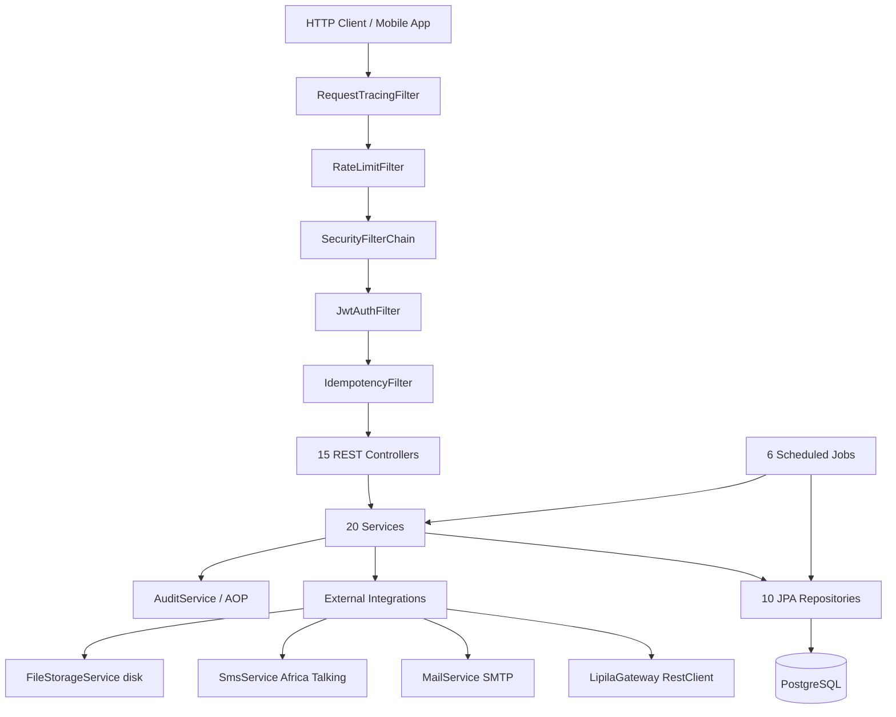

# NovaWallet API — Current Architecture

> **Document**: `docs/architecture/current-architecture.md`
> **Scope**: Verified against source tree at `novawallet-api/` (no `.git` directory present — unversioned working tree).
> **Stack**: Java 17, Spring Boot 3.5.3, Maven, PostgreSQL, Flyway.
> **Counts (verified)**: 146 main Java files, 40 test Java files, 15 `@RestController` classes, 1 `@RestControllerAdvice`, 20 `@Service` classes, 10 `JpaRepository` interfaces, 10 JPA `@Entity` classes, 37 DTOs, 13 enumerations, 12 Flyway migrations (11 SQL + V12 Java).

---

## 1. Repository & Build Overview

- **Backend root**: `novawallet-api/` (relative to repository root `/home/ivwananji-silungwe/DEVELOPMENT/PROJECTS/NovaWallet`).
- **Version control state**: no `.git` directory found at either the repository root or `novawallet-api/`; the tree is an unversioned working copy.
- **Entry point**: `novawallet-api/src/main/java/com/novawallet/novawallet_api/NovawalletApiApplication.java` (`@SpringBootApplication`).
- **Java**: 17 (`<java.version>17</java.version>` in `novawallet-api/pom.xml`).
- **Spring Boot**: 3.5.3 (`spring-boot-starter-parent` 3.5.3).
- **Build tool**: Maven (`novawallet-api/pom.xml`, `mvnw`/`mvnw.cmd` wrappers).
- **Database**: PostgreSQL (runtime driver `org.postgresql:postgresql`), H2 in-memory for tests (`com.h2database:h2`, test scope).
- **Migrations**: Flyway (`flyway-core` + `flyway-database-postgresql`), 12 migrations `V1__init_schema.sql` … `V11__add_notification_read_at.sql` plus Java migration `V12__CreateTransactionReferenceSequence.java` under `novawallet-api/src/main/java/db/migration/`.
- **Profiles**: `dev` (default, `spring.profiles.active: dev`), `prod`. `application.yml`, `application-dev.yml`, `application-prod.yml` under `novawallet-api/src/main/resources/`.

### Dependencies (from `pom.xml`)

| Dependency | Version / Notes |
|---|---|
| `spring-boot-starter-web` | Spring Boot 3.5.3 managed (Spring MVC / embedded Tomcat) |
| `spring-boot-starter-data-jpa` | Hibernate JPA |
| `spring-boot-starter-validation` | Jakarta Bean Validation |
| `spring-boot-starter-security` | Spring Security |
| `postgresql` | runtime scope |
| `flyway-core` + `flyway-database-postgresql` | DB migrations |
| `spring-boot-starter-actuator` | Health/info/metrics |
| `spring-boot-starter-cache` + `caffeine` | Caffeine-backed cache |
| `spring-boot-starter-aop` | AspectJ/AOP (`@Auditable` aspect) |
| `spring-boot-starter-mail` | JavaMail / SMTP |
| `springdoc-openapi-starter-webmvc-ui` | 2.8.9 (Swagger UI at `/api/swagger-ui.html`) |
| `jjwt-api` / `jjwt-impl` / `jjwt-jackson` | 0.12.7 |
| `lombok` | optional (annotation processor) |
| `spring-boot-starter-test` + `spring-security-test` | test scope |
| `h2` | test scope |
| `logstash-logback-encoder` | 8.0 (JSON structured logging, prod) |

---

## 2. Architectural Style & Package Organization

**Style**: traditional single-deployable monolith (one Spring Boot JAR, one shared PostgreSQL database, one shared JPA `EntityManager`/transaction manager). There is **no module-boundary enforcement** (no Java modules, no ArchUnit rules, no separate deployable units).

**Package layout**: top-level **package-by-feature** under `com.novawallet.novawallet_api`, with 18 top-level packages:

`admin`, `audit`, `auth`, `bootstrap`, `common`, `config`, `exception`, `fee`, `filter`, `idempotency`, `kyc`, `notification`, `payment`, `security`, `token`, `transaction`, `user`, `wallet`.

Each feature package typically contains `controller/`, `service/`, `repository/`, `entity/`, `dto/`, `enums/`, `config/`, `schedule/`, `filter/` sub-packages.

**Why it is not yet a strict modular monolith** (verified evidence):
- No module boundary enforcement: a single `@SpringBootApplication` component scan covers all packages; nothing prevents cross-package injection.
- Shared database tables: `users` (V2) carries KYC columns added in V5 (`kyc_status`, `kyc_tier`, …); `Wallet` references `User` only by raw `userId` UUID but `AdminKycService` mutates both.
- Rampant cross-domain repository injection: `AdminService` injects `UserRepository`, `TransactionRepository`, `WalletRepository`, `AuditLogRepository` (lines 42–46); `TransactionService` injects `WalletRepository`, `TransactionRepository`, `UserRepository`, `AuthService`, `FeeEngineService`, `AuditService`, `TransactionLimitService`, `NotificationService` (lines 57–65); `PayoutService` injects `WalletRepository`, `TransactionRepository`, `UserRepository`, `TransactionLimitService`, `FeeEngineService`, `AuthService` (lines 70–78); `WebhookService` injects `WalletRepository`, `TransactionRepository`, `TransactionService` (lines 70–73); `AdminKycService` injects `UserRepository`, `WalletRepository`, `KycDocumentRepository`, `AccountNumberGenerator`, `MailService`, `NotificationService` (lines 41–49); `KycService` injects `UserRepository` (lines 38–39); `TransactionLimitService` injects `UserRepository`, `TransactionRepository`, `KycConfig` (lines 47–50).
- Misplaced schedulers: `BalanceRecalculationJob` lives in `notification.schedule` but mutates `TransactionRepository`; `KycExpiryJob` lives in `notification.schedule` but mutates `UserRepository` and `KycDocumentRepository`.
- Class-level `@Transactional` defaults span Wallet + Transaction + Audit + Notification writes within one method (e.g. `TransactionService` `@Transactional` at class level, line 52).

---

## 3. Complete Source Code Inventory

### 3.1 Controllers (15 `@RestController` + `GlobalExceptionHandler`)

| # | Controller | File (line of `@RestController`) | Base path | Endpoints |
|---|---|---|---|---|
| 1 | `WalletController` | `novawallet-api/src/main/java/com/novawallet/novawallet_api/wallet/controller/WalletController.java:22` | `/api/v1/wallets` | `GET /me` (48), `GET /{walletId}/statements` (72) |
| 2 | `UserController` | `novawallet-api/src/main/java/com/novawallet/novawallet_api/user/controller/UserController.java:26` | `/api/v1/users` | `GET /me` (50), `PUT /me` (75), `POST /me/change-password` (101) |
| 3 | `NotificationController` | `novawallet-api/src/main/java/com/novawallet/novawallet_api/notification/controller/NotificationController.java:32` | `/api/v1/notifications` | `GET` (55), `GET /unread-count` (90), `PUT /read-all` (111) |
| 4 | `PasswordController` | `novawallet-api/src/main/java/com/novawallet/novawallet_api/auth/controller/PasswordController.java:23` | `/api/v1/password` | `POST /forgot` (44), `POST /reset` (67) |
| 5 | `PinController` | `novawallet-api/src/main/java/com/novawallet/novawallet_api/auth/controller/PinController.java:20` | `/api/v1/pin` | `POST` (47), `POST /change` (72) |
| 6 | `AuthController` | `novawallet-api/src/main/java/com/novawallet/novawallet_api/auth/controller/AuthController.java:31` | `/api/v1/auth` | `POST /register` (58), `POST /login` (85), `POST /refresh` (117) |
| 7 | `VerificationController` | `novawallet-api/src/main/java/com/novawallet/novawallet_api/auth/controller/VerificationController.java:19` | `/api/v1/email` | `POST /verify` (43) |
| 8 | `TransactionController` | `novawallet-api/src/main/java/com/novawallet/novawallet_api/transaction/controller/TransactionController.java:39` | `/api/v1` | `POST /wallets/{walletId}/deposit` (58), `POST /wallets/{walletId}/withdraw` (75), `POST /transfers` (93), `GET /wallets/{walletId}/transactions` (111), `GET /transactions/{reference}` (138), `GET /wallets/{walletId}/balance` (154) |
| 9 | `AdminUserController` | `novawallet-api/src/main/java/com/novawallet/novawallet_api/admin/controller/AdminUserController.java:33` | `/api/v1/admin` | `GET /users` (58), `GET /users/{userId}` (84), `PATCH /users/{userId}/deactivate` (107) |
| 10 | `AdminKycController` | `novawallet-api/src/main/java/com/novawallet/novawallet_api/admin/controller/AdminKycController.java:34` | `/api/v1/admin` | `GET /kyc/pending` (58), `GET /kyc/{userId}` (82), `GET /kyc/{userId}/documents/{documentId}` (94), `POST /kyc/{userId}/approve` (123), `POST /kyc/{userId}/reject` (152) |
| 11 | `AdminWalletController` | `novawallet-api/src/main/java/com/novawallet/novawallet_api/admin/controller/AdminWalletController.java:42` | `/api/v1/admin` | `POST /wallets/{walletId}/freeze` (74), `POST /wallets/{walletId}/unfreeze` (103), `GET /wallets` (125), `GET /transactions` (157), `GET /audit-logs` (200) |
| 12 | `FeeController` | `novawallet-api/src/main/java/com/novawallet/novawallet_api/fee/controller/FeeController.java:32` | `/api/v1` | `GET /fees/estimate` (59), `GET /admin/fees` (93), `GET /admin/fees/{id}` (104), `PUT /admin/fees/{id}` (117), `POST /admin/fees` (131), `DELETE /admin/fees/{id}` (144) |
| 13 | `KycController` | `novawallet-api/src/main/java/com/novawallet/novawallet_api/kyc/controller/KycController.java:30` | `/api/v1/kyc` | `POST /documents/upload` (57), `GET /status` (85), `POST /submit` (110) |
| 14 | `WebhookController` | `novawallet-api/src/main/java/com/novawallet/novawallet_api/payment/controller/WebhookController.java:31` | `/api/v1/webhooks` | `POST /lipila/collections` (53) |
| 15 | `PayoutController` | `novawallet-api/src/main/java/com/novawallet/novawallet_api/payment/controller/PayoutController.java:31` | `/api/v1` | `POST /wallets/{walletId}/payouts` (43) |
| — | `GlobalExceptionHandler` | `novawallet-api/src/main/java/com/novawallet/novawallet_api/exception/GlobalExceptionHandler.java:23` | `@RestControllerAdvice` | Maps exceptions to uniform `ErrorResponse` JSON |

### 3.2 Services (20 `@Service`)

| # | Service | File (line) | Responsibility (verified) |
|---|---|---|---|
| 1 | `AdminService` | `admin/service/AdminService.java:36` | User listing, wallet freeze/unfreeze, transaction search, deactivation (`@Transactional`) |
| 2 | `AuditService` | `audit/service/AuditService.java:23` | Audit log writes |
| 3 | `AuthService` | `auth/service/AuthService.java:37` | Registration, login, token issuance, PIN/password verification |
| 4 | `FeeEngineService` | `fee/service/FeeEngineService.java:26` | Fee calculation from `FeeConfiguration` |
| 5 | `IdempotencyService` | `idempotency/service/IdempotencyService.java:26` | Idempotency key claim/complete |
| 6 | `AdminKycService` | `kyc/service/AdminKycService.java:35` | Admin KYC review/approve/reject, document viewing |
| 7 | `FileStorageService` | `kyc/service/FileStorageService.java:18` | KYC file persistence to local disk (`uploads/kyc`) |
| 8 | `KycService` | `kyc/service/KycService.java:27` | KYC document upload, status, submit |
| 9 | `MailService` | `notification/MailService.java:14` | Verification/password-reset emails (`@Async`) |
| 10 | `NotificationService` | `notification/service/NotificationService.java:26` | In-app notification CRUD + retry |
| 11 | `SmsService` | `notification/service/SmsService.java:21` | Africa's Talking SMS (stub when no API key) |
| 12 | `PayoutService` | `payment/service/PayoutService.java:61` | Mobile-money disbursement via `PaymentGateway` |
| 13 | `WebhookService` | `payment/service/WebhookService.java:57` | Inbound Lipila collection callback processing |
| 14 | `CustomUserDetailsService` | `security/CustomUserDetailsService.java:15` | Spring Security `UserDetailsService` |
| 15 | `TokenService` | `token/service/TokenService.java:25` | Refresh-token lifecycle |
| 16 | `TransactionHistoryService` | `transaction/service/TransactionHistoryService.java:37` | Transaction history queries |
| 17 | `TransactionLimitService` | `transaction/service/TransactionLimitService.java:39` | Velocity + KYC daily-send limits |
| 18 | `TransactionService` | `transaction/service/TransactionService.java:51` | Deposit, withdraw, transfer (money-mutating, `@Transactional`) |
| 19 | `UserService` | `user/service/UserService.java:24` | Profile read/update, password change |
| 20 | `WalletService` | `wallet/service/WalletService.java:28` | Wallet creation, lookup, statements |

### 3.3 Repositories (10 `JpaRepository`)

| # | Repository | File | Custom queries (verified) |
|---|---|---|---|
| 1 | `WalletRepository` | `wallet/repository/WalletRepository.java` | `findByUserId`, `findByAccountNumber`, `existsByAccountNumber`, `findByStatus`, `findByIdWithLock` (pessimistic `SELECT … FOR UPDATE`), `updateBalance` (native `UPDATE wallets SET balance = balance + :amount … WHERE balance + :amount >= 0`) |
| 2 | `TransactionRepository` | `transaction/repository/TransactionRepository.java` | `findByReference`, `existsByDescription`, `findBySenderWalletIdOrReceiverWalletIdOrderByCreatedAtDesc`, `countByReferenceStartingWith`, `findMaxReferenceByPrefix`, `nextReferenceSequence`, `sumDailyOutgoing`, `countOutgoingByUserSince`, `sumOutgoingByUserSince`, `findPendingOlderThan`, `recalculateMissingBalances` |
| 3 | `UserRepository` | `user/repository/UserRepository.java` | `findByEmail`, `findByPhone`, `findByVerificationToken`, `findByPasswordResetToken`, `existsByEmail`, `existsByPhone`, `findByIdIncludingDeleted` (native), `findByKycStatusAndKycApprovedAtBefore` |
| 4 | `KycDocumentRepository` | `kyc/repository/KycDocumentRepository.java` | `findByUserId`, `findByUserIdAndStatus`, `countByUserIdAndStatus` |
| 5 | `FeeConfigurationRepository` | `fee/repository/FeeConfigurationRepository.java` | `findByTransactionTypeAndActiveTrue` |
| 6 | `AuditLogRepository` | `audit/repository/AuditLogRepository.java` | `findByEntityType`, `findByAction`, `findByPerformedBy`, `findByCreatedAtBetween`, plus combined filters |
| 7 | `RefreshTokenRepository` | `token/repository/RefreshTokenRepository.java` | `findByTokenHash`, `findByUserIdAndRevokedFalse`, `revokeAllByUserId`, `deleteByExpiresAtBefore`, `countByUserIdAndRevokedFalse` |
| 8 | `NotificationRepository` | `notification/repository/NotificationRepository.java` | `findByUserIdOrderByCreatedAtDesc`, `countByUserIdAndReadAtIsNull`, `findByStatusAndRetryCountLessThan`, `markAllAsRead`, `deleteOlderThan` |
| 9 | `NotificationAttemptRepository` | `notification/repository/NotificationAttemptRepository.java` | `findByNotificationIdOrderByAttemptNumberAsc` |
| 10 | `IdempotencyKeyRepository` | `idempotency/repository/IdempotencyKeyRepository.java` | `findByIdempotencyKey`, `complete`, `deleteExpired`, `deleteByIdempotencyKey` |

### 3.4 Entities (10 JPA `@Entity`)

| # | Entity | File | Table | `@Version` (optimistic lock) | Key relationships / notes |
|---|---|---|---|---|---|
| 1 | `User` | `user/entity/User.java:23` | `users` | `Integer version` (line 116) | `@SQLRestriction("deleted = false")`; embeds KYC fields (`kycStatus`, `kycTier`, `kycSubmittedAt`, `kycApprovedAt`, `kycRejectedAt`, `kycRejectionReason`, `kycApprovedBy`) |
| 2 | `Wallet` | `wallet/entity/Wallet.java:21` | `wallets` | `Integer version` (line 58) | `userId` UUID (no FK in entity); `balance DECIMAL(15,2)` mutable authoritative column |
| 3 | `Transaction` | `transaction/entity/Transaction.java:23` | `transactions` | `Integer version` (line 70) | `senderWalletId`, `receiverWalletId`, `relatedTransactionId` (UUIDs, no entity relations) |
| 4 | `KycDocument` | `kyc/entity/KycDocument.java:21` | `kyc_documents` | `Integer version` (line 73) | `@ManyToOne(fetch=LAZY) @JoinColumn(user_id)` → `User` |
| 5 | `FeeConfiguration` | `fee/entity/FeeConfiguration.java:19` | `fee_configurations` | none (no `@Version`) | — |
| 6 | `Notification` | `notification/entity/Notification.java:16` | `notifications` | none (no `@Version`) | — |
| 7 | `NotificationAttempt` | `notification/entity/NotificationAttempt.java:14` | `notification_attempts` | none | — |
| 8 | `RefreshToken` | `token/entity/RefreshToken.java:19` | `refresh_tokens` | none | — |
| 9 | `AuditLog` | `audit/entity/AuditLog.java:16` | `audit_logs` | none | — |
| 10 | `IdempotencyKey` | `idempotency/entity/IdempotencyKey.java:16` | `idempotency_keys` | `Integer version` (line 58) | — |

**Entity-vs-DDL mismatches (verified)**:
- `User.kycTier` defaults to `0` in Java (`@Builder.Default private int kycTier = 0;`, `user/entity/User.java`) but the DDL in `V5__add_kyc_tables.sql` sets `kyc_tier INTEGER DEFAULT 1`.
- `V1__init_schema.sql` creates a leftover `schema_version_test` table unrelated to the application schema.
- `Wallet` entity declares `@EntityListeners(AuditingEntityListener.class)` and uses `@CreatedDate`/`@LastModifiedDate`, but the DDL columns are plain `TIMESTAMP` (no DB defaults enforced beyond DDL `DEFAULT CURRENT_TIMESTAMP`); entity relies on Spring Data auditing.
- `KycDocument.reviewedBy` is a raw `UUID` column with a FK `fk_kyc_documents_reviewer` to `users(id)`, but there is **no index** on `reviewed_by` (see §4).

### 3.5 DTOs and Enumerations

- **DTOs**: 37 files under `*/dto/` and `*/dto/request`, `*/dto/response` (e.g. `common/dto/ApiResponse`, `auth/dto/request/*`, `auth/dto/response/*`, `admin/dto/*`, `fee/dto/*`, `kyc/dto/*`, `payment/dto/*`, `transaction/dto/*`, `user/dto/*`, `wallet/dto/*`, `notification/dto/*`).
- **Enumerations**: 13 — `Role`, `WalletStatus`, `FreezeReason`, `TransactionType`, `TransactionStatus`, `KycStatus`, `KycDocumentType`, `KycDocumentStatus`, `FeeType`, `NotificationType`, `NotificationChannel`, `NotificationStatus`, `IdempotencyStatus`.

---

## 4. Database Architecture (Flyway V1–V11)

### 4.1 Migrations

| Migration | File | Purpose |
|---|---|---|
| V1 | `V1__init_schema.sql` | Creates leftover `schema_version_test` table |
| V2 | `V2__create_users_table.sql` | `users` table + unique indexes on email/phone |
| V3 | `V3__create_wallets_table.sql` | `wallets` table + FK `fk_wallets_user_id` |
| V4 | `V4__create_refresh_tokens_table.sql` | `refresh_tokens` + FK to users |
| V5 | `V5__add_kyc_tables.sql` | KYC columns on `users` + `kyc_documents` table |
| V6 | `V6__create_transactions_table.sql` | `transactions` table + FKs to wallets |
| V7 | `V7__create_fee_configurations_table.sql` | `fee_configurations` + seed rows |
| V8 | `V8__create_audit_logs_table.sql` | `audit_logs` table |
| V9 | `V9__create_idempotency_keys_table.sql` | `idempotency_keys` table |
| V10 | `V10__create_notifications_tables.sql` | `notifications` + `notification_attempts` |
| V11 | `V11__add_notification_read_at.sql` | `read_at` column + index |
| V12 | `V12__CreateTransactionReferenceSequence.java` | Creates and seeds DB-backed `transaction_reference_seq` for FIN-12; scans references, ignores non-conforming rows, fails closed at capacity; does not rewrite historical rows |

### 4.2 Tables, keys, FKs

11 tables: `users`, `wallets`, `refresh_tokens`, `kyc_documents`, `transactions`, `fee_configurations`, `audit_logs`, `idempotency_keys`, `notifications`, `notification_attempts`, plus leftover `schema_version_test`.

- **Primary keys**: UUID for all application tables (Hibernate `GenerationType.UUID`).
- **Foreign keys** (verified, all lack `ON DELETE` rules): `wallets.user_id → users.id`; `refresh_tokens.user_id → users.id`; `kyc_documents.user_id → users.id`, `kyc_documents.reviewed_by → users.id`; `transactions.sender_wallet_id → wallets.id`, `transactions.receiver_wallet_id → wallets.id`; `idempotency_keys.user_id` (column exists, **no FK declared**); `notification_attempts.notification_id` (column, **no FK declared**); `notifications.user_id` (column, **no FK declared**).
- **No `ON DELETE CASCADE/SET NULL`** on any FK — orphaned rows must be handled in application code.

### 4.3 Indexes (existing)

- `users`: unique `idx_users_email`, `idx_users_phone`; `idx_users_deleted`, `idx_users_verification_token`, `idx_users_password_reset_token`, `idx_users_kyc_status`.
- `wallets`: unique `idx_wallets_account_number`; `idx_wallets_user_id`, `idx_wallets_status`.
- `refresh_tokens`: `idx_refresh_tokens_user_id`, `idx_refresh_tokens_token_hash`.
- `kyc_documents`: `idx_kyc_documents_user_id`, `idx_kyc_documents_status`.
- `transactions`: `idx_transactions_sender_wallet`, `idx_transactions_receiver_wallet`, `idx_transactions_created_at`; unique `uq_transactions_reference`.
- `audit_logs`: `idx_audit_logs_entity`, `idx_audit_logs_created_at`, `idx_audit_logs_performed_by`.
- `idempotency_keys`: `idx_idempotency_keys_expires_at`, `idx_idempotency_keys_status`; unique `uq_idempotency_key`.
- `notifications`: `idx_notifications_user_id`, `idx_notifications_status`, `idx_notifications_created_at`, `idx_notifications_user_read` (user_id, read_at).
- `notification_attempts`: `idx_notification_attempts_notification_id`.

### 4.4 Missing indexes (verified gaps)

- `kyc_documents.reviewed_by` — no index (FK to `users.id`).
- `transactions.related_transaction_id` — no index.
- `idempotency_keys.user_id` — no index and no FK.
- `notifications.user_id` already indexed; `notification_attempts.notification_id` indexed.

### 4.5 Missing DB CHECK constraints

No `CHECK` constraints exist on any table: `balance >= 0` is enforced only in application SQL (`WalletRepository.updateBalance` `WHERE balance + :amount >= 0`); `amount > 0` not enforced; status enums not constrained at DB level; `version >= 0` not constrained.

### 4.6 `wallets.balance` as authoritative mutable column

`wallets.balance` is a stored mutable `DECIMAL(15,2)` column. After Phase 1A, the direct deposit and webhook collection paths no longer mutate it; remaining mutation sites are verified by grep:

1. `TransactionService.withdraw` — `novawallet-api/src/main/java/com/novawallet/novawallet_api/transaction/service/TransactionService.java` (withdraw path calls `walletRepository.updateBalance`).
2. `TransactionService.transfer` — debit sender and credit receiver.
3. `PayoutService.payout` — `novawallet-api/src/main/java/com/novawallet/novawallet_api/payment/service/PayoutService.java` (payout path).
4. `WebhookService.processCollectionCallback` — previously credited via `TransactionService.deposit`; now throws `ServiceUnavailableException` before any balance update (FIN-02 contained).

`TransactionService.deposit` now preserves ownership/active checks and then throws `ServiceUnavailableException`; it performs no balance update, transaction save, audit record, or notification (FIN-01 contained).

This is **not** a double-entry ledger: balances are derived implicitly from transaction rows via `recalculateMissingBalances()` (job + repository), and `balance_before`/`balance_after` snapshots on `transactions` are back-filled by `TransactionRepository.recalculateMissingBalances()` when null. There is no `ledger_entries` table.

---

## 5. Security, Filters, Scheduling, and External Integrations

### 5.1 Security filter chain (`SecurityConfig`)

File: `novawallet-api/src/main/java/com/novawallet/novawallet_api/config/SecurityConfig.java` (`@Configuration`, `@EnableWebSecurity`, `@EnableMethodSecurity`).

Order (verified from `securityFilterChain`):
1. CORS (`corsConfigurationSource()`).
2. CSRF disabled (stateless JWT).
3. Stateless session (`SessionCreationPolicy.STATELESS`).
4. Security headers (frame options same-origin, HSTS 31536000s incl. subdomains, XSS block, CSP — swagger-ui same-origin CSP vs strict `default-src 'none'` elsewhere).
5. `JwtAuthFilter` added before `UsernamePasswordAuthenticationFilter`.
6. `IdempotencyFilter` added after `JwtAuthFilter`.
7. `RateLimitFilter` (`@Component @Profile("!test")`) auto-registered by Spring Boot as a servlet filter (Caffeine token bucket, 100 req/min default, 10 for auth endpoints, 429 response).
8. `RequestTracingFilter` (`@Component`) auto-registered (MDC `requestId`, `X-Request-ID`).

Public (permitAll) paths: `/api/v1/auth/register`, `/login`, `/refresh`, `/api/v1/password/forgot`, `/reset`, `/api/v1/email/verify`, `/api/v1/webhooks/lipila/**`, Swagger UI/api-docs, `/actuator/health`, `/actuator/info`. All others authenticated.

### 5.2 Scheduled jobs (6 `@Scheduled`)

| # | Job | File (line) | Cron | Behaviour |
|---|---|---|---|---|
| 1 | `IdempotencyCleanupJob` | `idempotency/schedule/IdempotencyCleanupJob.java:21` (`@Component`) | `0 0 4 * * ?` (4:00 AM daily) | Deletes idempotency keys with `expiresAt < now` |
| 2 | `BalanceRecalculationJob` | `notification/schedule/BalanceRecalculationJob.java:15` (`@Component`) | `0 0 3 * * ?` (3:00 AM daily) | Calls `TransactionRepository.recalculateMissingBalances()` |
| 3 | `KycExpiryJob` | `notification/schedule/KycExpiryJob.java:17` (`@Component`) | `0 0 0 * * ?` (midnight daily) | Expires KYC approved > 1 year: resets `kycStatus=NOT_SUBMITTED`, `kycTier=0`, rejects documents |
| 4 | `NotificationRetryJob` | `notification/schedule/NotificationRetryJob.java:10` (`@Component`) | `0 0/15 * * * ?` (every 15 min) | Retries failed notifications (max 3) |
| 5 | `RefreshTokenCleanupJob` | `token/schedule/RefreshTokenCleanupJob.java:24` (`@Component`) | `0 30 4 * * ?` (4:30 AM daily) | Deletes refresh tokens expired before now |
| 6 | `PendingTransactionCleanupJob` | `transaction/schedule/PendingTransactionCleanupJob.java:26` (`@Component`) | `0 0 3 * * ?` (3:00 AM daily) | Marks PENDING transactions older than 24h as FAILED |

### 5.3 External integrations

- **Payment gateway**: `payment/PaymentGateway.java` interface; `payment/LipilaGateway.java` implementation using `RestClient` with `CONNECT_TIMEOUT = 5s`, `READ_TIMEOUT = 10s` (`LipilaGateway.java:44,47`). Configured via `app.payments.lipila.*` (enabled flag, base-url, api-key, webhook-secret). Master switch `enabled=false` by default.
- **Mail**: `notification/MailService.java` (`@Service`, `@Async`) via `JavaMailSender` (optional bean; Mailtrap dev / SMTP prod). From address `app.mail.from`.
- **SMS**: `notification/service/SmsService.java` — Africa's Talking; stubs to console when no API key.
- **File storage**: `kyc/service/FileStorageService.java` — local filesystem (`app.kyc.upload-dir`, dev `uploads/kyc`, prod `/app/uploads/kyc`).
- **Bootstrap seeder**: `bootstrap/AdminDataInitializer.java` (`@Component`, `CommandLineRunner`) seeds admin user under dev profile.

### 5.4 Infrastructure

- `novawallet-api/Dockerfile`: multi-stage (Maven 3.9 + JDK17 build → JRE17 alpine runtime), non-root `novawallet` user, port 8080, healthcheck `/actuator/health`.
- `novawallet-api/docker-compose.yml`: services `api`, `db` (Postgres 16), `mailpit` (dev profile); volumes `postgres-data`, `kyc-uploads`.
- `novawallet-api/.github/workflows/ci.yml`: GitHub Actions — JDK 17 (temurin), `mvn test`, Docker build/push on push to main/master; secret scan step.
- Config: `application.yml` (base), `application-dev.yml` (Postgres localhost, ddl-auto validate, show-sql), `application-prod.yml` (env-var driven, Hikari pool, actuator health/info/metrics/prometheus).

---

## 6. Current Architecture Diagram

---

## 7. Test-Execution Findings (TASK-H) — Reference Generation & Build Tooling

### 7.1 TransactionReferenceGenerator (DB-backed sequence) — FIN-12

- **Component:** `novawallet-api/src/main/java/com/novawallet/novawallet_api/transaction/service/TransactionReferenceGenerator.java`; `novawallet-api/src/main/java/com/novawallet/novawallet_api/transaction/repository/TransactionRepository.java` (`nextReferenceSequence()`); `novawallet-api/src/main/java/db/migration/V12__CreateTransactionReferenceSequence.java`.
- **Behaviour:** The sequence suffix is allocated by PostgreSQL sequence `transaction_reference_seq` via `SELECT nextval(...)`. The generator no longer uses `AtomicLong`, `@PostConstruct`, date-based reset, or `findMaxReferenceByPrefix`; it enforces the supported range `1..99,999,999`. Migration V12 scans all references, ignores non-conforming rows with a warning, fails closed at `>=99,999,999`, restarts to `max+1`, and never rewrites historical rows.
- **Risk:** Cross-instance / cross-test reference collisions are mitigated by the database-backed sequence. PostgreSQL 16 verified: all 8 migration tests and 3 Java generator tests passed against PostgreSQL 16.15. No corrections were required. Caveats: PostgreSQL 16 verification passed; sequence capacity finite (99,999,999).
- **Status:** MITIGATED (Phase 1A).

### 7.2 Maven Wrapper properties — OPS-01

- **Component:** `novawallet-api/mvnw`, `novawallet-api/mvnw.cmd`, and `novawallet-api/.mvn/wrapper/maven-wrapper.properties` (untracked by repository policy).
- **Behaviour:** Wrapper 3.3.4 script-only configuration uses Maven 3.9.16 with a pinned SHA-256 from the official ASF SHA-512. Clean-cache bootstrap and tampered-checksum failure were verified; `mvnw` mode is `755`.
- **Risk:** Build/CI unreliability and Maven version drift are mitigated. Wrapper properties remain untracked by design.
- **Status:** VERIFIED (Phase 1A).
