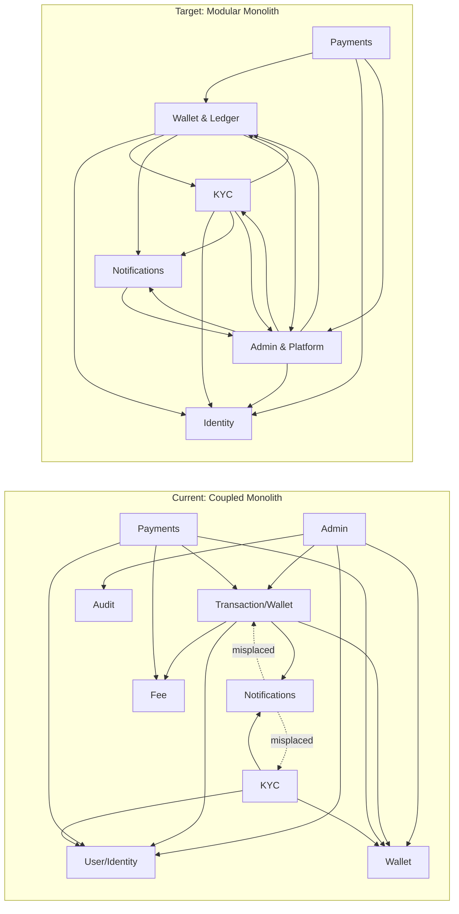

# NovaWallet API — Domain Boundaries

> **Document**: `docs/architecture/domain-boundaries.md`
> **Scope**: Verified against source tree at `novawallet-api/`. Facts are distinguished from recommendations.
> **Purpose**: Identify current domain structure, cross-domain coupling evidence, and proposed ownership boundaries for a modular-monolith refactor.

---

## 1. Current Package-to-Domain Mapping

18 top-level packages under `com.novawallet.novawallet_api`, mapped to business vs cross-cutting concerns:

### Business domains

| Package | Concern | Business domain |
|---|---|---|
| `auth` | Authentication, password/PIN reset, email verification | Identity |
| `user` | User profile, role, soft-delete | Identity |
| `token` | Refresh-token lifecycle, cleanup job | Identity |
| `security` | JWT auth filter, rate limiter, `UserDetailsService` | Identity / Platform |
| `bootstrap` | Admin data seeder (`AdminDataInitializer`) | Identity / Platform |
| `wallet` | Wallet entity, service, repository, statements | Wallet & Ledger |
| `transaction` | Deposits, withdrawals, transfers, history, limits, cleanup job | Wallet & Ledger |
| `fee` | Fee configuration, fee engine | Wallet & Ledger |
| `payment` | Payouts, webhooks, gateway integration | Payments |
| `kyc` | KYC documents, submission, admin review, file storage, config | KYC |
| `notification` | In-app notifications, mail, SMS, retry job, (misplaced) balance/KYC jobs | Notifications |
| `admin` | Admin user/wallet/KYC controllers + `AdminService` | Administration |

### Cross-cutting / platform

| Package | Concern |
|---|---|
| `audit` | `AuditLog` entity/repository/service + `@Auditable` annotation/aspect |
| `common` | `ApiResponse` standard wrapper |
| `config` | `SecurityConfig`, `PasswordConfig` |
| `exception` | `GlobalExceptionHandler`, `ErrorResponse`, `ResourceNotFoundException` |
| `filter` | `RequestTracingFilter` |
| `idempotency` | `IdempotencyKey` entity/filter/repository/service/schedule |

---

## 2. Cross-Domain Dependency & Coupling Evidence

### 2.1 Cross-domain service calls and repository injections

**`AdminService`** — `novawallet-api/src/main/java/com/novawallet/novawallet_api/admin/service/AdminService.java:42-46`
- `UserRepository userRepository` (line 42)
- `AuditService auditService` (line 43)
- `TransactionRepository transactionRepository` (line 44)
- `AuditLogRepository auditLogRepository` (line 45)
- `WalletRepository walletRepository` (line 46)
- Class-level `@Transactional` (line 38) spans User/Wallet/Transaction/Audit writes.

**`TransactionService`** — `novawallet-api/src/main/java/com/novawallet/novawallet_api/transaction/service/TransactionService.java:57-65`
- `WalletRepository walletRepository` (57)
- `TransactionRepository transactionRepository` (58)
- `TransactionReferenceGenerator referenceGenerator` (59) — transaction-local
- `AuthService authService` (60) — Identity domain
- `FeeEngineService feeEngineService` (61) — Wallet & Ledger (same domain, OK)
- `AuditService auditService` (62) — platform
- `UserRepository userRepository` (63) — Identity domain
- `TransactionLimitService transactionLimitService` (64) — Wallet & Ledger (same domain, OK)
- `NotificationService notificationService` (65) — Notifications domain

**`PayoutService`** — `novawallet-api/src/main/java/com/novawallet/novawallet_api/payment/service/PayoutService.java:70-78`
- `PaymentConfig paymentConfig` (70) — Payments-local
- `PaymentGateway paymentGateway` (71) — Payments-local
- `WalletRepository walletRepository` (72) — **Wallet & Ledger (cross-domain)**
- `TransactionRepository transactionRepository` (73) — **Wallet & Ledger (cross-domain)**
- `TransactionReferenceGenerator referenceGenerator` (74)
- `TransactionLimitService transactionLimitService` (75) — **Wallet & Ledger (cross-domain)**
- `FeeEngineService feeEngineService` (76) — **Wallet & Ledger (cross-domain)**
- `AuthService authService` (77) — Identity (cross-domain)
- `UserRepository userRepository` (78) — Identity (cross-domain)

**`WebhookService`** — `novawallet-api/src/main/java/com/novawallet/novawallet_api/payment/service/WebhookService.java:70-73`
- `PaymentConfig paymentConfig` (70)
- `WalletRepository walletRepository` (71) — **cross-domain**
- `TransactionRepository transactionRepository` (72) — **cross-domain**
- `TransactionService transactionService` (73) — **cross-domain** (direct service call into Wallet & Ledger)

**`AdminKycService`** — `novawallet-api/src/main/java/com/novawallet/novawallet_api/kyc/service/AdminKycService.java:41-49`
- `KycService kycService` (41) — KYC-local
- `UserRepository userRepository` (42) — Identity (cross-domain)
- `KycDocumentRepository kycDocumentRepository` (43) — KYC-local
- `WalletRepository walletRepository` (44) — **Wallet & Ledger (cross-domain)**
- `AccountNumberGenerator accountNumberGenerator` (45)
- `KycConfig kycConfig` (46)
- `FileStorageService fileStorageService` (47)
- `MailService mailService` (48) — Notifications (cross-domain)
- `NotificationService notificationService` (49) — Notifications (cross-domain)

**`KycService`** — `novawallet-api/src/main/java/com/novawallet/novawallet_api/kyc/service/KycService.java:38-39`
- `UserRepository userRepository` (38) — Identity (cross-domain)
- `KycDocumentRepository kycDocumentRepository` (39) — KYC-local

**`TransactionLimitService`** — `novawallet-api/src/main/java/com/novawallet/novawallet_api/transaction/service/TransactionLimitService.java:47-50`
- `UserRepository userRepository` (47) — Identity (cross-domain)
- `TransactionRepository transactionRepository` (48) — Wallet & Ledger (same domain, OK)
- `KycConfig kycConfig` (49)
- `TransactionVelocityConfig velocityConfig` (50)

**Misplaced schedulers**:
- `BalanceRecalculationJob` — `novawallet-api/src/main/java/com/novawallet/novawallet_api/notification/schedule/BalanceRecalculationJob.java:20` (package `notification.schedule`) injects `TransactionRepository` and mutates transaction/balance data.
- `KycExpiryJob` — `novawallet-api/src/main/java/com/novawallet/novawallet_api/notification/schedule/KycExpiryJob.java:23-24` (package `notification.schedule`) injects `UserRepository` and `KycDocumentRepository` and mutates user KYC state and KYC documents.

### 2.2 Shared entity & schema coupling

- `User` entity (`user/entity/User.java`) embeds KYC fields: `kycStatus`, `kycTier`, `kycSubmittedAt`, `kycApprovedAt`, `kycRejectedAt`, `kycRejectionReason`, `kycApprovedBy` (lines ~60–80 of entity).
- `KycDocument` has `@ManyToOne(fetch=LAZY) @JoinColumn(name="user_id") private User user;` (`kyc/entity/KycDocument.java:35-37`) — direct entity reference across domains.
- Cross-table SQL foreign keys: `kyc_documents.user_id → users.id`, `kyc_documents.reviewed_by → users.id`; `wallets.user_id → users.id` (no FK declared in JPA, but DDL has `fk_wallets_user_id`).
- `Transaction` references wallets only by raw UUIDs (`senderWalletId`, `receiverWalletId`, `relatedTransactionId`) — looser coupling but still cross-domain by data.

### 2.3 Transaction boundary coupling

- Class-level `@Transactional` on `AdminService`, `TransactionService`, `PayoutService`, `WebhookService`, `AdminKycService`, `KycService`, `TransactionLimitService` (verified) means a single DB transaction routinely spans Wallet + Transaction + Audit + Notification (and sometimes User/KYC) writes. Failures in one domain roll back unrelated domain state.

---

## 3. Proposed 6 Domain Ownership Boundaries

Target: modular monolith with strict module boundaries (no cross-module repository injection; modules communicate via public service APIs/events). Proposed domains:

1. **Identity Domain** (`auth`, `user`, `token`, `security`, `bootstrap`)
2. **Wallet & Ledger Domain** (`wallet`, `transaction`, `fee`)
3. **Payments Domain** (`payment`)
4. **KYC Domain** (`kyc`)
5. **Notifications Domain** (`notification`)
6. **Administration & Platform Cross-Cutting Domain** (`admin`, `audit`, `idempotency`, `common`, `config`, `exception`, `filter`)

### 3.1 Identity Domain

| Attribute | Details |
|---|---|
| Owned packages | `auth`, `user`, `token`, `security`, `bootstrap` |
| Key classes (controllers) | `AuthController`, `PasswordController`, `PinController`, `VerificationController`, `UserController` |
| Key classes (services) | `AuthService`, `UserService`, `TokenService`, `CustomUserDetailsService`, `AdminDataInitializer` (seeder) |
| Key classes (schedulers) | `RefreshTokenCleanupJob` (`token/schedule`, cron `0 30 4 * * ?`) |
| Owned entities / tables | `User` (`users`), `RefreshToken` (`refresh_tokens`) |
| Owned repositories | `UserRepository`, `RefreshTokenRepository` |
| Public REST APIs | `/api/v1/auth/**`, `/api/v1/password/**`, `/api/v1/email/**`, `/api/v1/users/**`, `/api/v1/pin/**` |
| Current inbound deps | None (root identity provider) |
| Current outbound deps | None (root) |
| Required decoupling actions | Extract KYC columns out of `users` into KYC-owned table (see KYC domain); publish user identity events instead of direct `UserRepository` reads by other domains; `AuthService` consumed by Wallet & Ledger/Payments must become a published (read-only) Identity API. |

### 3.2 Wallet & Ledger Domain

| Attribute | Details |
|---|---|
| Owned packages | `wallet`, `transaction`, `fee` |
| Key classes (controllers) | `WalletController`, `TransactionController`, `FeeController` (user-facing `/fees/estimate`) |
| Key classes (services) | `WalletService`, `TransactionService`, `TransactionHistoryService`, `TransactionLimitService`, `FeeEngineService` |
| Key classes (schedulers) | `PendingTransactionCleanupJob` (`transaction/schedule`, cron `0 0 3 * * ?`), `BalanceRecalculationJob` (relocate from `notification.schedule`) |
| Owned entities / tables | `Wallet` (`wallets`), `Transaction` (`transactions`), `FeeConfiguration` (`fee_configurations`) |
| Owned repositories | `WalletRepository`, `TransactionRepository`, `FeeConfigurationRepository` |
| Public REST APIs | `/api/v1/wallets/**`, `/api/v1/transfers`, `/api/v1/wallets/{id}/deposit|withdraw|payouts|transactions|balance|statements`, `/api/v1/fees/estimate`, `/api/v1/transactions/{reference}` |
| Current inbound deps | Identity (`AuthService`, `UserRepository`), Notifications (`NotificationService`), Audit (`AuditService`) |
| Current outbound deps | None owned externally; provides balance/limit APIs to Payments |
| Required decoupling actions | Relocate `BalanceRecalculationJob` into `transaction/schedule` (or `wallet/schedule`); replace direct `WalletRepository`/`TransactionRepository` access from Payments, KYC, Admin with a Wallet & Ledger public API (e.g. `WalletService.credit/debit`, `TransactionService.record`); introduce a true double-entry ledger or at minimum keep `balance` mutation inside this domain only. |

### 3.3 Payments Domain

| Attribute | Details |
|---|---|
| Owned packages | `payment` |
| Key classes (controllers) | `PayoutController`, `WebhookController` |
| Key classes (services) | `PayoutService`, `WebhookService` |
| Key classes (config) | `PaymentConfig`, `PaymentGateway`, `LipilaGateway` |
| Owned entities / tables | None (uses Wallet & Ledger transactions; payment metadata lives in `Transaction.description` marker `[LIPILA:<ref>]`) |
| Owned repositories | None (must stop injecting `WalletRepository`/`TransactionRepository`) |
| Public REST APIs | `/api/v1/wallets/{walletId}/payouts`, `/api/v1/webhooks/lipila/collections` |
| Current inbound deps | Wallet & Ledger (direct repo + service injection), Identity (`AuthService`, `UserRepository`), Wallet & Ledger (`TransactionLimitService`, `FeeEngineService`) |
| Current outbound deps | None (leaf consumer) |
| Required decoupling actions | **Forbid direct `WalletRepository`/`TransactionRepository`/`TransactionService` access** from Payments; call Wallet & Ledger public APIs for debit/credit and transaction recording; keep gateway/webhook secret verification local; verify Lipila payload then invoke domain API. |

### 3.4 KYC Domain

| Attribute | Details |
|---|---|
| Owned packages | `kyc` |
| Key classes (controllers) | `KycController`, `AdminKycController` (admin-facing; could move admin controller to Administration domain but service stays here) |
| Key classes (services) | `KycService`, `AdminKycService`, `FileStorageService` |
| Key classes (config) | `KycConfig`, `AccountNumberGenerator` (verify ownership; may belong to Wallet & Ledger) |
| Key classes (schedulers) | `KycExpiryJob` (relocate from `notification.schedule`) |
| Owned entities / tables | `KycDocument` (`kyc_documents`); KYC columns currently on `users` (move to a KYC-owned `user_kyc`/`kyc_profiles` table) |
| Owned repositories | `KycDocumentRepository` |
| Public REST APIs | `/api/v1/kyc/**`, `/api/v1/admin/kyc/**` |
| Current inbound deps | Identity (`UserRepository`), Wallet & Ledger (`WalletRepository`), Notifications (`MailService`, `NotificationService`) |
| Current outbound deps | Provides KYC tier/limits to Wallet & Ledger via `KycConfig` |
| Required decoupling actions | Relocate `KycExpiryJob` into `kyc/schedule`; extract KYC columns out of `users` (Identity) into a KYC-owned table keyed by `userId`; replace direct `WalletRepository` access with Wallet & Ledger API; keep `FileStorageService` local; expose `KycTierResolver`/`KycConfig` as published API. |

### 3.5 Notifications Domain

| Attribute | Details |
|---|---|
| Owned packages | `notification` |
| Key classes (controllers) | `NotificationController` |
| Key classes (services) | `NotificationService`, `MailService`, `SmsService` |
| Key classes (schedulers) | `NotificationRetryJob` (`notification/schedule`, cron `0 0/15 * * * ?`) |
| Owned entities / tables | `Notification` (`notifications`), `NotificationAttempt` (`notification_attempts`) |
| Owned repositories | `NotificationRepository`, `NotificationAttemptRepository` |
| Public REST APIs | `/api/v1/notifications/**` |
| Current inbound deps | None (leaf consumer; receives calls from Wallet & Ledger, KYC, Identity) |
| Current outbound deps | None |
| Required decoupling actions | Remove misplaced jobs: relocate `BalanceRecalculationJob` to Wallet & Ledger and `KycExpiryJob` to KYC; keep notification dispatch asynchronous (events) rather than direct service calls where possible; do not let other domains read notification tables directly. |

### 3.6 Administration & Platform Cross-Cutting Domain

| Attribute | Details |
|---|---|
| Owned packages | `admin`, `audit`, `idempotency`, `common`, `config`, `exception`, `filter` |
| Key classes (controllers) | `AdminUserController`, `AdminWalletController`, `AdminKycController` (admin façade; delegates to domain services) |
| Key classes (services) | `AdminService`, `AuditService`, `IdempotencyService` |
| Key classes (schedulers) | `IdempotencyCleanupJob` (`idempotency/schedule`, cron `0 0 4 * * ?`) |
| Key classes (filters) | `RequestTracingFilter`, `IdempotencyFilter` |
| Key classes (config) | `SecurityConfig`, `PasswordConfig` |
| Owned entities / tables | `AuditLog` (`audit_logs`), `IdempotencyKey` (`idempotency_keys`) |
| Owned repositories | `AuditLogRepository`, `IdempotencyKeyRepository` |
| Public REST APIs | `/api/v1/admin/**`, `/api/actuator/**`, Swagger docs |
| Current inbound deps | All domains (cross-cutting: audit, idempotency, security, exception handling) |
| Current outbound deps | All domains (admin controllers orchestrate domain services) |
| Required decoupling actions | `AdminService` must stop injecting `UserRepository`/`TransactionRepository`/`WalletRepository` directly; use domain public APIs + read models (projections) for admin queries; keep `IdempotencyFilter` as platform infrastructure; keep audit as an aspect (`@Auditable`) but ensure audit writes don't span domain transactions improperly. |

---

## 4. Coupling Summary (Current vs Target)

### Current (verified coupled edges)

- Admin → Identity (UserRepository), Wallet & Ledger (TransactionRepository, WalletRepository), Audit, Platform.
- Wallet & Ledger → Identity (AuthService, UserRepository), Notifications, Audit, Transaction limits/KYC config.
- Payments → Wallet & Ledger (WalletRepository, TransactionRepository, TransactionService, TransactionLimitService, FeeEngineService), Identity (AuthService, UserRepository).
- KYC → Identity (UserRepository), Wallet & Ledger (WalletRepository), Notifications (MailService, NotificationService).
- Notifications → (leaf; plus misplaced BalanceRecalculationJob → TransactionRepository, KycExpiryJob → UserRepository/KycDocumentRepository).
- Administration & Platform → all domains (admin orchestration).

### Target (modular monolith)

- Identity: root, no outbound deps.
- Wallet & Ledger: depends on Identity (published read-only API), KYC (tier resolver), Notifications (events), Audit/Platform.
- Payments: depends on Wallet & Ledger (published APIs), Identity, Platform. **No direct repo access.**
- KYC: depends on Identity, Wallet & Ledger (account number gen), Notifications, Platform.
- Notifications: leaf; receives domain events.
- Administration & Platform: cross-cutting; admin reads via domain read models/APIs, not direct repos.

---

## 5. Mermaid Diagram — Current Coupled vs Target Modular

