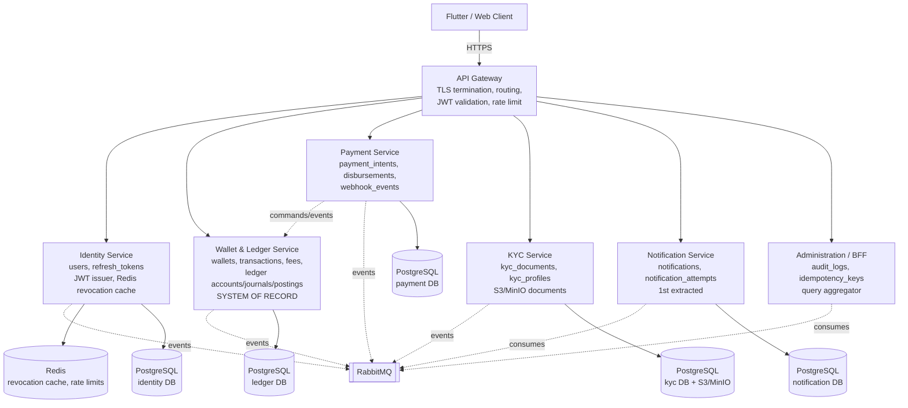

# NovaWallet — Microservices Readiness Assessment & Final Architecture Recommendation

**Document:** 4 of the NovaWallet Architecture Series
**Scope:** TASK J (Microservices Readiness Assessment) + TASK K (Final Architecture Recommendation)
**Repository:** `NovaWallet` (root) / `novawallet-api` (Spring Boot 3.5.3 backend)
**Backend baseline:** 179 Java source files, Flyway V1–V11, 130/130 backend tests passing on H2
**Status:** Assessment only — no source, config, migration, or test changes are made by this document.

---

## 0. Mandatory Architectural Progression

NovaWallet MUST evolve strictly in this order. No phase may be skipped, and no service may be extracted before its phase preconditions are met:

```
Financial integrity
   ↓
Modular monolith (schema-per-module, strict boundaries)
   ↓
Event-driven architecture (domain events + Transactional Outbox)
   ↓
Independent microservices (extracted leaf/edge services first)
```

Any proposal that extracts a service before the financial-integrity, ledger, payment-orchestration, modular-monolith, and outbox phases are complete is **rejected** by this document.

---

## 1. Current-State Summary (Baseline)

The backend today is a single Spring Boot application (`com.novawallet.novawallet_api`) with package-per-domain modules but **no enforced boundaries**:

- One shared PostgreSQL database with cross-domain foreign keys (`wallets.user_id → users.id`, `transactions.sender_wallet_id → wallets.id`, `kyc_documents.user_id → users.id`, `refresh_tokens.user_id → users.id`).
- Cross-domain repository injection is pervasive (see §3.1–§3.6).
- Two schedulers are misplaced: `notification.schedule.BalanceRecalculationJob` (`recalculateMissingBalances()` at line 28) and `notification.schedule.KycExpiryJob` (`expireKycDocuments()` at line 33).
- KYC fields live on the `User` entity (`user/entity/User.java` lines 81–106) and the `users` table (migration `V5__add_kyc_tables.sql`).
- `payment.service.PayoutService` (line 107 `payout(...)`) and `payment.service.WebhookService` (line 93 `processCollectionCallback(...)`) own **zero** tables and mutate `WalletRepository` / `TransactionRepository` inside shared `@Transactional` methods.
- `transaction.service.TransactionService` (lines 90/144/227) synchronously calls `NotificationService.sendBoth(...)` and `AuditService.recordAction(...)` inside the money-movement transaction.
- `kyc.service.AdminKycService.approveKyc(...)` (line 104) auto-creates a `Wallet` via `WalletRepository.save(...)` (line 139–141) inside the KYC approval transaction.
- `FileStorageService` (`kyc/service/FileStorageService.java`) stores KYC documents on the local filesystem under `uploads/kyc`.
- `security/JwtAuthFilter.doFilterInternal(...)` (line 37) loads `UserDetails` via `CustomUserDetailsService.loadUserById(...)` (line 41) but does not enforce active/non-deleted status beyond the soft-delete flag.

---

## 2. Service-by-Service Readiness Assessment

### 2.1 Identity Service (`auth`, `user`, `token`, `security`)

**Owned tables (current):** `users` (V2), `refresh_tokens` (V4).

**Domain independence:** Low today. `User` carries KYC columns (V5) and is referenced by `wallets`, `kyc_documents`, `refresh_tokens`, `audit_logs.performed_by`, `idempotency_keys.user_id`, `notifications.user_id`. Identity cannot be extracted without first removing KYC ownership and replacing direct `UserRepository` lookups with claims/events/APIs.

**Internal inbound dependencies (who calls into Identity):**
- `payment.service.PayoutService` — `UserRepository.findById(...)` at line 214 (`requireVerifiedEmail`), `AuthService.verifyPin(...)` at line 118.
- `kyc.service.KycService` — `UserRepository.findById(...)` at line 48 (`uploadDocument`).
- `kyc.service.AdminKycService` — `UserRepository.findById(...)` at line 105 (`approveKyc`).
- `security.CustomUserDetailsService` — `UserRepository.findByEmail(...)` / `findById(...)` (lines 27, 42).
- `transaction.service.TransactionLimitService` — `UserRepository` (line 47).
- `transaction.service.TransactionService` — `UserRepository.findById(...)` at lines 96 and 296.

**Internal outbound dependencies (Identity calls outward):**
- `AuthService` → `UserRepository` only; no outward domain calls. Cleanest leaf-ish domain once KYC is removed.

**API boundaries:** `/api/v1/auth/**`, `/api/v1/password/**`, `/api/v1/email/**`, `/api/v1/users/**`, `/api/v1/pins/**` (see `SecurityConfig` lines 90–98 permit-all list).

**Event requirements:**
- Publishes: `UserRegistered`, `EmailVerified`, `PasswordChanged`, `UserDeactivated`, `RefreshTokenRevoked`.
- Consumes: none (leaf producer).

**Security requirements:** JWT issuer, refresh-token rotation with reuse detection, BCrypt password/PIN hashing, email-verification gate, rate limiting (`RateLimitFilter`, `LoginRateLimiter`), token revocation cache (Redis) for microservice mode.

**Independent deployment feasibility:** Medium — blocked by KYC coupling and shared `users` table; feasible after Phase 8.

**Extraction complexity:** High.

**Risks of premature extraction:** Auth becomes a distributed dependency on every request; without a token-revocation cache and service mesh, latency and availability degrade; KYC fields on `users` force a cross-service join.

**Mandatory preconditions:**
- Phase 4: remove KYC columns from `User` (move to `kyc` schema).
- Phase 5: publish `UserRegistered`/`EmailVerified`/`PasswordChanged`/`UserDeactivated` events; consumers (Wallet provisioning, KYC) react asynchronously.
- Phase 8: Redis-backed revocation cache + API Gateway routing.

---

### 2.2 Wallet and Ledger Service (`wallet`, `transaction`, `fee`)

**Owned tables (current):** `wallets` (V3), `transactions` (V6), `fee_configurations` (V7).

**Domain independence:** This is the **core financial system of record**. It must remain the authoritative anchor. It currently depends on `UserRepository` (for user existence/KYC tier) and `NotificationService` (for outbound notifications), both of which must be inverted via events/APIs.

**Internal inbound dependencies (who calls Wallet/Ledger):**
- `payment.service.PayoutService` — `WalletRepository.findByIdWithLock(...)` (line 201), `WalletRepository.updateBalance(...)` (line 125), `TransactionRepository.save(...)` (lines 161, 175).
- `payment.service.WebhookService` — `WalletRepository.findByIdWithLock(...)` (line 112), `TransactionService.deposit(...)` (line 124).
- `kyc.service.AdminKycService` — `WalletRepository.save(...)` (line 141) (wallet provisioning on KYC approval).
- `transaction.service.TransactionService` — internal owner.
- `admin.service.AdminService` — `WalletRepository` (line 46), `TransactionRepository` (line 44).
- `transaction.service.TransactionHistoryService` — `WalletRepository`, `TransactionRepository` (lines 43–44).
- `transaction.service.TransactionLimitService` — `TransactionRepository` (line 48).

**Internal outbound dependencies (Wallet/Ledger calls outward):**
- `TransactionService` → `UserRepository` (lines 96, 296), `AuthService` (PIN verification), `FeeEngineService`, `AuditService`, `NotificationService.sendBoth(...)`, `TransactionLimitService`.
- `WalletService` → `AuditService`.

**API boundaries:** `/api/v1/wallets/**`, `/api/v1/transactions/**`, `/api/v1/fees/**`.

**Event requirements:**
- Publishes: `WalletCreated`, `WalletFrozen`, `WalletUnfrozen`, `DepositCompleted`, `WithdrawalCompleted`, `TransferCompleted`, `TransactionFailed`, `BalanceChanged`.
- Consumes: `UserRegistered` (provision wallet after KYC approval — or `KycApproved`), `KycApproved` (raise tier/limits), `PaymentDisbursementSettled`, `PaymentCollectionCompleted` (credit wallet via ledger command).

**Security requirements:** Pessimistic locking (`WalletRepository.findByIdWithLock` line 38–40), atomic balance updates (`updateBalance` line 50–59), idempotency, velocity limits, KYC tier limits, audit trail.

**Independent deployment feasibility:** This service is the **last** to be considered for extraction — it is the system of record and anchors all financial state. In practice it remains in the core cluster.

**Extraction complexity:** Very High (and not recommended to extract in the programme horizon).

**Risks of premature extraction:** Distributed transactions across every money movement; split-brain balances; reconciliation burden; money loss.

**Mandatory preconditions:** Phases 1–7 complete; double-entry ledger proven; payment orchestration entities proven; modular boundaries enforced; outbox proven with Notification + Payment services.

---

### 2.3 Payment Service (`payment`)

**Owned tables (current):** **None.** `PayoutService` and `WebhookService` own zero tables.

**Domain independence:** None today. Payment logic is a thin orchestration layer directly mutating `WalletRepository` and `TransactionRepository` inside `@Transactional` methods (`PayoutService.payout(...)` line 107; `WebhookService.processCollectionCallback(...)` line 93). Extracting Payments now would create distributed-transaction corruption and money loss.

**Internal inbound dependencies:** `PayoutController`, `WebhookController` → `PayoutService`/`WebhookService`.

**Internal outbound dependencies (Payment calls outward):**
- `PayoutService` → `WalletRepository`, `TransactionRepository`, `UserRepository`, `AuthService`, `FeeEngineService`, `TransactionLimitService`, `TransactionReferenceGenerator`, `PaymentGateway`, `PaymentConfig`.
- `WebhookService` → `WalletRepository`, `TransactionRepository`, `TransactionService.deposit(...)`.

**API boundaries:** `/api/v1/payouts/**`, `/api/v1/webhooks/lipila/**` (SecurityConfig line 103).

**Event requirements (target):**
- Publishes: `PaymentCollectionInitiated`, `PaymentCollectionCompleted`, `PaymentCollectionFailed`, `PaymentDisbursementInitiated`, `PaymentDisbursementSettled`, `PaymentDisbursementFailed`, `WebhookReceived`, `WebhookVerified`.
- Consumes: `WalletCreated` (for merchant float setup), `UserRegistered`.

**Security requirements:** Webhook HMAC/shared-secret verification (constant-time, `WebhookController`), replay protection, amount/currency verification, provider IP allow-listing, idempotent callbacks.

**Independent deployment feasibility:** Medium — only after Phase 3 payment-orchestration tables (`payment_collections`, `payment_disbursements`, `provider_webhook_events`) and Phase 5 outbox contracts are proven inside the modular monolith.

**Extraction complexity:** High.

**Risks of premature extraction:** Distributed transaction corruption; money loss on timeout (PayoutService javadoc lines 50–54 documents the timeout caveat); no durable intent → no reconciliation.

**Mandatory preconditions:**
- Phase 3: dedicated `payment_intents`/`collection_requests`, `disbursement_requests`, `provider_webhook_events` tables; two-phase payout reservation + async disbursement; webhook HMAC/replay + amount/currency verification; `checkStatus` polling scheduler.
- Phase 4: Payment module owns its tables; no cross-domain repository injection.
- Phase 5: outbox events + idempotent consumer inbox; Wallet & Ledger command/event contracts proven.

---

### 2.4 KYC Service (`kyc`)

**Owned tables (current):** `kyc_documents` (V5); KYC columns on `users` (V5).

**Domain independence:** Low. KYC is fused into `User` (entity lines 81–106; table columns V5). `AdminKycService` directly mutates `User` and creates `Wallet` via `WalletRepository.save(...)` (line 141). `KycExpiryJob` (misplaced in `notification.schedule`) mutates `User` and `KycDocument`. `UserRepository.findByKycStatusAndKycApprovedAtBefore(...)` (line 34) couples identity to KYC queries.

**Internal inbound dependencies:** `KycController`, `AdminKycController`.

**Internal outbound dependencies:**
- `KycService` → `UserRepository`, `KycDocumentRepository`, `FileStorageService`, `KycConfig`.
- `AdminKycService` → `UserRepository`, `KycDocumentRepository`, `WalletRepository`, `AccountNumberGenerator`, `NotificationService`/`MailService`, `FileStorageService`.
- `KycExpiryJob` → `UserRepository`, `KycDocumentRepository`.

**API boundaries:** `/api/v1/kyc/**`, `/api/v1/admin/kyc/**`.

**Event requirements (target):**
- Publishes: `KycSubmitted`, `KycApproved`, `KycRejected`, `KycExpired`.
- Consumes: `UserRegistered` (create KYC profile), `KycApproved` → Wallet & Ledger provisions wallet (replacing `AdminKycService`'s direct `WalletRepository.save`).

**Security requirements:** File upload validation (size/MIME, `KycService` lines 25–28), rate limiting (5 uploads/hour, line 28), admin approval, document storage security.

**Independent deployment feasibility:** Medium — blocked by KYC-on-User coupling and local filesystem storage; feasible after Phase 8 with S3/MinIO.

**Extraction complexity:** High.

**Risks of premature extraction:** Wallet provisioning becomes a distributed call; KYC status queries require cross-service joins; document storage must move first.

**Mandatory preconditions:**
- Phase 4: decouple `kyc_*` columns from `users` into a `kyc_profiles`/`kyc_documents` ownership in the `kyc` schema; replace `UserRepository` KYC queries with KYC-owned queries.
- Phase 5: `KycApproved` event drives wallet provisioning in Wallet & Ledger (remove direct `WalletRepository.save` from `AdminKycService`).
- Phase 8: object storage (S3/MinIO) replaces `FileStorageService`.

---

### 2.5 Notification Service (`notification`)

**Owned tables (current):** `notifications` (V10, V11 `read_at`), `notification_attempts` (V10).

**Domain independence:** Highest among all six. `notifications` and `notification_attempts` have **no foreign keys** to any other table (V10 defines only `notification_id → notifications.id` within the same domain). `Notification.userId` is a plain UUID with no FK. This is the only domain that can be extracted without schema surgery.

**Internal inbound dependencies:** `NotificationController`, `NotificationRetryJob` (every 15 min, line 21).

**Internal outbound dependencies:**
- `NotificationService` → `NotificationRepository`, `NotificationAttemptRepository`. No repository calls to other domains. Clean leaf.
- Misplaced schedulers in this package: `BalanceRecalculationJob` (owns `TransactionRepository`) and `KycExpiryJob` (owns `UserRepository`, `KycDocumentRepository`) — these must move to their proper domains in Phase 4 before extraction.

**API boundaries:** `/api/v1/notifications/**`.

**Event requirements:**
- Publishes: `NotificationSent`, `NotificationFailed`, `NotificationRead`.
- Consumes: `DepositCompleted`, `WithdrawalCompleted`, `TransferCompleted`, `TransactionFailed`, `KycApproved`, `KycRejected`, `PasswordChanged`, `EmailVerified`, `UserRegistered` (welcome).

**Security requirements:** User-scoped inbox (only the owning user reads their notifications), admin read-only, retry backoff.

**Independent deployment feasibility:** High — once the two misplaced schedulers are relocated (Phase 4) and outbound calls are inverted to events (Phase 5), Notification is a pure consumer with its own DB.

**Extraction complexity:** Low.

**Risks of premature extraction:** If extracted before `BalanceRecalculationJob`/`KycExpiryJob` are moved, the Notification service would carry Wallet/KYC data dependencies and fail to be a leaf; if extracted before outbox, notifications would be lost on transaction rollback (today `NotificationService.sendBoth` is called inside the money tx, masking failures).

**Mandatory preconditions:**
- Phase 4: relocate `BalanceRecalculationJob` → `transaction.schedule`, `KycExpiryJob` → `kyc.schedule`.
- Phase 5: replace synchronous `NotificationService.sendBoth(...)` calls in `TransactionService` (lines 118, 161, 344+) and `AdminKycService` (line 148) with outbox events; Notification consumes them.

---

### 2.6 Administration Service / BFF (`admin`, `audit`, `idempotency`)

**Owned tables (current):** `audit_logs` (V8), `idempotency_keys` (V9).

**Domain independence:** Medium-low. `AdminService` (lines 42–46) injects `UserRepository`, `TransactionRepository`, `WalletRepository`, `AuditLogRepository`, `AuditService` — it is a cross-domain query aggregator (BFF). `IdempotencyFilter` runs in the request pipeline after `JwtAuthFilter` (SecurityConfig line 119) and scopes keys per user. `AuditService` is invoked synchronously from `TransactionService` and `WalletService`.

**Internal inbound dependencies:** `AdminUserController`, `AdminWalletController`, `AdminKycController`, `IdempotencyFilter`.

**Internal outbound dependencies:**
- `AdminService` → `UserRepository`, `TransactionRepository`, `WalletRepository`, `AuditLogRepository`, `AuditService`.
- `AuditService` → `AuditLogRepository` (and is called by Wallet/Transaction).
- `IdempotencyService` → `IdempotencyKeyRepository`.

**API boundaries:** `/api/v1/admin/**`.

**Event requirements (target):**
- Publishes: `AdminActionPerformed`.
- Consumes: all domain events for audit projection (audit log becomes an event-sourced projection rather than synchronous `recordAction` calls).

**Security requirements:** Role-based (`ROLE_ADMIN`), audit trail, idempotency scoping.

**Independent deployment feasibility:** Low as a standalone service; better treated as a **BFF / query aggregator** that composes calls to the other services, plus an audit projection service. Keep in core cluster.

**Extraction complexity:** Medium (as BFF) / High (as independent service with own audit store).

**Risks of premature extraction:** Cross-service query fan-out latency; audit consistency gaps; idempotency must remain platform-level.

**Mandatory preconditions:** All other services extracted first; audit becomes an event projection; API Gateway handles routing.

---

## 3. Microservices Readiness Matrix

| # | Service (Domain) | Owned Tables | Domain Independence | Inbound Deps | Outbound Deps | API Boundary | Events Published | Events Consumed | Security | Deploy Feasibility | Extraction Complexity |
|---|---|---|---|---|---|---|---|---|---|---|---|
| 1 | Identity (`auth`,`user`,`token`,`security`) | `users`, `refresh_tokens` | Low (KYC fused) | All services (user lookups) | None (leaf producer after KYC split) | `/auth`,`/users`,`/password`,`/email` | UserRegistered, EmailVerified, PasswordChanged, UserDeactivated, RefreshTokenRevoked | None | JWT, BCrypt, refresh rotation, rate limit, revocation cache | Medium (after Phase 8) | High |
| 2 | Wallet & Ledger (`wallet`,`transaction`,`fee`) | `wallets`, `transactions`, `fee_configurations` | Core anchor | Payment, KYC, Admin, History, Limits | User, Auth (PIN), Fee, Audit, Notification | `/wallets`,`/transactions`,`/fees` | WalletCreated/Frozen/Unfrozen, Deposit/Withdrawal/Transfer Completed, TransactionFailed, BalanceChanged | UserRegistered, KycApproved, PaymentDisbursementSettled, PaymentCollectionCompleted | Pessimistic locks, atomic updates, idempotency, velocity/KYC limits, audit | Last (system of record) | Very High |
| 3 | Payment (`payment`) | **None** today | None | Payout/Webhook controllers | Wallet, Transaction, User, Auth, Fee, Limits, Gateway | `/payouts`,`/webhooks` | PaymentCollection/Disbursement *, WebhookReceived/Verified | WalletCreated, UserRegistered | Webhook HMAC, replay, amount/currency verify, IP allow-list | Medium (after Phase 3+5) | High |
| 4 | KYC (`kyc`) | `kyc_documents` + `kyc_*` on `users` | Low (fused to User) | Kyc/Admin controllers | User, Wallet (provisioning), Notification, Mail, FileStorage | `/kyc`,`/admin/kyc` | KycSubmitted/Approved/Rejected/Expired | UserRegistered, KycApproved→Wallet provisioning | Upload validation, rate limit, admin approval, doc storage | Medium (after Phase 8, S3/MinIO) | High |
| 5 | Notification (`notification`) | `notifications`, `notification_attempts` | **Highest** (no FKs) | Notification controller/retry job | None (pure consumer after Phase 5) | `/notifications` | NotificationSent/Failed/Read | All domain events | User-scoped inbox, admin read-only, retry backoff | **Highest (1st extraction)** | **Low** |
| 6 | Administration / BFF (`admin`,`audit`,`idempotency`) | `audit_logs`, `idempotency_keys` | Medium-low (aggregator) | Admin controllers, IdempotencyFilter | User, Transaction, Wallet, Audit | `/admin` | AdminActionPerformed | All domain events (audit projection) | RBAC, audit trail, idempotency scoping | Low (stays BFF in core) | Medium |

---

## 4. Recommended Extraction Order & Architectural Justification

### 4.1 Why Notification Service MUST be extracted first

1. **Leaf domain with zero inbound data dependencies** once `BalanceRecalculationJob` and `KycExpiryJob` are relocated to their proper domains in Phase 4. After relocation, `notification.service.NotificationService` depends only on `NotificationRepository` and `NotificationAttemptRepository` — no cross-domain repository.
2. **Owns `notifications` and `notification_attempts` with no foreign keys** to any other table (migration `V10__create_notifications_tables.sql`): `notifications.user_id` is a plain UUID with no `REFERENCES` clause. Extraction requires no schema surgery or data backfill.
3. **Naturally event-driven.** Today `TransactionService` (lines 118, 161, and the transfer notification block) and `AdminKycService` (line 148) call `NotificationService.sendBoth(...)` / `recordSent(...)` synchronously inside money/KYC transactions. Phase 5 replaces these with outbox events; Notification becomes a pure consumer of `DepositCompleted`, `WithdrawalCompleted`, `TransferCompleted`, `TransactionFailed`, `KycApproved`, `KycRejected`, `PasswordChanged`, `EmailVerified`, `UserRegistered`.
4. **Lowest blast radius.** A notification delivery failure must never roll back a money movement; extracting it first removes that coupling and proves the outbox + RabbitMQ plumbing on the safest domain.

### 4.2 Why Payment Service MUST NOT be extracted first

Despite having the `PaymentGateway` interface (`payment/PaymentGateway.java`, 46 lines, methods `initiateCollection`, `initiateDisbursement`, `checkStatus`), extracting Payments first would be dangerous:

1. **`PayoutService` and `WebhookService` own zero tables** and directly mutate `WalletRepository` and `TransactionRepository` inside shared `@Transactional` methods (`PayoutService.payout(...)` line 107; `WebhookService.processCollectionCallback(...)` line 93).
2. **Payout debits the wallet and writes a `WITHDRAWAL` row before the HTTP gateway call** (PayoutService lines 125–161), and relies on transaction rollback if the provider rejects (lines 139–142). Across a service boundary this becomes a distributed transaction; a timeout after provider acceptance leaves money moving externally while the local debit rolls back (documented caveat, lines 50–54).
3. **Webhook credits via `TransactionService.deposit(...)`** (line 124) inside the same DB transaction, coupling Payment to the Wallet ledger's KYC-limit enforcement and balance update.
4. **No durable payment intent exists.** Without `payment_collections` / `payment_disbursements` / `provider_webhook_events` tables (Phase 3) and Wallet & Ledger command/event contracts (Phase 5), extraction would lose reconciliation capability and risk money loss.

Therefore Payment is extracted **only in Phase 7**, after payment orchestration entities and outbox contracts are proven inside the modular monolith.

### 4.3 Full sequence

1. **Keep the monolith** while completing:
   - Phase 1 — Financial integrity & security remediation.
   - Phase 2 — Double-entry accounting ledger.
   - Phase 3 — Payment orchestration & multi-provider readiness.
   - Phase 4 — Modular monolith boundaries & schema-per-module.
   - Phase 5 — Event-driven architecture & Transactional Outbox.
2. **1st extraction — Notification Service** (Phase 6).
3. **2nd extraction — Payment Service** (Phase 7), after payment-orchestration tables and Wallet & Ledger command/event contracts are proven.
4. **3rd extraction — Identity & KYC Services** (Phase 8), after decoupling `kyc_*` columns from `users` and replacing direct `UserRepository` lookups with claims/events/APIs.
5. **Core authoritative anchor — Wallet & Ledger Service + Administration** remains the core financial system of record as surrounding services are extracted, with an API Gateway fronting all services.

---

## 5. Target Architecture Blueprint (TASK K)

### 5.1 Current vs Near-term vs Long-term

| Dimension | Current (Monolith) | Near-term (Modular Monolith, Phase 4–5) | Long-term (Microservices, Phase 6–9) |
|---|---|---|---|
| Deployment unit | Single Spring Boot jar | Single jar, strict module boundaries enforced by ArchUnit | Multiple services behind API Gateway |
| Database | One shared PostgreSQL DB, cross-domain FKs | PostgreSQL 16 with logical schema-per-module (`identity`, `ledger`, `payment`, `kyc`, `notification`, `admin`); FKs only within schema | Isolated DB per service; no shared tables |
| Money movement | Synchronous `@Transactional` across domains | Same, but boundaries enforced; outbox writes in same tx | Wallet & Ledger is sole owner; Payments issues idempotent commands + outbox events |
| Notifications | Synchronous `sendBoth` inside money tx | Outbox event → relay → RabbitMQ → Notification consumer | Notification is standalone service consuming events |
| Audit | Synchronous `recordAction` | Outbox-driven projection | Audit projection service consuming all events |
| KYC wallet provisioning | `AdminKycService` directly saves `Wallet` | Event `KycApproved` → Wallet & Ledger provisions wallet | Same, across service boundary |
| Auth | In-process JWT + `UserDetailsService` | Same | API Gateway + stateless JWT; internal mTLS/signed tokens; Redis revocation cache |
| Schedulers | Misplaced (`BalanceRecalculationJob`, `KycExpiryJob` in notification package) | Relocated to owning domains | Owned by the service that owns the data |

### 5.2 Service Ownership Matrix

| Service | Owns | Does NOT own |
|---|---|---|
| Identity | `users`, `refresh_tokens`, JWT issuance | KYC status (moves to KYC), balances |
| Wallet & Ledger | `wallets`, `transactions`, `fee_configurations`, ledger accounts/journals/postings (Phase 2) | User profile, KYC |
| Payment | `payment_collections`/`intents`, `disbursement_requests`, `provider_webhook_events` (Phase 3) | Balances, ledger rows |
| KYC | `kyc_documents`, `kyc_profiles` (decoupled from `users`) | User credentials, wallets |
| Notification | `notifications`, `notification_attempts` | Transaction state |
| Administration / BFF | `audit_logs`, `idempotency_keys` (or platform-level) | Domain data (queries via APIs) |

### 5.3 Database Ownership Strategy

- **Near-term (Phase 4):** single PostgreSQL 16 instance, logical schema-per-module: `identity`, `ledger`, `payment`, `kyc`, `notification`, `admin`. Foreign keys permitted only within a schema. Cross-schema references are by UUID only, resolved via API/event.
- **Long-term (Phase 6+):** each extracted service gets its own PostgreSQL instance/cluster; the core Wallet & Ledger retains the `ledger` schema as the system of record. No shared tables across services.

### 5.4 Synchronous API vs Asynchronous Event Communication

- **Synchronous (REST, via API Gateway):** user-facing reads/writes that require an immediate answer (login, balance lookup, transfer initiation, KYC upload, notification inbox). Internal service-to-service sync calls are limited to identity verification and wallet balance checks where a command cannot be deferred.
- **Asynchronous (Spring `ApplicationEvent` + Transactional Outbox → RabbitMQ):** all cross-domain side effects — notifications, audit projections, KYC wallet provisioning, payment settlement, KYC expiry, balance reconciliation. Pattern: write domain row + `outbox_events` row in the same DB transaction; an outbox relay publishes to RabbitMQ; consumers are idempotent (inbox table) and process at-least-once.
- **Financial commands:** Payments → Wallet & Ledger uses idempotent signed commands (`ReserveFunds`, `CreditWallet`, `DebitWallet`) with correlation IDs, not distributed transactions.

### 5.5 Authentication & Authorization

- **API Gateway** terminates TLS and routes by path to services.
- **Stateless JWT** (access token) issued by Identity; validated at the gateway and/or each service via shared public key / JWKS.
- **Active status / revocation cache in Redis** (replacing in-process `CustomUserDetailsService` lookups): on password change or admin deactivation, Identity publishes `PasswordChanged`/`UserDeactivated`; gateway and services evict/invalidate cached status. This addresses the current gap where `JwtAuthFilter` (line 37) does not enforce active/non-deleted status.
- **Internal service-to-service:** mTLS or signed internal tokens (short-lived), never user JWTs forwarded blindly.
- **Roles:** `ROLE_USER`, `ROLE_ADMIN` carried as JWT claims; services enforce method security (`@PreAuthorize`).

### 5.6 Financial Consistency Strategy

- **Wallet & Ledger is the sole owner of balances and double-entry postings.** No other service writes to `wallets`/`transactions`.
- **Double-entry (Phase 2):** `ledger_accounts`, `journal_entries`, `ledger_postings` with `Total Debits = Total Credits` enforcement; chart of accounts; historical backfill preserving existing `wallets`/`transactions`; dual-write + continuous reconciliation.
- **Idempotent commands:** every money command carries an idempotency key; Wallet & Ledger dedupes.
- **Outbox pattern:** domain events written in the same transaction as the ledger posting.
- **Saga orchestration for payouts/collections:** reserve → disburse → settle/compensate, with `checkStatus` polling and `PendingTransactionCleanupJob`-style reconciliation. No 2PC.

### 5.7 Mermaid Diagrams

#### (a) Current Monolith Architecture

```mermaid
flowchart TB
    Client[Flutter / Web Client]
    Client -->|HTTPS + JWT| API[Spring Boot Monolith<br/>com.novawallet.novawallet_api]
    API --> Sec[SecurityFilterChain<br/>SecurityConfig]
    Sec --> Ctrls[Controllers: auth, user, wallet, transaction,<br/>payment, kyc, admin, notification, fee]
    Ctrls --> Svcs[Services: TransactionService, WalletService,<br/>PayoutService, WebhookService, KycService,<br/>AdminKycService, NotificationService, ...]
    Svcs --> Repos[Shared Repositories:<br/>UserRepository, WalletRepository,<br/>TransactionRepository, KycDocumentRepository,<br/>NotificationRepository, ...]
    Repos --> DB[(PostgreSQL 16<br/>single DB, cross-domain FKs)]
    Svcs --> Sched[Schedulers:<br/>BalanceRecalculationJob (misplaced),<br/>KycExpiryJob (misplaced),<br/>PendingTransactionCleanupJob,<br/>NotificationRetryJob]
    Svcs --> Ext[External: Lipila gateway,<br/>SMTP/SMS, local filesystem uploads/kyc]
```

#### (b) Near-Term Target: Modular Monolith with Schema Isolation & Transactional Outbox

```mermaid
flowchart TB
    Client[Flutter / Web Client]
    Client -->|HTTPS + JWT| API[Spring Boot Modular Monolith<br/>ArchUnit-enforced boundaries]
    API --> Sec[SecurityFilterChain]
    Sec --> Ctrls[Controllers per module]
    Ctrls --> Svcs[Services per module<br/>no cross-domain repo injection]
    Svcs --> Schemas[(PostgreSQL 16<br/>schema-per-module:<br/>identity, ledger, payment, kyc,<br/>notification, admin)]
    Svcs --> Outbox[outbox_events table<br/>written in same tx]
    Outbox --> Relay[Outbox Relay Publisher]
    Relay --> MQ[[RabbitMQ]]
    MQ --> Consumers[In-process consumers:<br/>Notification, Audit projection,<br/>KYC wallet provisioning]
    Svcs --> Sched[Schedulers relocated to owning modules]
    Svcs --> Ext[External: Lipila, SMTP/SMS,<br/>S3/MinIO (Phase 8)]
```

#### (c) Long-Term Target: Event-Driven Microservices Architecture with API Gateway



---

## 6. Cross-References

- Document 1: `docs/IMPLEMENTATION-PLAN.md` (original phase plan).
- Document 2: `docs/TECHNICAL-REPORT.md`.
- Document 3: `docs/D1-RELEASE-READINESS-ASSESSMENT.md`.
- Document 5: `docs/architecture/implementation-roadmap.md` (this programme's phased migration plan).
- Source of truth for file paths/line numbers: `novawallet-api/src/main/java/...` as cited inline.

---
