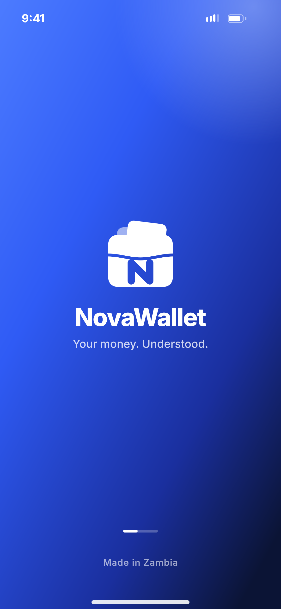
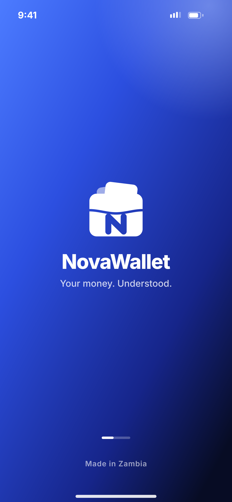

# A01 · Splash

**Flow:** Launch & onboarding  
**Route:** `/splash`  
**Design files:** `light.png`, `dark.png` (3×, 1170 × 2532) and `light.svg`, `dark.svg` in this folder.

| Light | Dark |
|---|---|
|  |  |

## Purpose
First thing the user sees. Shows the brand while the app restores the session and decides where to go.

## Layout (top to bottom, 390 × 844 canvas, 20 side padding)
1. Full-screen hero gradient (no rounded corners), white status bar icons.
2. Centre: white wallet logo symbol 112 high, “NovaWallet” 34/800 white below, tagline “Your money. Understood.” 15.5/500 white 78%.
3. Near bottom: a small 48×4 progress track (white 25%) with a 20-wide white fill that slides left-right while loading.
4. “Made in Zambia” 12.5/600 white 60%, 60 from bottom.

## Components used (see ../../../docs/COMPONENTS.md)
- NwHeroHeader (full screen variant)
- Logo symbol (white variant)

## States and behaviour
- Loading (shown max ~1.5 s; never block longer than 3 s).
- Offline: still route using cached session; show offline banner on the next screen.

## Navigation
| When | Go to |
|---|---|
| First install, never onboarded | A02 Onboarding 1 |
| Onboarded, no account on device | A05 Welcome |
| Signed in before, token stored | C02 Unlock with PIN |
| App version below minimum | P05 Update required |

## Data and backend
- Reads secure storage (refresh token, onboarding flag, theme, language).
- GET app config / minimum version — NEW endpoint `GET /api/v1/app/config` (see backend docs).

## Rules and notes
- Use the native splash (flutter_native_splash) with the same gradient and logo so there is no white flash.
- Logo animation: the splash Lottie from the animation pack (cards slide up into the wallet, N draws). Reduce motion: static logo.

## Done when
- Matches `light.png` and `dark.png` side by side at 390 × 844 (spacing within 2 px, same colours from theme tokens).
- Works at text scale 1.3× without clipping, and on a 360-wide Android phone.
- Every state listed above can be reached (use a debug menu or fake repository).
- TalkBack reads every button and field with a clear label.
- No hard-coded colours, strings (all in ARB files) or limits.

## Prompt to give opencode (paste as is)
```text
Build screen A01 "Splash" for the NovaWallet Flutter app (route /splash).
Read docs/COMPONENTS.md and this file (screens/.../A01_splash/BUILD.md) first, and open light.png and dark.png to match the design exactly.
Use only the shared components from lib/core/ui and colours from the theme extension; if a component is missing, build it in lib/core/ui first.
Put the screen in the feature folder for "Launch & onboarding" following the existing architecture (presentation / application / data layers, Riverpod for state, go_router for navigation).
Implement every state listed under "States and behaviour", the navigation table, and the data calls listed under "Data and backend" through a repository interface with a fake implementation for now if the endpoint is marked NEW.
Add all text to the ARB localisation files. Add a widget test that pumps the screen in light and dark and a golden test for each.
Do not change other screens. When finished, list the files you created or changed and anything you could not complete.
```
