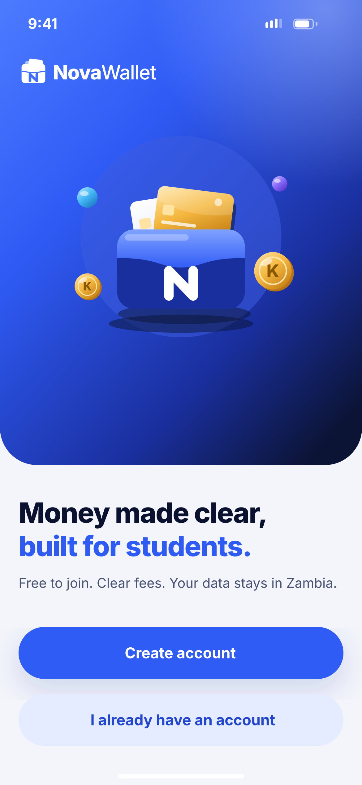
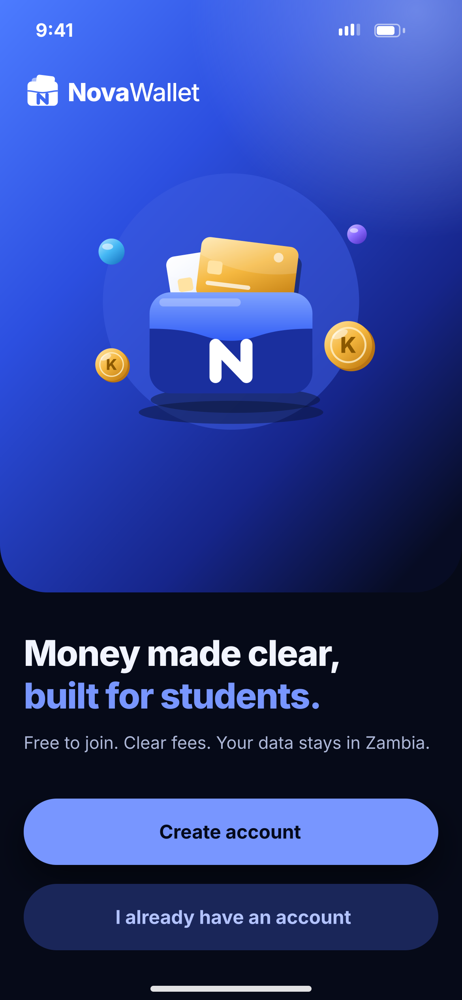

# A05 · Welcome

**Flow:** Launch & onboarding  
**Route:** `/welcome`  
**Design files:** `light.png`, `dark.png` (3×, 1170 × 2532) and `light.svg`, `dark.svg` in this folder.

| Light | Dark |
|---|---|
|  |  |

## Purpose
Choose to create an account or sign in.

## Layout (top to bottom, 390 × 844 canvas, 20 side padding)
1. Hero header 500 high, bottom radius 40, white status bar.
2. White logo lockup at top-left (y 62, 32 high).
3. Illustration `welcome` (dark variant) inside the hero.
4. Below: “Money made clear,” 30/800 text1 and “built for students.” 30/800 primary on the next line.
5. Body 14.5 text2: “Free to join. Clear fees. Your data stays in Zambia.”
6. Stacked CTAs: primary “Create account”, tonal “I already have an account”.

## Components used (see ../../../docs/COMPONENTS.md)
- NwHeroHeader
- NwIllustration
- NwButton primary + tonal

## States and behaviour
- Static.

## Navigation
| When | Go to |
|---|---|
| Create account | A06 Language → A07 → B01 |
| I already have an account | C01 Sign in |

## Data and backend
- None.

## Rules and notes
- Only claim “data stays in Zambia” if hosting really is in Zambia; otherwise change the line (see compliance doc).

## Done when
- Matches `light.png` and `dark.png` side by side at 390 × 844 (spacing within 2 px, same colours from theme tokens).
- Works at text scale 1.3× without clipping, and on a 360-wide Android phone.
- Every state listed above can be reached (use a debug menu or fake repository).
- TalkBack reads every button and field with a clear label.
- No hard-coded colours, strings (all in ARB files) or limits.

## Prompt to give opencode (paste as is)
```text
Build screen A05 "Welcome" for the NovaWallet Flutter app (route /welcome).
Read docs/COMPONENTS.md and this file (screens/.../A05_welcome/BUILD.md) first, and open light.png and dark.png to match the design exactly.
Use only the shared components from lib/core/ui and colours from the theme extension; if a component is missing, build it in lib/core/ui first.
Put the screen in the feature folder for "Launch & onboarding" following the existing architecture (presentation / application / data layers, Riverpod for state, go_router for navigation).
Implement every state listed under "States and behaviour", the navigation table, and the data calls listed under "Data and backend" through a repository interface with a fake implementation for now if the endpoint is marked NEW.
Add all text to the ARB localisation files. Add a widget test that pumps the screen in light and dark and a golden test for each.
Do not change other screens. When finished, list the files you created or changed and anything you could not complete.
```
