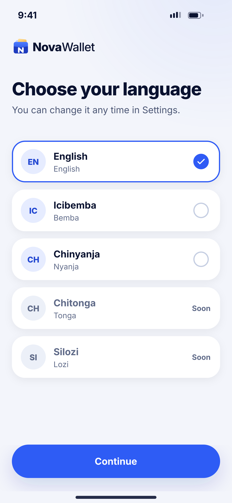
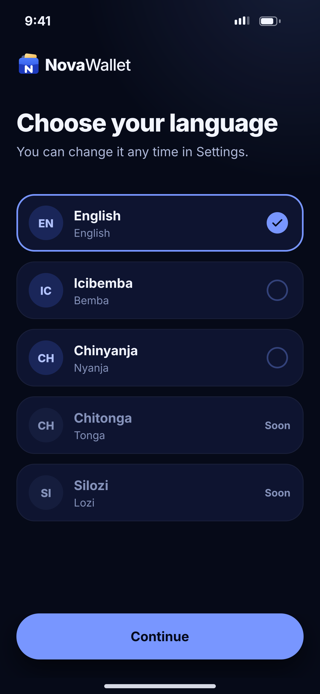

# A06 · Choose language

**Flow:** Launch & onboarding  
**Route:** `/language`  
**Design files:** `light.png`, `dark.png` (3×, 1170 × 2532) and `light.svg`, `dark.svg` in this folder.

| Light | Dark |
|---|---|
|  |  |

## Purpose
Pick the app language before sign-up.

## Layout (top to bottom, 390 × 844 canvas, 20 side padding)
1. Logo lockup top-left.
2. H1 “Choose your language” + sub.
3. List of selectable cards (70 high, gap 12): 42 circle with two-letter code, language name 16/700, English name 13 text3.
4. Selected card: 2px primary border + filled primary check circle. Unselected: empty radio. “Soon” languages are greyed with a neutral pill and not selectable.
5. NwBottomCta “Continue”.

## Components used (see ../../../docs/COMPONENTS.md)
- NwCard (selectable)
- NwPill
- NwBottomCta

## States and behaviour
- English, Bemba, Nyanja enabled at launch; Tonga, Lozi show “Soon”.

## Navigation
| When | Go to |
|---|---|
| Continue | A07 Allow notifications |

## Data and backend
- Save locale locally; send to backend later on `PUT /api/v1/users/me` (field `language` — NEW).

## Rules and notes
- Use flutter gen-l10n ARB files. Change applies instantly (no restart).

## Done when
- Matches `light.png` and `dark.png` side by side at 390 × 844 (spacing within 2 px, same colours from theme tokens).
- Works at text scale 1.3× without clipping, and on a 360-wide Android phone.
- Every state listed above can be reached (use a debug menu or fake repository).
- TalkBack reads every button and field with a clear label.
- No hard-coded colours, strings (all in ARB files) or limits.

## Prompt to give opencode (paste as is)
```text
Build screen A06 "Choose language" for the NovaWallet Flutter app (route /language).
Read docs/COMPONENTS.md and this file (screens/.../A06_choose_language/BUILD.md) first, and open light.png and dark.png to match the design exactly.
Use only the shared components from lib/core/ui and colours from the theme extension; if a component is missing, build it in lib/core/ui first.
Put the screen in the feature folder for "Launch & onboarding" following the existing architecture (presentation / application / data layers, Riverpod for state, go_router for navigation).
Implement every state listed under "States and behaviour", the navigation table, and the data calls listed under "Data and backend" through a repository interface with a fake implementation for now if the endpoint is marked NEW.
Add all text to the ARB localisation files. Add a widget test that pumps the screen in light and dark and a golden test for each.
Do not change other screens. When finished, list the files you created or changed and anything you could not complete.
```
