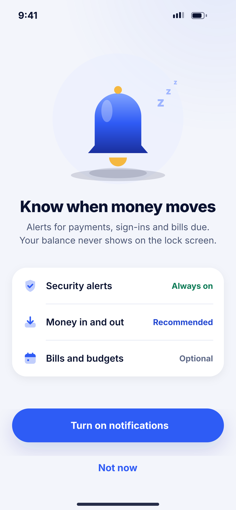
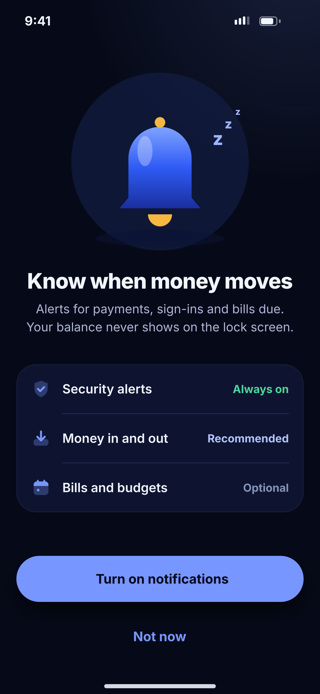

# A07 · Allow notifications

**Flow:** Launch & onboarding  
**Route:** `/permissions/notifications`  
**Design files:** `light.png`, `dark.png` (3×, 1170 × 2532) and `light.svg`, `dark.svg` in this folder.

| Light | Dark |
|---|---|
|  |  |

## Purpose
Explain why alerts help before the system permission dialog appears.

## Layout (top to bottom, 390 × 844 canvas, 20 side padding)
1. Illustration `empty_notifications` (bell) 330 wide.
2. Title “Know when money moves” 26/800 centred, body centred.
3. List group with three rows: Security alerts (pill “Always on” success), Money in and out (pill “Recommended” primary), Bills and budgets (pill “Optional” neutral).
4. Primary “Turn on notifications”, ghost “Not now”.

## Components used (see ../../../docs/COMPONENTS.md)
- NwIllustration
- NwListGroup
- NwPill
- NwButton

## States and behaviour
- If already granted, skip this screen.
- If denied permanently, the primary button opens app settings.

## Navigation
| When | Go to |
|---|---|
| Turn on (any result) | B01 Phone number |
| Not now | B01 |

## Data and backend
- Request POST_NOTIFICATIONS (Android 13+) / iOS authorization. Register FCM token after sign-in.

## Rules and notes
- Never show balances in push text. Lock-screen copy is generic, e.g. “You received money”.

## Done when
- Matches `light.png` and `dark.png` side by side at 390 × 844 (spacing within 2 px, same colours from theme tokens).
- Works at text scale 1.3× without clipping, and on a 360-wide Android phone.
- Every state listed above can be reached (use a debug menu or fake repository).
- TalkBack reads every button and field with a clear label.
- No hard-coded colours, strings (all in ARB files) or limits.

## Prompt to give opencode (paste as is)
```text
Build screen A07 "Allow notifications" for the NovaWallet Flutter app (route /permissions/notifications).
Read docs/COMPONENTS.md and this file (screens/.../A07_allow_notifications/BUILD.md) first, and open light.png and dark.png to match the design exactly.
Use only the shared components from lib/core/ui and colours from the theme extension; if a component is missing, build it in lib/core/ui first.
Put the screen in the feature folder for "Launch & onboarding" following the existing architecture (presentation / application / data layers, Riverpod for state, go_router for navigation).
Implement every state listed under "States and behaviour", the navigation table, and the data calls listed under "Data and backend" through a repository interface with a fake implementation for now if the endpoint is marked NEW.
Add all text to the ARB localisation files. Add a widget test that pumps the screen in light and dark and a golden test for each.
Do not change other screens. When finished, list the files you created or changed and anything you could not complete.
```
