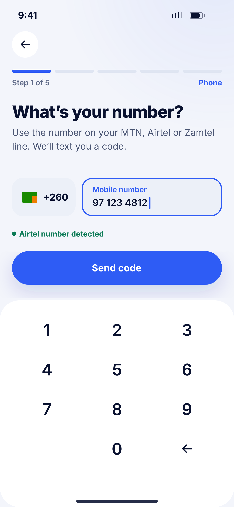
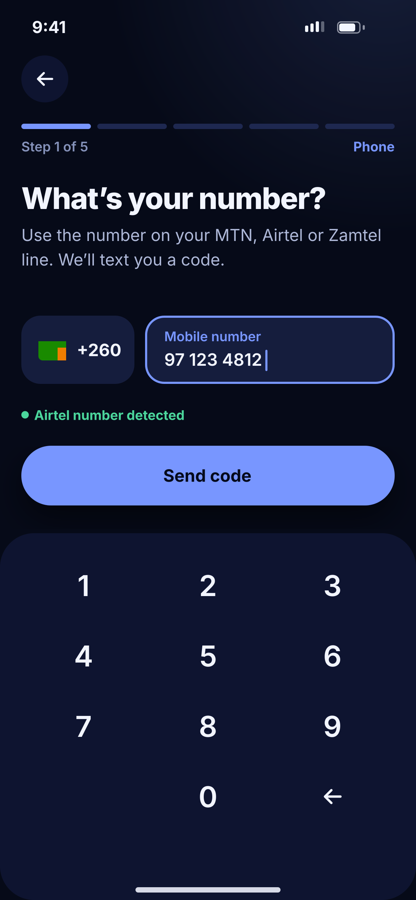

# B01 · Phone number

**Flow:** Create account  
**Route:** `/signup/phone`  
**Design files:** `light.png`, `dark.png` (3×, 1170 × 2532) and `light.svg`, `dark.svg` in this folder.

| Light | Dark |
|---|---|
|  |  |

## Purpose
Step 1 of 5. Capture the mobile number that becomes the account ID.

## Layout (top to bottom, 390 × 844 canvas, 20 side padding)
1. NwTopBar (back). NwStepProgress step 1 “Phone”.
2. H1 28 “What’s your number?” + sub.
3. Row: country box 106 wide (Zambian flag + “+260”, not tappable for now) and NwField “Mobile number” focused.
4. Under the field: NwPill “Airtel number detected” (success) once 2 digits match a prefix.
5. Primary button “Send code” full width at y 418.
6. Surface panel from y 500 with NwKeypad (no key circles), radius 32 top.

## Components used (see ../../../docs/COMPONENTS.md)
- NwTopBar
- NwStepProgress
- NwField
- NwPill
- NwButton
- NwKeypad

## States and behaviour
- Button disabled until 9 digits.
- Network prefix detection: 96/76 MTN, 97/77 Airtel, 95/75 Zamtel (verify current ranges with ZICTA).
- Error “Enter a valid Zambian number”.
- Number already registered → sheet “You already have an account” with “Sign in”.
- Loading on button while sending.

## Navigation
| When | Go to |
|---|---|
| Send code success | B02 Verify code |

## Data and backend
- NEW `POST /api/v1/auth/otp/send` {phone, purpose:"SIGNUP"}. Current backend only has `/auth/register` — the OTP endpoints are in the backend completion doc.

## Rules and notes
- Store number in E.164 (+26097…).
- Rate limit UI: after 3 sends show 60 s cooldown.

## Done when
- Matches `light.png` and `dark.png` side by side at 390 × 844 (spacing within 2 px, same colours from theme tokens).
- Works at text scale 1.3× without clipping, and on a 360-wide Android phone.
- Every state listed above can be reached (use a debug menu or fake repository).
- TalkBack reads every button and field with a clear label.
- No hard-coded colours, strings (all in ARB files) or limits.

## Prompt to give opencode (paste as is)
```text
Build screen B01 "Phone number" for the NovaWallet Flutter app (route /signup/phone).
Read docs/COMPONENTS.md and this file (screens/.../B01_phone_number/BUILD.md) first, and open light.png and dark.png to match the design exactly.
Use only the shared components from lib/core/ui and colours from the theme extension; if a component is missing, build it in lib/core/ui first.
Put the screen in the feature folder for "Create account" following the existing architecture (presentation / application / data layers, Riverpod for state, go_router for navigation).
Implement every state listed under "States and behaviour", the navigation table, and the data calls listed under "Data and backend" through a repository interface with a fake implementation for now if the endpoint is marked NEW.
Add all text to the ARB localisation files. Add a widget test that pumps the screen in light and dark and a golden test for each.
Do not change other screens. When finished, list the files you created or changed and anything you could not complete.
```
