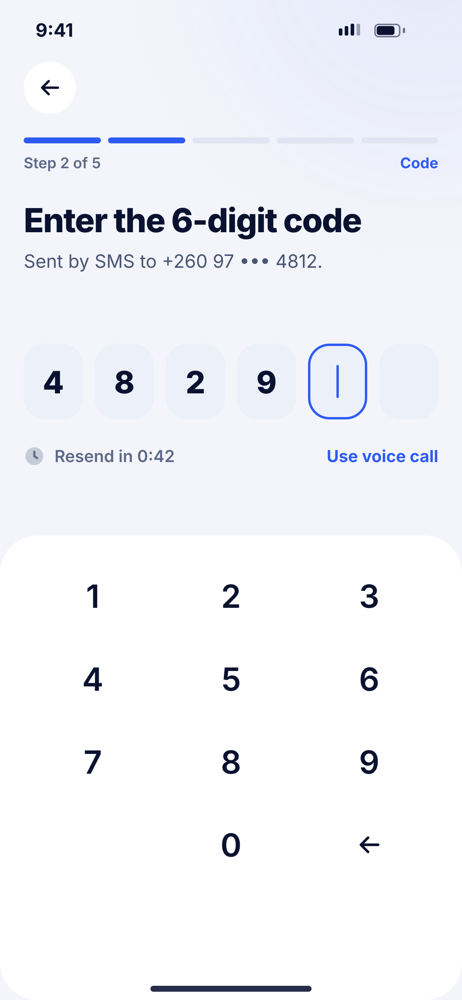
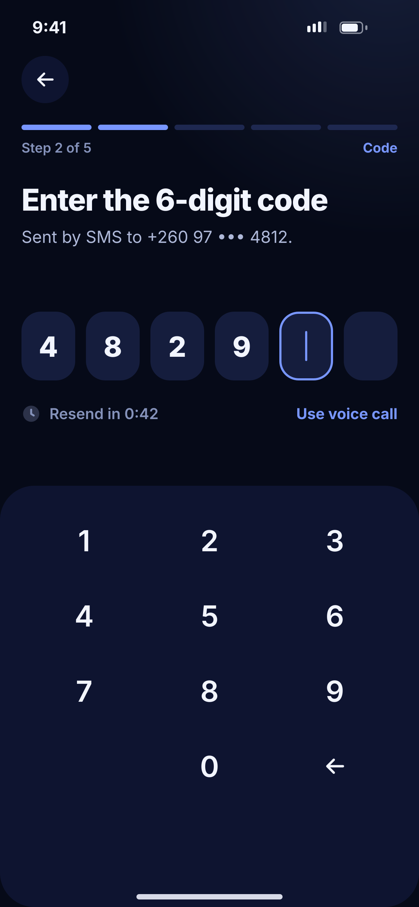

# B02 · Verify code

**Flow:** Create account  
**Route:** `/signup/otp`  
**Design files:** `light.png`, `dark.png` (3×, 1170 × 2532) and `light.svg`, `dark.svg` in this folder.

| Light | Dark |
|---|---|
|  |  |

## Purpose
Step 2 of 5. Confirm the phone with a 6-digit SMS code.

## Layout (top to bottom, 390 × 844 canvas, 20 side padding)
1. TopBar, step 2 “Code”.
2. H1 “Enter the 6-digit code”, sub with masked number “+260 97 ••• 4812”.
3. NwOtpBoxes at y 290.
4. Row: clock icon + “Resend in 0:42” text3 left; “Use voice call” primary right.
5. Surface panel from y 452 with NwKeypad.

## Components used (see ../../../docs/COMPONENTS.md)
- NwOtpBoxes
- NwKeypad

## States and behaviour
- Auto-submit on 6th digit.
- Wrong code: boxes shake, border danger, “Wrong code. 2 tries left.”
- Expired: “Code expired” + Resend enabled.
- Countdown 60 s then “Resend code” becomes a link.

## Navigation
| When | Go to |
|---|---|
| Correct code | B03 Your details |
| Back | B01 (keeps number) |

## Data and backend
- NEW `POST /api/v1/auth/otp/verify` → returns short-lived `signupToken`.

## Rules and notes
- Use SMS Retriever API on Android (no SMS read permission).

## Done when
- Matches `light.png` and `dark.png` side by side at 390 × 844 (spacing within 2 px, same colours from theme tokens).
- Works at text scale 1.3× without clipping, and on a 360-wide Android phone.
- Every state listed above can be reached (use a debug menu or fake repository).
- TalkBack reads every button and field with a clear label.
- No hard-coded colours, strings (all in ARB files) or limits.

## Prompt to give opencode (paste as is)
```text
Build screen B02 "Verify code" for the NovaWallet Flutter app (route /signup/otp).
Read docs/COMPONENTS.md and this file (screens/.../B02_verify_code/BUILD.md) first, and open light.png and dark.png to match the design exactly.
Use only the shared components from lib/core/ui and colours from the theme extension; if a component is missing, build it in lib/core/ui first.
Put the screen in the feature folder for "Create account" following the existing architecture (presentation / application / data layers, Riverpod for state, go_router for navigation).
Implement every state listed under "States and behaviour", the navigation table, and the data calls listed under "Data and backend" through a repository interface with a fake implementation for now if the endpoint is marked NEW.
Add all text to the ARB localisation files. Add a widget test that pumps the screen in light and dark and a golden test for each.
Do not change other screens. When finished, list the files you created or changed and anything you could not complete.
```
