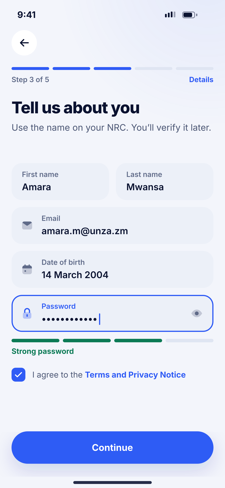
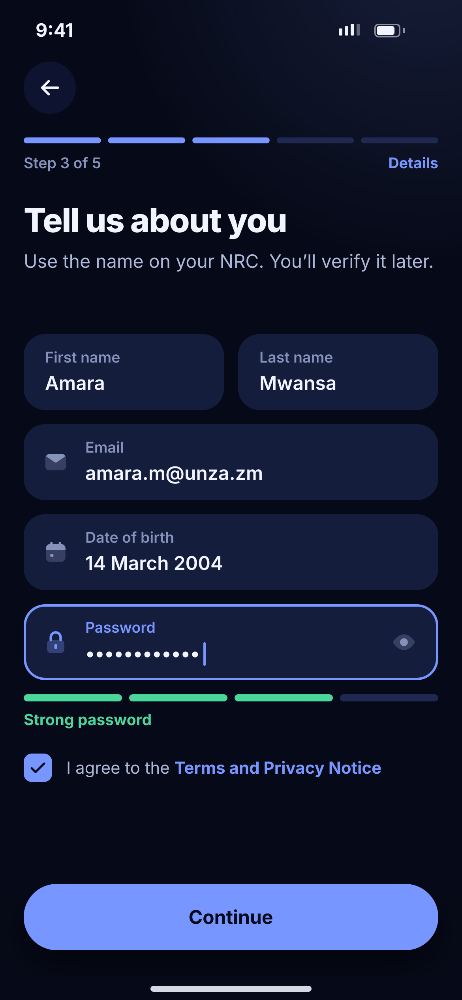

# B03 · Your details

**Flow:** Create account  
**Route:** `/signup/details`  
**Design files:** `light.png`, `dark.png` (3×, 1170 × 2532) and `light.svg`, `dark.svg` in this folder.

| Light | Dark |
|---|---|
|  |  |

## Purpose
Step 3 of 5. Name, email, date of birth, password and consent.

## Layout (top to bottom, 390 × 844 canvas, 20 side padding)
1. TopBar, step 3 “Details”. H1 “Tell us about you” + sub “Use the name on your NRC…”.
2. Two half-width NwFields: First name, Last name.
3. NwFields: Email (mail icon), Date of birth (calendar icon, opens date picker), Password (lock icon, eye toggle).
4. Password strength: 4 segments (success for strong), label “Strong password” 13/700.
5. Checkbox 24 (primary filled with check) + “I agree to the Terms and Privacy Notice” (link part primary).
6. NwBottomCta “Continue”.

## Components used (see ../../../docs/COMPONENTS.md)
- NwField
- Strength meter
- Checkbox
- NwBottomCta

## States and behaviour
- Validation on blur: names letters only, email format, age 16+ (verify minimum age with legal), password 10+ chars, number and symbol.
- Continue disabled until terms ticked.
- Email already used → field error.

## Navigation
| When | Go to |
|---|---|
| Continue | B04 Create PIN |
| Terms link | In-app web view |

## Data and backend
- Held in memory until B04; account created with `POST /api/v1/auth/register` after PIN is confirmed.

## Rules and notes
- Keyboard “next” moves between fields. Scroll so focused field stays above keyboard.

## Done when
- Matches `light.png` and `dark.png` side by side at 390 × 844 (spacing within 2 px, same colours from theme tokens).
- Works at text scale 1.3× without clipping, and on a 360-wide Android phone.
- Every state listed above can be reached (use a debug menu or fake repository).
- TalkBack reads every button and field with a clear label.
- No hard-coded colours, strings (all in ARB files) or limits.

## Prompt to give opencode (paste as is)
```text
Build screen B03 "Your details" for the NovaWallet Flutter app (route /signup/details).
Read docs/COMPONENTS.md and this file (screens/.../B03_your_details/BUILD.md) first, and open light.png and dark.png to match the design exactly.
Use only the shared components from lib/core/ui and colours from the theme extension; if a component is missing, build it in lib/core/ui first.
Put the screen in the feature folder for "Create account" following the existing architecture (presentation / application / data layers, Riverpod for state, go_router for navigation).
Implement every state listed under "States and behaviour", the navigation table, and the data calls listed under "Data and backend" through a repository interface with a fake implementation for now if the endpoint is marked NEW.
Add all text to the ARB localisation files. Add a widget test that pumps the screen in light and dark and a golden test for each.
Do not change other screens. When finished, list the files you created or changed and anything you could not complete.
```
