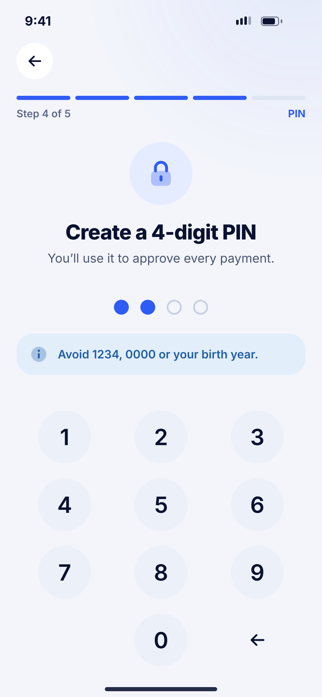
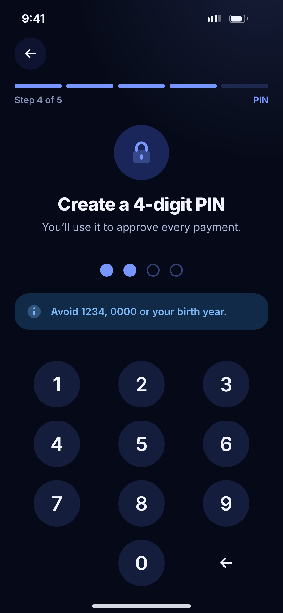

# B04 · Create PIN

**Flow:** Create account  
**Route:** `/signup/pin`  
**Design files:** `light.png`, `dark.png` (3×, 1170 × 2532) and `light.svg`, `dark.svg` in this folder.

| Light | Dark |
|---|---|
|  |  |

## Purpose
Step 4 of 5. Choose a 4-digit transaction PIN.

## Layout (top to bottom, 390 × 844 canvas, 20 side padding)
1. TopBar, step 4 “PIN”.
2. 76 primarySoft circle with lock icon centred at y 210.
3. Title “Create a 4-digit PIN” 25/800, sub “You’ll use it to approve every payment.”
4. NwPinDots at y 372.
5. Info NwBanner “Avoid 1234, 0000 or your birth year.”
6. NwKeypad with circle keys from y 488.

## Components used (see ../../../docs/COMPONENTS.md)
- NwPinDots
- NwBanner
- NwKeypad

## States and behaviour
- After 4 digits go to confirm (B05 layout with title “Confirm your PIN”).
- Weak PIN (1234, 0000, 1111, repeated, birth year) → banner turns warning “Choose a harder PIN”.

## Navigation
| When | Go to |
|---|---|
| 4 digits | Confirm PIN (same screen, step=confirm) |

## Data and backend
- None until confirmed.

## Rules and notes
- Never store the PIN on device. Send only to backend over TLS; backend hashes (BCrypt).

## Done when
- Matches `light.png` and `dark.png` side by side at 390 × 844 (spacing within 2 px, same colours from theme tokens).
- Works at text scale 1.3× without clipping, and on a 360-wide Android phone.
- Every state listed above can be reached (use a debug menu or fake repository).
- TalkBack reads every button and field with a clear label.
- No hard-coded colours, strings (all in ARB files) or limits.

## Prompt to give opencode (paste as is)
```text
Build screen B04 "Create PIN" for the NovaWallet Flutter app (route /signup/pin).
Read docs/COMPONENTS.md and this file (screens/.../B04_create_pin/BUILD.md) first, and open light.png and dark.png to match the design exactly.
Use only the shared components from lib/core/ui and colours from the theme extension; if a component is missing, build it in lib/core/ui first.
Put the screen in the feature folder for "Create account" following the existing architecture (presentation / application / data layers, Riverpod for state, go_router for navigation).
Implement every state listed under "States and behaviour", the navigation table, and the data calls listed under "Data and backend" through a repository interface with a fake implementation for now if the endpoint is marked NEW.
Add all text to the ARB localisation files. Add a widget test that pumps the screen in light and dark and a golden test for each.
Do not change other screens. When finished, list the files you created or changed and anything you could not complete.
```
