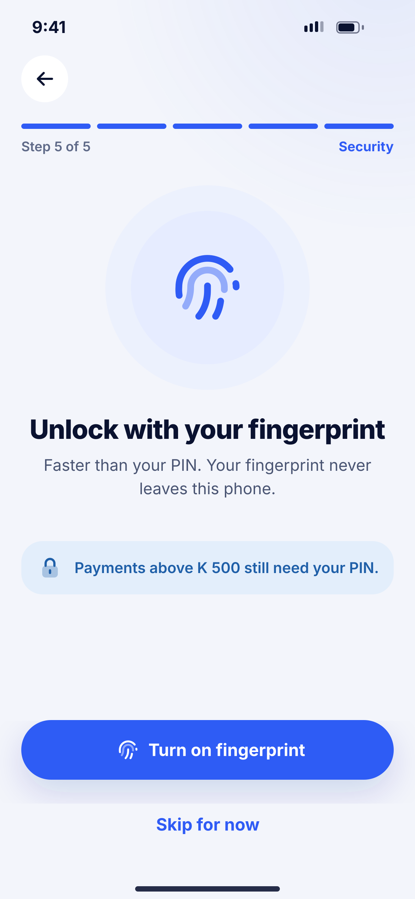
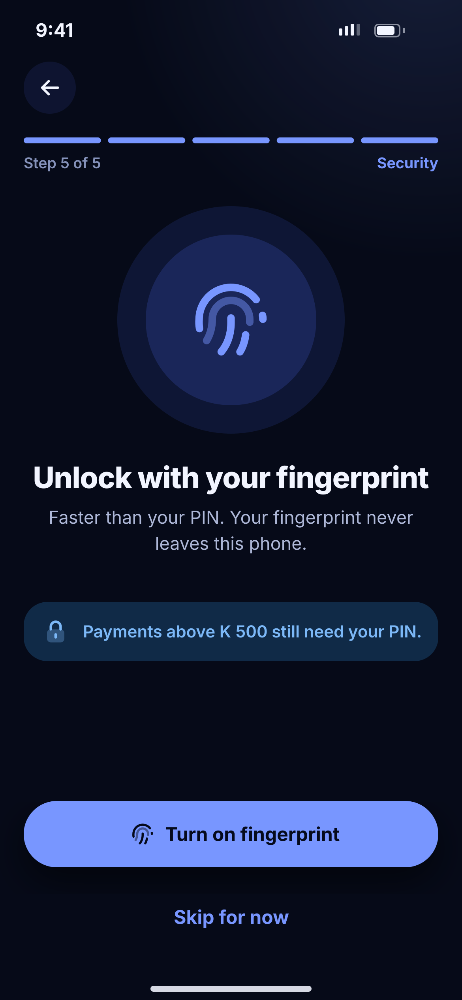

# B06 · Enable fingerprint

**Flow:** Create account  
**Route:** `/signup/biometrics`  
**Design files:** `light.png`, `dark.png` (3×, 1170 × 2532) and `light.svg`, `dark.svg` in this folder.

| Light | Dark |
|---|---|
|  |  |

## Purpose
Step 5 of 5. Offer biometric unlock.

## Layout (top to bottom, 390 × 844 canvas, 20 side padding)
1. TopBar, step 5 “Security”.
2. Double circle (96 at 45% + 72 solid primarySoft) with 76 fingerprint icon.
3. Title “Unlock with your fingerprint”, body centred.
4. Info banner with lock icon “Payments above K 500 still need your PIN.”
5. Primary “Turn on fingerprint” (fingerprint icon), ghost “Skip for now”.

## Components used (see ../../../docs/COMPONENTS.md)
- NwBanner
- NwButton

## States and behaviour
- Device without biometrics → skip screen.
- Face unlock devices → swap icon to face_id and copy to “face”.
- Prompt cancelled → stay on screen.

## Navigation
| When | Go to |
|---|---|
| Turn on success / Skip | B07 Account ready |

## Data and backend
- local_auth. Store a flag only; biometric unlocks the stored refresh token.

## Rules and notes
- The K 500 threshold is a setting from backend config, not hard-coded.

## Done when
- Matches `light.png` and `dark.png` side by side at 390 × 844 (spacing within 2 px, same colours from theme tokens).
- Works at text scale 1.3× without clipping, and on a 360-wide Android phone.
- Every state listed above can be reached (use a debug menu or fake repository).
- TalkBack reads every button and field with a clear label.
- No hard-coded colours, strings (all in ARB files) or limits.

## Prompt to give opencode (paste as is)
```text
Build screen B06 "Enable fingerprint" for the NovaWallet Flutter app (route /signup/biometrics).
Read docs/COMPONENTS.md and this file (screens/.../B06_enable_biometrics/BUILD.md) first, and open light.png and dark.png to match the design exactly.
Use only the shared components from lib/core/ui and colours from the theme extension; if a component is missing, build it in lib/core/ui first.
Put the screen in the feature folder for "Create account" following the existing architecture (presentation / application / data layers, Riverpod for state, go_router for navigation).
Implement every state listed under "States and behaviour", the navigation table, and the data calls listed under "Data and backend" through a repository interface with a fake implementation for now if the endpoint is marked NEW.
Add all text to the ARB localisation files. Add a widget test that pumps the screen in light and dark and a golden test for each.
Do not change other screens. When finished, list the files you created or changed and anything you could not complete.
```
