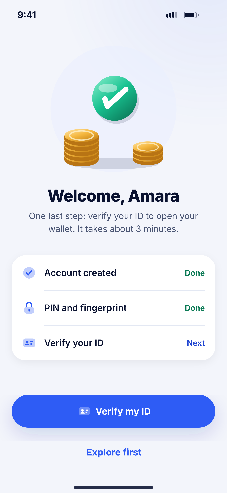
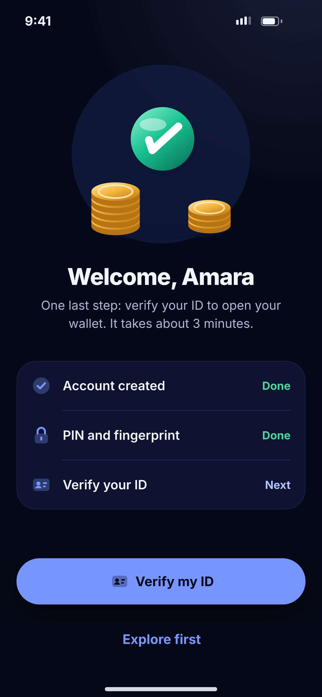

# B07 · Account ready

**Flow:** Create account  
**Route:** `/signup/done`  
**Design files:** `light.png`, `dark.png` (3×, 1170 × 2532) and `light.svg`, `dark.svg` in this folder.

| Light | Dark |
|---|---|
|  |  |

## Purpose
Celebrate and push the user into ID verification.

## Layout (top to bottom, 390 × 844 canvas, 20 side padding)
1. Illustration `payment_success` (check + coins).
2. Title “Welcome, Amara” 28/800, body centred about verifying ID in 3 minutes.
3. List group: Account created (Done), PIN and fingerprint (Done), Verify your ID (Next).
4. Primary “Verify my ID” (verification icon), ghost “Explore first”.

## Components used (see ../../../docs/COMPONENTS.md)
- NwIllustration
- NwListGroup
- NwPill

## States and behaviour
- Play success Lottie once over the illustration on entry.

## Navigation
| When | Go to |
|---|---|
| Verify my ID | D01 KYC intro |
| Explore first | E01 Home (before ID approval) |

## Data and backend
- GET `/api/v1/users/me` to get the first name.

## Rules and notes
- Clear the sign-up stack so back does not return into sign-up.

## Done when
- Matches `light.png` and `dark.png` side by side at 390 × 844 (spacing within 2 px, same colours from theme tokens).
- Works at text scale 1.3× without clipping, and on a 360-wide Android phone.
- Every state listed above can be reached (use a debug menu or fake repository).
- TalkBack reads every button and field with a clear label.
- No hard-coded colours, strings (all in ARB files) or limits.

## Prompt to give opencode (paste as is)
```text
Build screen B07 "Account ready" for the NovaWallet Flutter app (route /signup/done).
Read docs/COMPONENTS.md and this file (screens/.../B07_account_ready/BUILD.md) first, and open light.png and dark.png to match the design exactly.
Use only the shared components from lib/core/ui and colours from the theme extension; if a component is missing, build it in lib/core/ui first.
Put the screen in the feature folder for "Create account" following the existing architecture (presentation / application / data layers, Riverpod for state, go_router for navigation).
Implement every state listed under "States and behaviour", the navigation table, and the data calls listed under "Data and backend" through a repository interface with a fake implementation for now if the endpoint is marked NEW.
Add all text to the ARB localisation files. Add a widget test that pumps the screen in light and dark and a golden test for each.
Do not change other screens. When finished, list the files you created or changed and anything you could not complete.
```
