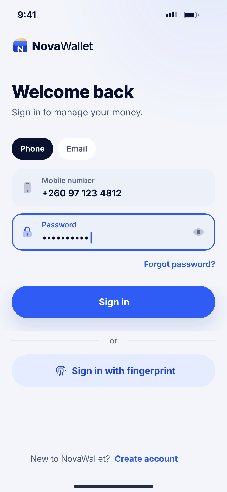
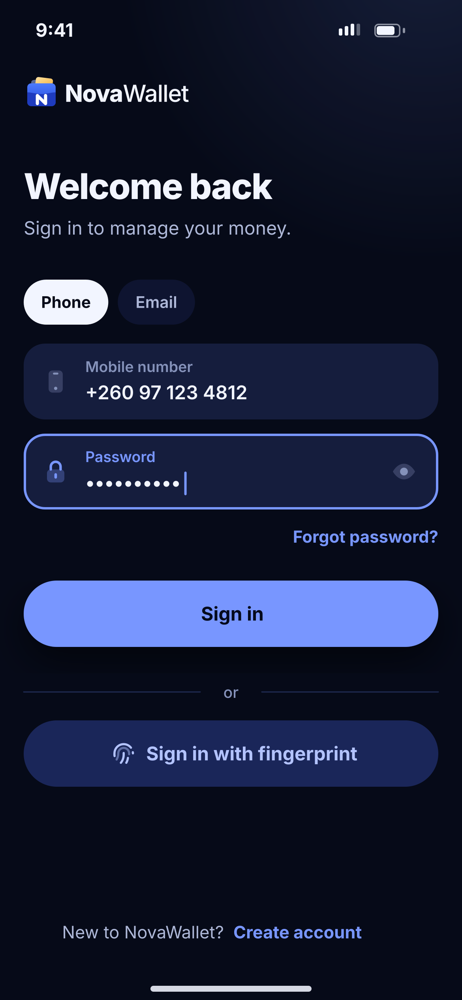

# C01 · Sign in

**Flow:** Sign in  
**Route:** `/signin`  
**Design files:** `light.png`, `dark.png` (3×, 1170 × 2532) and `light.svg`, `dark.svg` in this folder.

| Light | Dark |
|---|---|
|  |  |

## Purpose
Sign in with phone or email and password, or fingerprint.

## Layout (top to bottom, 390 × 844 canvas, 20 side padding)
1. Logo lockup top-left.
2. H1 “Welcome back” + sub.
3. NwChips: Phone | Email (changes the first field).
4. NwField Mobile number (phone icon); NwField Password focused (lock, eye).
5. “Forgot password?” primary right.
6. Primary “Sign in” at y 490.
7. “or” divider; tonal “Sign in with fingerprint” (only if enabled on this device).
8. Footer: “New to NovaWallet? Create account”.

## Components used (see ../../../docs/COMPONENTS.md)
- NwChips
- NwField
- NwButton

## States and behaviour
- Wrong details: banner danger “Phone or password is wrong. 3 tries left.”
- Locked account → C07.
- New device → C05.
- Loading on button.

## Navigation
| When | Go to |
|---|---|
| Success | E02 Home |
| Forgot password | C03 |
| Create account | B01 |

## Data and backend
- `POST /api/v1/auth/login` → AuthResponse {accessToken, refreshToken, user}. The backend LoginRequest currently takes `email` only: the Phone tab needs a backend change to accept `{identifier, password}` (phone or email). Device ID header `X-Device-Id` (NEW in backend doc).

## Rules and notes
- Generic error wording (don’t reveal whether the phone exists).

## Done when
- Matches `light.png` and `dark.png` side by side at 390 × 844 (spacing within 2 px, same colours from theme tokens).
- Works at text scale 1.3× without clipping, and on a 360-wide Android phone.
- Every state listed above can be reached (use a debug menu or fake repository).
- TalkBack reads every button and field with a clear label.
- No hard-coded colours, strings (all in ARB files) or limits.

## Prompt to give opencode (paste as is)
```text
Build screen C01 "Sign in" for the NovaWallet Flutter app (route /signin).
Read docs/COMPONENTS.md and this file (screens/.../C01_sign_in/BUILD.md) first, and open light.png and dark.png to match the design exactly.
Use only the shared components from lib/core/ui and colours from the theme extension; if a component is missing, build it in lib/core/ui first.
Put the screen in the feature folder for "Sign in" following the existing architecture (presentation / application / data layers, Riverpod for state, go_router for navigation).
Implement every state listed under "States and behaviour", the navigation table, and the data calls listed under "Data and backend" through a repository interface with a fake implementation for now if the endpoint is marked NEW.
Add all text to the ARB localisation files. Add a widget test that pumps the screen in light and dark and a golden test for each.
Do not change other screens. When finished, list the files you created or changed and anything you could not complete.
```
