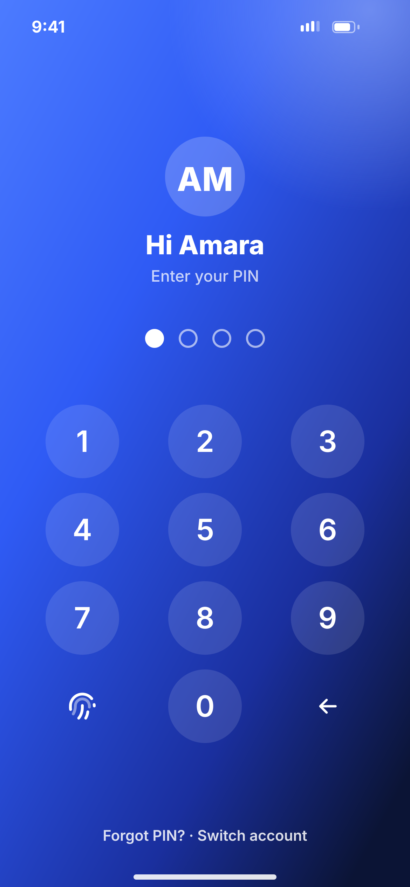
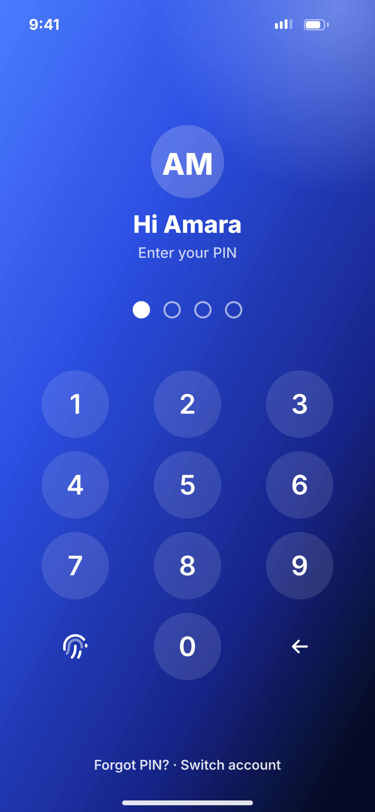

# C02 · Unlock with PIN

**Flow:** Sign in  
**Route:** `/unlock`  
**Design files:** `light.png`, `dark.png` (3×, 1170 × 2532) and `light.svg`, `dark.svg` in this folder.

| Light | Dark |
|---|---|
|  |  |

## Purpose
Quick unlock for a returning user on a trusted phone.

## Layout (top to bottom, 390 × 844 canvas, 20 side padding)
1. Full-screen hero gradient, white status bar.
2. White avatar 38 radius with initials, “Hi Amara” 25/800 white, “Enter your PIN” white 75%.
3. White NwPinDots.
4. White keypad: 70 circles at white 12%, digits white 28/600; bottom-left fingerprint, bottom-right backspace.
5. Footer “Forgot PIN? · Switch account” white 85%.

## Components used (see ../../../docs/COMPONENTS.md)
- NwAvatar (white)
- NwPinDots (white)
- NwKeypad (on-hero variant)

## States and behaviour
- Auto-prompt biometrics on open if enabled.
- Wrong PIN: dots shake, “Wrong PIN. 4 tries left.” in white under dots.
- 5 wrong → C07.

## Navigation
| When | Go to |
|---|---|
| Correct | Last screen or E02 Home |
| Forgot PIN | PIN reset flow (OTP + selfie) |
| Switch account | C01 (clears tokens after confirm) |

## Data and backend
- Local unlock then `POST /api/v1/auth/refresh`. PIN check endpoint NEW `POST /api/v1/pin/verify`.

## Rules and notes
- Show after 5 min in background or on cold start.

## Done when
- Matches `light.png` and `dark.png` side by side at 390 × 844 (spacing within 2 px, same colours from theme tokens).
- Works at text scale 1.3× without clipping, and on a 360-wide Android phone.
- Every state listed above can be reached (use a debug menu or fake repository).
- TalkBack reads every button and field with a clear label.
- No hard-coded colours, strings (all in ARB files) or limits.

## Prompt to give opencode (paste as is)
```text
Build screen C02 "Unlock with PIN" for the NovaWallet Flutter app (route /unlock).
Read docs/COMPONENTS.md and this file (screens/.../C02_unlock_pin/BUILD.md) first, and open light.png and dark.png to match the design exactly.
Use only the shared components from lib/core/ui and colours from the theme extension; if a component is missing, build it in lib/core/ui first.
Put the screen in the feature folder for "Sign in" following the existing architecture (presentation / application / data layers, Riverpod for state, go_router for navigation).
Implement every state listed under "States and behaviour", the navigation table, and the data calls listed under "Data and backend" through a repository interface with a fake implementation for now if the endpoint is marked NEW.
Add all text to the ARB localisation files. Add a widget test that pumps the screen in light and dark and a golden test for each.
Do not change other screens. When finished, list the files you created or changed and anything you could not complete.
```
