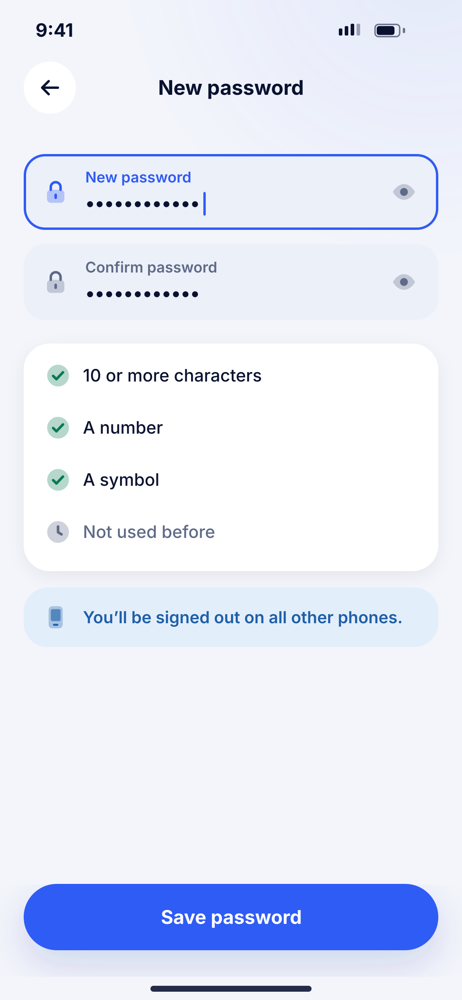
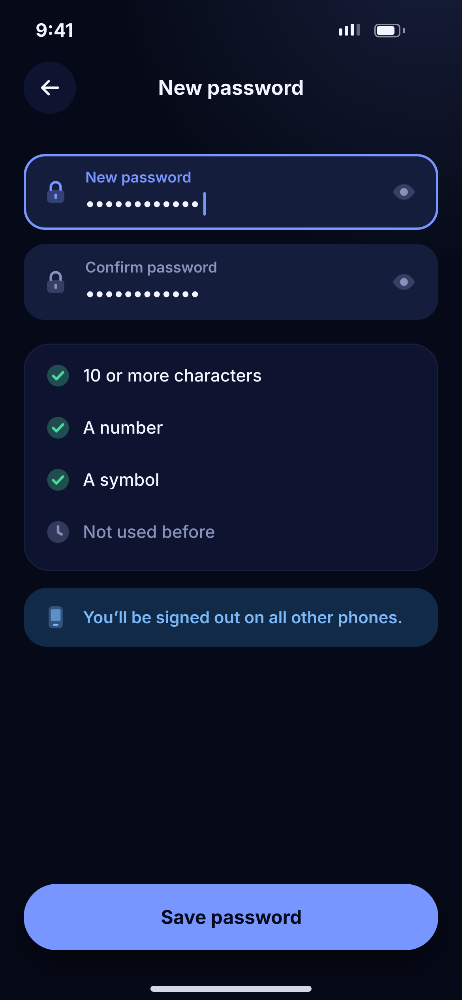

# C04 · New password

**Flow:** Sign in  
**Route:** `/password/new`  
**Design files:** `light.png`, `dark.png` (3×, 1170 × 2532) and `light.svg`, `dark.svg` in this folder.

| Light | Dark |
|---|---|
|  |  |

## Purpose
Set a new password after the reset code.

## Layout (top to bottom, 390 × 844 canvas, 20 side padding)
1. TopBar “New password”.
2. Two NwFields with eye toggles.
3. Checklist card: four rows with success check or grey pending icon: 10+ characters, a number, a symbol, not used before.
4. Info banner (device icon) “You’ll be signed out on all other phones.”
5. NwBottomCta “Save password”.

## Components used (see ../../../docs/COMPONENTS.md)
- NwField
- Checklist card
- NwBanner

## States and behaviour
- Checklist updates live. Button disabled until all pass and both match.

## Navigation
| When | Go to |
|---|---|
| Saved | C01 with success snackbar |

## Data and backend
- `POST /api/v1/password/reset` {token, newPassword}.

## Rules and notes
- Backend must revoke all refresh tokens on reset.

## Done when
- Matches `light.png` and `dark.png` side by side at 390 × 844 (spacing within 2 px, same colours from theme tokens).
- Works at text scale 1.3× without clipping, and on a 360-wide Android phone.
- Every state listed above can be reached (use a debug menu or fake repository).
- TalkBack reads every button and field with a clear label.
- No hard-coded colours, strings (all in ARB files) or limits.

## Prompt to give opencode (paste as is)
```text
Build screen C04 "New password" for the NovaWallet Flutter app (route /password/new).
Read docs/COMPONENTS.md and this file (screens/.../C04_new_password/BUILD.md) first, and open light.png and dark.png to match the design exactly.
Use only the shared components from lib/core/ui and colours from the theme extension; if a component is missing, build it in lib/core/ui first.
Put the screen in the feature folder for "Sign in" following the existing architecture (presentation / application / data layers, Riverpod for state, go_router for navigation).
Implement every state listed under "States and behaviour", the navigation table, and the data calls listed under "Data and backend" through a repository interface with a fake implementation for now if the endpoint is marked NEW.
Add all text to the ARB localisation files. Add a widget test that pumps the screen in light and dark and a golden test for each.
Do not change other screens. When finished, list the files you created or changed and anything you could not complete.
```
