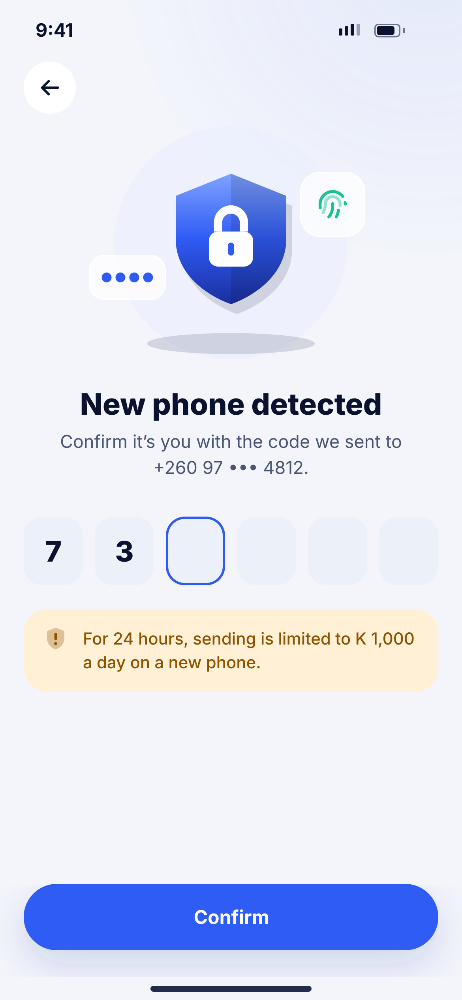
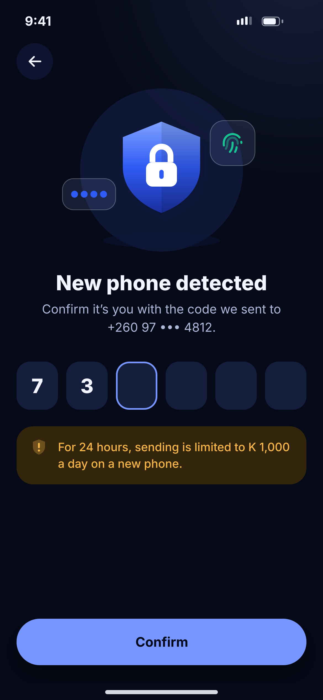

# C05 · New phone detected

**Flow:** Sign in  
**Route:** `/signin/new-device`  
**Design files:** `light.png`, `dark.png` (3×, 1170 × 2532) and `light.svg`, `dark.svg` in this folder.

| Light | Dark |
|---|---|
|  |  |

## Purpose
Step-up check when signing in on a device not seen before.

## Layout (top to bottom, 390 × 844 canvas, 20 side padding)
1. TopBar back. Illustration `security` 300 wide.
2. Title “New phone detected”, body with masked number.
3. 6 OTP boxes (58 high).
4. Warning banner: “For 24 hours, sending is limited to K 1,000 a day on a new phone.”
5. NwBottomCta “Confirm”.

## Components used (see ../../../docs/COMPONENTS.md)
- NwIllustration
- NwOtpBoxes
- NwBanner

## States and behaviour
- Same OTP states as B02.

## Navigation
| When | Go to |
|---|---|
| Confirmed | E02 Home |

## Data and backend
- NEW `POST /api/v1/auth/device/verify`. Backend stores trusted devices (see backend doc SEC items).

## Rules and notes
- The 24 h cooling limit is enforced on the server, not the app.

## Done when
- Matches `light.png` and `dark.png` side by side at 390 × 844 (spacing within 2 px, same colours from theme tokens).
- Works at text scale 1.3× without clipping, and on a 360-wide Android phone.
- Every state listed above can be reached (use a debug menu or fake repository).
- TalkBack reads every button and field with a clear label.
- No hard-coded colours, strings (all in ARB files) or limits.

## Prompt to give opencode (paste as is)
```text
Build screen C05 "New phone detected" for the NovaWallet Flutter app (route /signin/new-device).
Read docs/COMPONENTS.md and this file (screens/.../C05_new_device_check/BUILD.md) first, and open light.png and dark.png to match the design exactly.
Use only the shared components from lib/core/ui and colours from the theme extension; if a component is missing, build it in lib/core/ui first.
Put the screen in the feature folder for "Sign in" following the existing architecture (presentation / application / data layers, Riverpod for state, go_router for navigation).
Implement every state listed under "States and behaviour", the navigation table, and the data calls listed under "Data and backend" through a repository interface with a fake implementation for now if the endpoint is marked NEW.
Add all text to the ARB localisation files. Add a widget test that pumps the screen in light and dark and a golden test for each.
Do not change other screens. When finished, list the files you created or changed and anything you could not complete.
```
