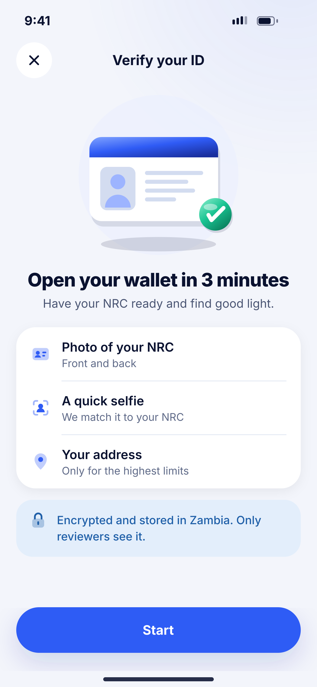
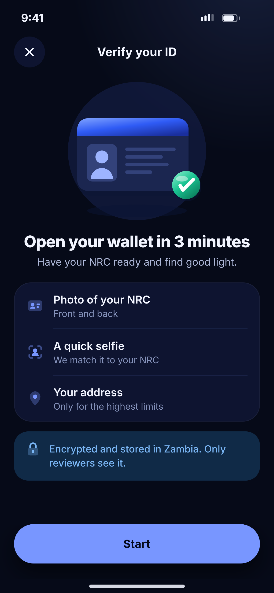

# D01 · KYC intro

**Flow:** Verify ID (KYC)  
**Route:** `/kyc`  
**Design files:** `light.png`, `dark.png` (3×, 1170 × 2532) and `light.svg`, `dark.svg` in this folder.

| Light | Dark |
|---|---|
|  |  |

## Purpose
Explain what ID verification needs and why.

## Layout (top to bottom, 390 × 844 canvas, 20 side padding)
1. TopBar with close and title “Verify your ID”.
2. Illustration `kyc_verify` 300 wide.
3. Title “Open your wallet in 3 minutes”, sub.
4. List group (66 rows): Photo of your NRC / Front and back; A quick selfie / We match it to your NRC; Your address / Only for the highest limits.
5. Info banner with lock: “Encrypted and stored in Zambia. Only reviewers see it.”
6. NwBottomCta “Start”.

## Components used (see ../../../docs/COMPONENTS.md)
- NwIllustration
- NwListGroup
- NwBanner

## States and behaviour
- If KYC already pending → open D07; approved → D08.

## Navigation
| When | Go to |
|---|---|
| Start | D03 Choose ID |
| See levels (row link optional) | D02 |

## Data and backend
- `GET /api/v1/kyc/status`.

## Done when
- Matches `light.png` and `dark.png` side by side at 390 × 844 (spacing within 2 px, same colours from theme tokens).
- Works at text scale 1.3× without clipping, and on a 360-wide Android phone.
- Every state listed above can be reached (use a debug menu or fake repository).
- TalkBack reads every button and field with a clear label.
- No hard-coded colours, strings (all in ARB files) or limits.

## Prompt to give opencode (paste as is)
```text
Build screen D01 "KYC intro" for the NovaWallet Flutter app (route /kyc).
Read docs/COMPONENTS.md and this file (screens/.../D01_kyc_intro/BUILD.md) first, and open light.png and dark.png to match the design exactly.
Use only the shared components from lib/core/ui and colours from the theme extension; if a component is missing, build it in lib/core/ui first.
Put the screen in the feature folder for "Verify ID (KYC)" following the existing architecture (presentation / application / data layers, Riverpod for state, go_router for navigation).
Implement every state listed under "States and behaviour", the navigation table, and the data calls listed under "Data and backend" through a repository interface with a fake implementation for now if the endpoint is marked NEW.
Add all text to the ARB localisation files. Add a widget test that pumps the screen in light and dark and a golden test for each.
Do not change other screens. When finished, list the files you created or changed and anything you could not complete.
```
