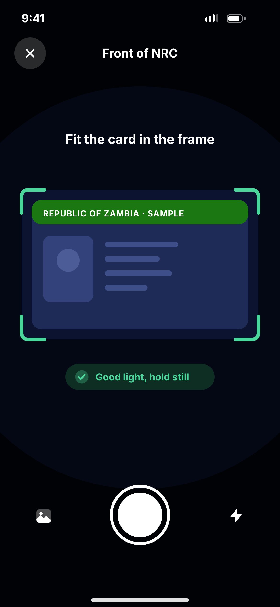

# D04 · Capture NRC

**Flow:** Verify ID (KYC)  
**Route:** `/kyc/capture?side=front`  
**Design files:** `light.png`, `dark.png` (3×, 1170 × 2532) and `light.svg`, `dark.svg` in this folder.

| Light | Dark |
|---|---|
|  |  |

## Purpose
Camera screen to photograph the NRC (front, then back).

## Layout (top to bottom, 390 × 844 canvas, 20 side padding)
1. Full-screen camera preview, near-black background.
2. Dark mask (60%) with a clear card-shaped window (x 30, y 264, ratio ~1.6), green (#4BD69C) corner brackets.
3. Top: glass close button, title “Front of NRC” white.
4. Prompt “Fit the card in the frame” 18/700 white above the window.
5. Under window: dark-green pill with check “Good light, hold still”.
6. Bottom: 80 shutter (white ring + white disc), gallery icon left, flash icon right.

## Components used (see ../../../docs/COMPONENTS.md)
- camera package preview
- Custom overlay painter

## States and behaviour
- Guidance pill changes: “Too dark”, “Too blurry”, “Move closer”, “Good light, hold still”.
- Auto-capture when stable for 1 s; manual shutter always available.
- After front, same screen for back.

## Navigation
| When | Go to |
|---|---|
| Both sides captured | D05 Selfie |

## Data and backend
- Upload each image with `POST /api/v1/kyc/documents/upload` (multipart, type NRC_FRONT / NRC_BACK).

## Rules and notes
- Compress to ~1600 px JPEG 85%. Never save to the phone gallery. Delete temp files after upload.

## Done when
- Matches `light.png` and `dark.png` side by side at 390 × 844 (spacing within 2 px, same colours from theme tokens).
- Works at text scale 1.3× without clipping, and on a 360-wide Android phone.
- Every state listed above can be reached (use a debug menu or fake repository).
- TalkBack reads every button and field with a clear label.
- No hard-coded colours, strings (all in ARB files) or limits.

## Prompt to give opencode (paste as is)
```text
Build screen D04 "Capture NRC" for the NovaWallet Flutter app (route /kyc/capture?side=front).
Read docs/COMPONENTS.md and this file (screens/.../D04_kyc_capture_nrc/BUILD.md) first, and open light.png and dark.png to match the design exactly.
Use only the shared components from lib/core/ui and colours from the theme extension; if a component is missing, build it in lib/core/ui first.
Put the screen in the feature folder for "Verify ID (KYC)" following the existing architecture (presentation / application / data layers, Riverpod for state, go_router for navigation).
Implement every state listed under "States and behaviour", the navigation table, and the data calls listed under "Data and backend" through a repository interface with a fake implementation for now if the endpoint is marked NEW.
Add all text to the ARB localisation files. Add a widget test that pumps the screen in light and dark and a golden test for each.
Do not change other screens. When finished, list the files you created or changed and anything you could not complete.
```
