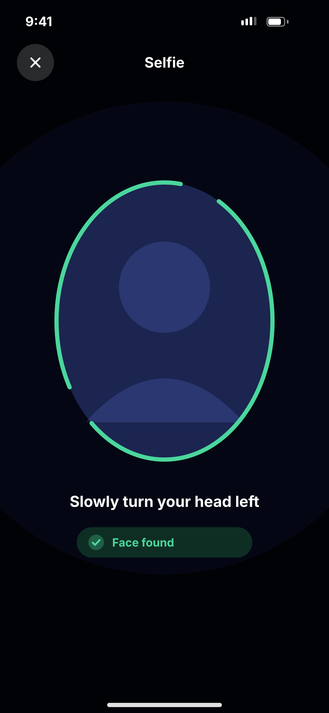

# D05 · Selfie

**Flow:** Verify ID (KYC)  
**Route:** `/kyc/selfie`  
**Design files:** `light.png`, `dark.png` (3×, 1170 × 2532) and `light.svg`, `dark.svg` in this folder.

| Light | Dark |
|---|---|
|  |  |

## Purpose
Liveness selfie matched against the NRC photo.

## Layout (top to bottom, 390 × 844 canvas, 20 side padding)
1. Front camera preview, dark mask with an oval window (256×328) and a green dashed ring that fills as steps pass.
2. Prompt under the oval: “Slowly turn your head left”.
3. Pill “Face found”.

## Components used (see ../../../docs/COMPONENTS.md)
- camera
- Oval overlay

## States and behaviour
- Steps: look straight → turn left → turn right → done. Ring fills per step.
- No face → pill warning “Move your face into the oval”.

## Navigation
| When | Go to |
|---|---|
| Done | D06 Check and submit |

## Data and backend
- Upload as type SELFIE. Liveness provider: see KYC section in backend doc (e.g. Smile ID).

## Rules and notes
- Do not run face matching on the phone only; the server/provider decides.

## Done when
- Matches `light.png` and `dark.png` side by side at 390 × 844 (spacing within 2 px, same colours from theme tokens).
- Works at text scale 1.3× without clipping, and on a 360-wide Android phone.
- Every state listed above can be reached (use a debug menu or fake repository).
- TalkBack reads every button and field with a clear label.
- No hard-coded colours, strings (all in ARB files) or limits.

## Prompt to give opencode (paste as is)
```text
Build screen D05 "Selfie" for the NovaWallet Flutter app (route /kyc/selfie).
Read docs/COMPONENTS.md and this file (screens/.../D05_kyc_selfie/BUILD.md) first, and open light.png and dark.png to match the design exactly.
Use only the shared components from lib/core/ui and colours from the theme extension; if a component is missing, build it in lib/core/ui first.
Put the screen in the feature folder for "Verify ID (KYC)" following the existing architecture (presentation / application / data layers, Riverpod for state, go_router for navigation).
Implement every state listed under "States and behaviour", the navigation table, and the data calls listed under "Data and backend" through a repository interface with a fake implementation for now if the endpoint is marked NEW.
Add all text to the ARB localisation files. Add a widget test that pumps the screen in light and dark and a golden test for each.
Do not change other screens. When finished, list the files you created or changed and anything you could not complete.
```
