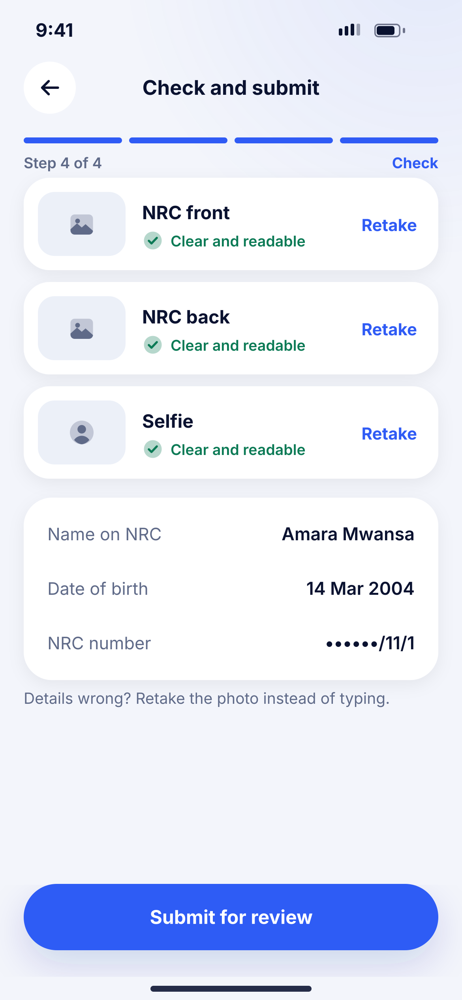
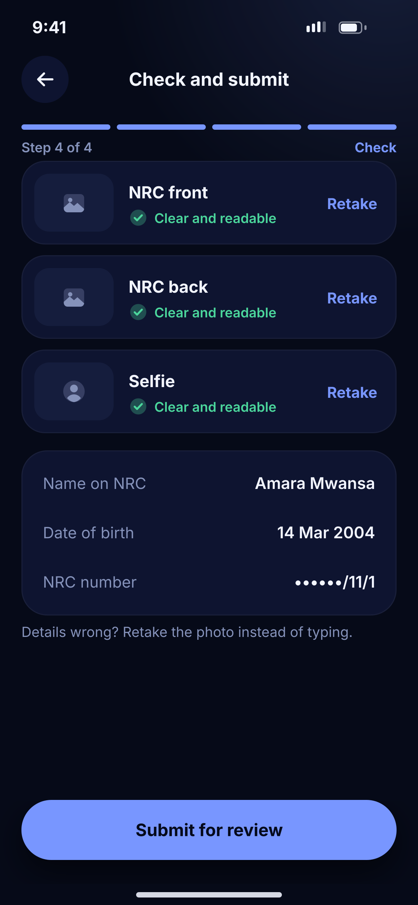

# D06 · Check and submit

**Flow:** Verify ID (KYC)  
**Route:** `/kyc/review`  
**Design files:** `light.png`, `dark.png` (3×, 1170 × 2532) and `light.svg`, `dark.svg` in this folder.

| Light | Dark |
|---|---|
|  |  |

## Purpose
Let the user check photos and read details before submitting.

## Layout (top to bottom, 390 × 844 canvas, 20 side padding)
1. TopBar “Check and submit”, step 4 of 4.
2. Three cards 78 high: thumbnail 74×54, label, green “Clear and readable”, “Retake” link right.
3. NwKeyValueCard: Name on NRC, Date of birth, NRC number (masked).
4. Caption “Details wrong? Retake the photo instead of typing.”
5. NwBottomCta “Submit for review”.

## Components used (see ../../../docs/COMPONENTS.md)
- NwCard
- NwKeyValueCard

## States and behaviour
- Submitting → button loading.
- A photo failing quality check shows a danger line and disables submit.

## Navigation
| When | Go to |
|---|---|
| Submit | D07 In review |
| Retake | D04/D05 |

## Data and backend
- `POST /api/v1/kyc/submit`.

## Rules and notes
- NRC number masked except the last part.

## Done when
- Matches `light.png` and `dark.png` side by side at 390 × 844 (spacing within 2 px, same colours from theme tokens).
- Works at text scale 1.3× without clipping, and on a 360-wide Android phone.
- Every state listed above can be reached (use a debug menu or fake repository).
- TalkBack reads every button and field with a clear label.
- No hard-coded colours, strings (all in ARB files) or limits.

## Prompt to give opencode (paste as is)
```text
Build screen D06 "Check and submit" for the NovaWallet Flutter app (route /kyc/review).
Read docs/COMPONENTS.md and this file (screens/.../D06_kyc_check_submit/BUILD.md) first, and open light.png and dark.png to match the design exactly.
Use only the shared components from lib/core/ui and colours from the theme extension; if a component is missing, build it in lib/core/ui first.
Put the screen in the feature folder for "Verify ID (KYC)" following the existing architecture (presentation / application / data layers, Riverpod for state, go_router for navigation).
Implement every state listed under "States and behaviour", the navigation table, and the data calls listed under "Data and backend" through a repository interface with a fake implementation for now if the endpoint is marked NEW.
Add all text to the ARB localisation files. Add a widget test that pumps the screen in light and dark and a golden test for each.
Do not change other screens. When finished, list the files you created or changed and anything you could not complete.
```
