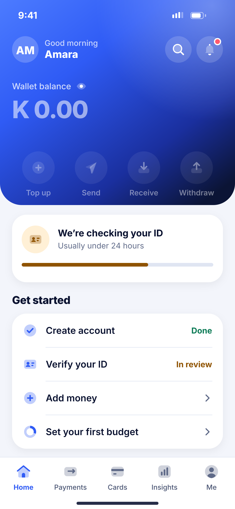
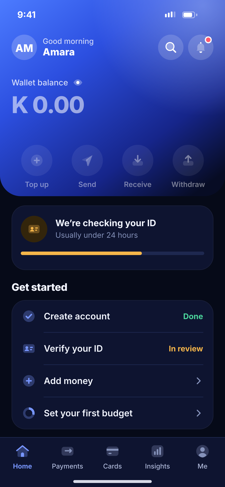

# E01 · Home – ID in review

**Flow:** Home  
**Route:** `/home`  
**Design files:** `light.png`, `dark.png` (3×, 1170 × 2532) and `light.svg`, `dark.svg` in this folder.

| Light | Dark |
|---|---|
|  |  |

## Purpose
Home for a new user whose ID is still being checked. Money actions are locked.

## Layout (top to bottom, 390 × 844 canvas, 20 side padding)
1. NwHeroHeader 340 high, bottom radius 36, white status bar.
2. Top row (y 60): white avatar 22 radius with initials, “Good morning” 13 white 75% + first name 17/800; right: glass search and bell buttons (bell has a red unread dot).
3. Balance block: “Wallet balance” 14 white 80% + 18 eye toggle; amount 40/800 white; glass pill with weekly change.
4. Balance shows K 0.00 at 55% opacity; quick actions at 45% opacity (tapping one opens a sheet: “Available after your ID is verified”).
5. Status card (112 high): warning bubble with ID icon, “We’re checking your ID”, sub, 6-high progress bar (warning colour, 66%).
6. Section “Get started” + list group of four rows: Create account (Done), Verify your ID (In review), Add money (chevron), Set your first budget (chevron).
7. NwTabBar with Home active.

## Components used (see ../../../docs/COMPONENTS.md)
- NwHeroHeader
- NwCard
- NwListGroup
- NwPill
- NwTabBar

## States and behaviour
- KYC not started: status card says “Verify your ID to open your wallet” with a primary “Start” button.
- KYC action needed: card becomes danger tone and opens D09.
- Pull to refresh re-checks KYC status.

## Navigation
| When | Go to |
|---|---|
| Status card | D07 ID in review |
| Set your first budget | M03 Create budget |
| Bell | E06 |

## Data and backend
- `GET /api/v1/users/me`, `GET /api/v1/kyc/status`, `GET /api/v1/notifications/unread-count`.

## Rules and notes
- Budgets and goals work before KYC (no money movement).

## Done when
- Matches `light.png` and `dark.png` side by side at 390 × 844 (spacing within 2 px, same colours from theme tokens).
- Works at text scale 1.3× without clipping, and on a 360-wide Android phone.
- Every state listed above can be reached (use a debug menu or fake repository).
- TalkBack reads every button and field with a clear label.
- No hard-coded colours, strings (all in ARB files) or limits.

## Prompt to give opencode (paste as is)
```text
Build screen E01 "Home – ID in review" for the NovaWallet Flutter app (route /home).
Read docs/COMPONENTS.md and this file (screens/.../E01_home_pending_id/BUILD.md) first, and open light.png and dark.png to match the design exactly.
Use only the shared components from lib/core/ui and colours from the theme extension; if a component is missing, build it in lib/core/ui first.
Put the screen in the feature folder for "Home" following the existing architecture (presentation / application / data layers, Riverpod for state, go_router for navigation).
Implement every state listed under "States and behaviour", the navigation table, and the data calls listed under "Data and backend" through a repository interface with a fake implementation for now if the endpoint is marked NEW.
Add all text to the ARB localisation files. Add a widget test that pumps the screen in light and dark and a golden test for each.
Do not change other screens. When finished, list the files you created or changed and anything you could not complete.
```
