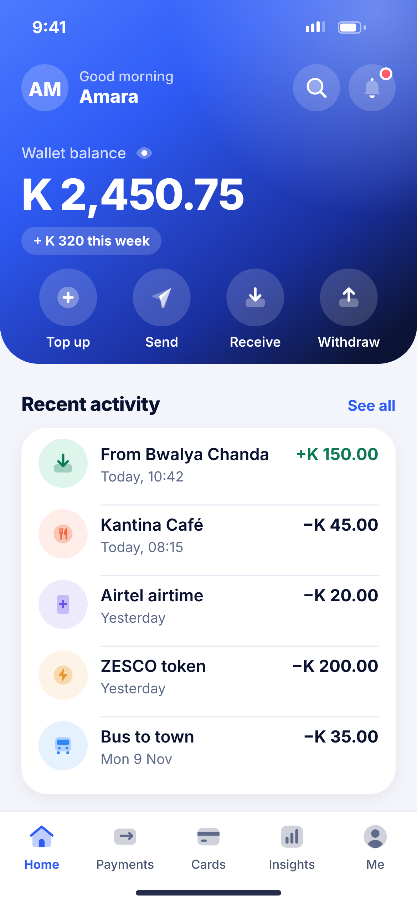
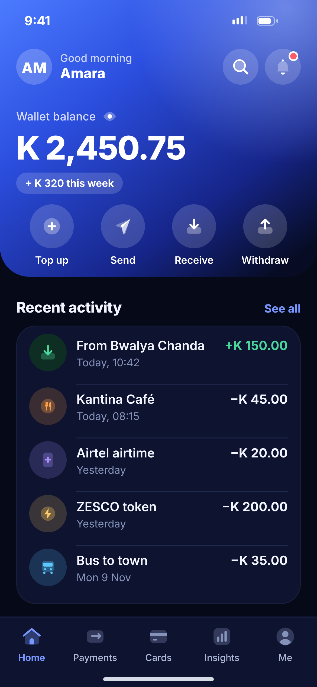

# E02 · Home

**Flow:** Home  
**Route:** `/home`  
**Design files:** `light.png`, `dark.png` (3×, 1170 × 2532) and `light.svg`, `dark.svg` in this folder.

| Light | Dark |
|---|---|
|  |  |

## Purpose
Main dashboard: balance, quick actions, quick bill payments and recent activity.

## Layout (top to bottom, 390 × 844 canvas, 20 side padding)
1. NwHeroHeader 340 high, bottom radius 36, white status bar.
2. Top row (y 60): white avatar 22 radius with initials, “Good morning” 13 white 75% + first name 17/800; right: glass search and bell buttons (bell has a red unread dot).
3. Balance block: “Wallet balance” 14 white 80% + 18 eye toggle; amount 40/800 white; glass pill with weekly change.
4. Four quick actions (glass 54 circles + 12.5 labels): Top up, Send, Receive, Withdraw.
5. Section “Recent activity” + “See all”; card with up to 5 NwTxRow items (money in shown green with +).
6. NwTabBar Home active.
7. Nothing else: bill shortcuts are in the Payments tab (K00).

## Components used (see ../../../docs/COMPONENTS.md)
- NwHeroHeader
- NwCategoryTile
- NwTxRow
- NwTabBar

## States and behaviour
- Loading: skeleton for amount, bubbles and three rows (see P06).
- Offline: cached balance with “Updated 10:42” caption and offline banner (see P02).
- Demo mode: “Demo” pill next to balance.
- Pull to refresh.

## Navigation
| When | Go to |
|---|---|
| Top up | F01 |
| Send | G01 |
| Receive | H01 |
| Withdraw | I01 |
| Transaction row | J03 Detail |
| See all | J01 Activity |
| Search | J01 with search focused |
| Bell | E06 |

## Data and backend
- `GET /api/v1/wallets/me` (balance), `GET /api/v1/wallets/{walletId}/transactions?size=5`, unread count.

## Rules and notes
- Balance animates (count-up 400 ms) only when it changes, not on every open.
- Weekly change pill comes from an insights summary endpoint (NEW `GET /api/v1/insights/summary`).

## Done when
- Matches `light.png` and `dark.png` side by side at 390 × 844 (spacing within 2 px, same colours from theme tokens).
- Works at text scale 1.3× without clipping, and on a 360-wide Android phone.
- Every state listed above can be reached (use a debug menu or fake repository).
- TalkBack reads every button and field with a clear label.
- No hard-coded colours, strings (all in ARB files) or limits.

## Prompt to give opencode (paste as is)
```text
Build screen E02 "Home" for the NovaWallet Flutter app (route /home).
Read docs/COMPONENTS.md and this file (screens/.../E02_home/BUILD.md) first, and open light.png and dark.png to match the design exactly.
Use only the shared components from lib/core/ui and colours from the theme extension; if a component is missing, build it in lib/core/ui first.
Put the screen in the feature folder for "Home" following the existing architecture (presentation / application / data layers, Riverpod for state, go_router for navigation).
Implement every state listed under "States and behaviour", the navigation table, and the data calls listed under "Data and backend" through a repository interface with a fake implementation for now if the endpoint is marked NEW.
Add all text to the ARB localisation files. Add a widget test that pumps the screen in light and dark and a golden test for each.
Do not change other screens. When finished, list the files you created or changed and anything you could not complete.
```
