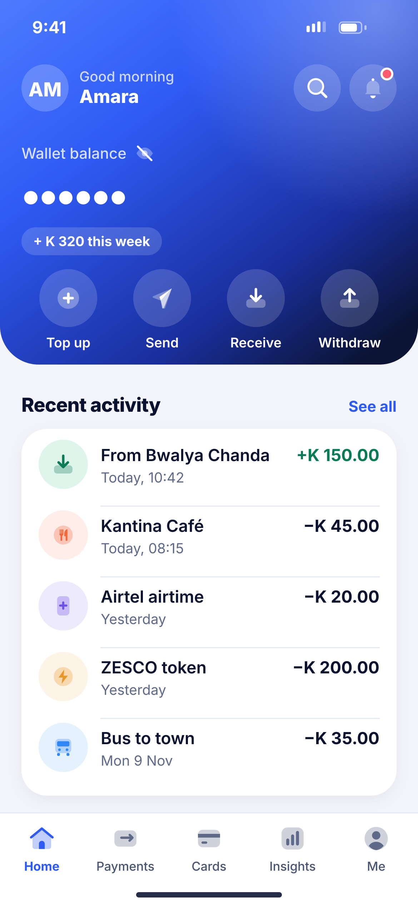
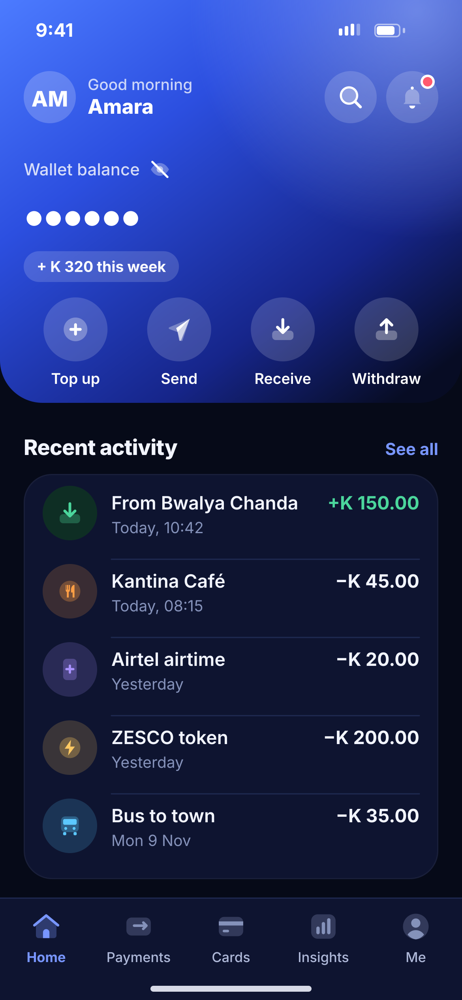

# E03 · Home – balance hidden

**Flow:** Home  
**Route:** `/home`  
**Design files:** `light.png`, `dark.png` (3×, 1170 × 2532) and `light.svg`, `dark.svg` in this folder.

| Light | Dark |
|---|---|
|  |  |

## Purpose
Privacy mode: balance masked.

## Layout (top to bottom, 390 × 844 canvas, 20 side padding)
1. Same as E02 but amount shows “••••••” and the eye icon becomes eye-off.

## Components used (see ../../../docs/COMPONENTS.md)
- As E02

## States and behaviour
- Choice remembered on this device. Long-press the balance to peek for 3 s.

## Navigation
| When | Go to |
|---|---|
| Eye | Toggles back to E02 |

## Data and backend
- Local setting only.

## Rules and notes
- Also hide amounts in recent activity rows when hidden is on (optional setting in O08).

## Done when
- Matches `light.png` and `dark.png` side by side at 390 × 844 (spacing within 2 px, same colours from theme tokens).
- Works at text scale 1.3× without clipping, and on a 360-wide Android phone.
- Every state listed above can be reached (use a debug menu or fake repository).
- TalkBack reads every button and field with a clear label.
- No hard-coded colours, strings (all in ARB files) or limits.

## Prompt to give opencode (paste as is)
```text
Build screen E03 "Home – balance hidden" for the NovaWallet Flutter app (route /home).
Read docs/COMPONENTS.md and this file (screens/.../E03_home_balance_hidden/BUILD.md) first, and open light.png and dark.png to match the design exactly.
Use only the shared components from lib/core/ui and colours from the theme extension; if a component is missing, build it in lib/core/ui first.
Put the screen in the feature folder for "Home" following the existing architecture (presentation / application / data layers, Riverpod for state, go_router for navigation).
Implement every state listed under "States and behaviour", the navigation table, and the data calls listed under "Data and backend" through a repository interface with a fake implementation for now if the endpoint is marked NEW.
Add all text to the ARB localisation files. Add a widget test that pumps the screen in light and dark and a golden test for each.
Do not change other screens. When finished, list the files you created or changed and anything you could not complete.
```
