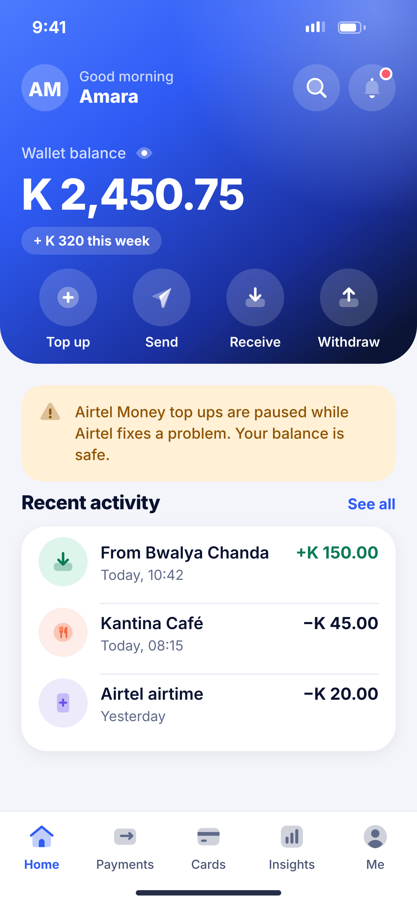
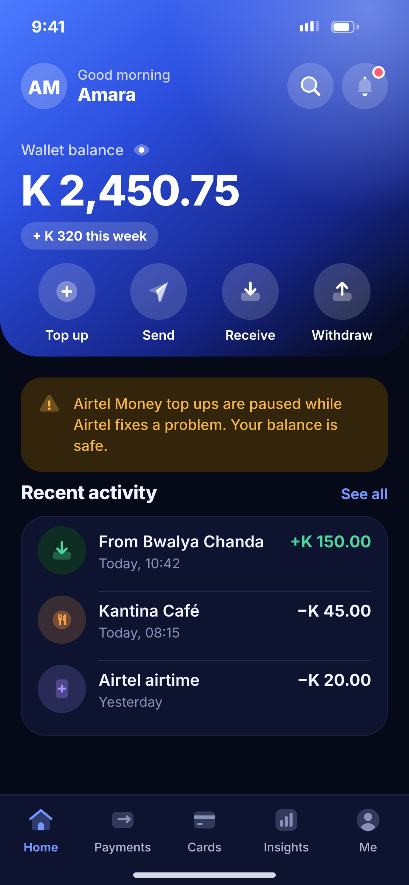

# E05 · Home – service notice

**Flow:** Home  
**Route:** `/home`  
**Design files:** `light.png`, `dark.png` (3×, 1170 × 2532) and `light.svg`, `dark.svg` in this folder.

| Light | Dark |
|---|---|
|  |  |

## Purpose
Show a provider outage without scaring the user.

## Layout (top to bottom, 390 × 844 canvas, 20 side padding)
1. Same hero as E02.
2. Warning NwBanner under the hero: “Airtel Money top ups are paused while Airtel fixes a problem. Your balance is safe.”
3. Recent activity below (3 rows).

## Components used (see ../../../docs/COMPONENTS.md)
- NwBanner

## States and behaviour
- Banner text and severity come from the server. Dismissible only for info level.
- Disabled provider rows in F01 and I01 show the same message.

## Navigation
| When | Go to |
|---|---|
| Banner tap | Status details sheet |

## Data and backend
- NEW `GET /api/v1/app/notices` (driven by the admin Providers kill switch).

## Rules and notes
- Never blame the user. Always say what still works.

## Done when
- Matches `light.png` and `dark.png` side by side at 390 × 844 (spacing within 2 px, same colours from theme tokens).
- Works at text scale 1.3× without clipping, and on a 360-wide Android phone.
- Every state listed above can be reached (use a debug menu or fake repository).
- TalkBack reads every button and field with a clear label.
- No hard-coded colours, strings (all in ARB files) or limits.

## Prompt to give opencode (paste as is)
```text
Build screen E05 "Home – service notice" for the NovaWallet Flutter app (route /home).
Read docs/COMPONENTS.md and this file (screens/.../E05_home_service_notice/BUILD.md) first, and open light.png and dark.png to match the design exactly.
Use only the shared components from lib/core/ui and colours from the theme extension; if a component is missing, build it in lib/core/ui first.
Put the screen in the feature folder for "Home" following the existing architecture (presentation / application / data layers, Riverpod for state, go_router for navigation).
Implement every state listed under "States and behaviour", the navigation table, and the data calls listed under "Data and backend" through a repository interface with a fake implementation for now if the endpoint is marked NEW.
Add all text to the ARB localisation files. Add a widget test that pumps the screen in light and dark and a golden test for each.
Do not change other screens. When finished, list the files you created or changed and anything you could not complete.
```
