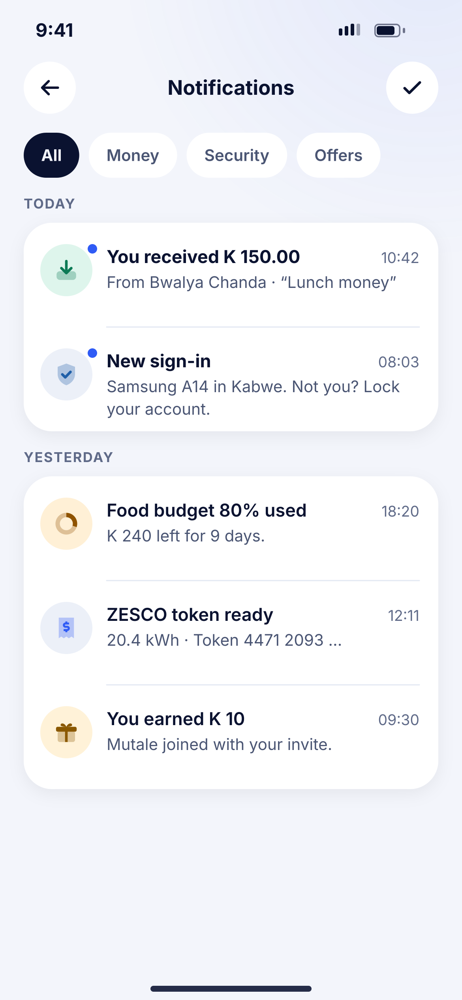
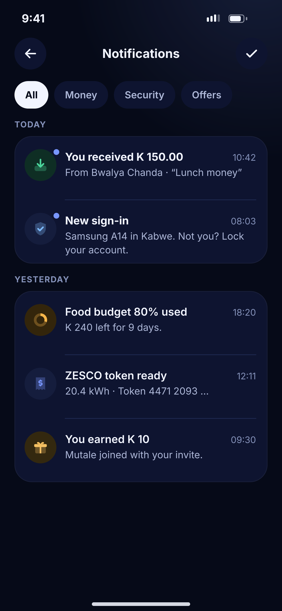

# E06 · Notifications

**Flow:** Home  
**Route:** `/notifications`  
**Design files:** `light.png`, `dark.png` (3×, 1170 × 2532) and `light.svg`, `dark.svg` in this folder.

| Light | Dark |
|---|---|
|  |  |

## Purpose
All alerts grouped by day.

## Layout (top to bottom, 390 × 844 canvas, 20 side padding)
1. TopBar “Notifications” with a check action (mark all read).
2. NwChips: All, Money, Security, Offers.
3. Overline “TODAY” then a card of rows (88 high): 44 tinted bubble, title 15/700 if unread, time right 12.5, two-line body 13.5 text2, 5 primary unread dot on the bubble.
4. Overline “YESTERDAY” and its card.

## Components used (see ../../../docs/COMPONENTS.md)
- NwChips
- NwCard
- NwBubble

## States and behaviour
- Infinite scroll with skeleton rows.
- Swipe left to delete.
- Tap marks as read and opens the related screen.

## Navigation
| When | Go to |
|---|---|
| Money item | J03 Transaction detail |
| New sign-in | O04 Devices |
| Budget | M02 |
| Bill token | K03 |

## Data and backend
- NEW `GET /api/v1/notifications?category=` (list), existing `PUT /api/v1/notifications/read-all`, `GET /unread-count`.

## Done when
- Matches `light.png` and `dark.png` side by side at 390 × 844 (spacing within 2 px, same colours from theme tokens).
- Works at text scale 1.3× without clipping, and on a 360-wide Android phone.
- Every state listed above can be reached (use a debug menu or fake repository).
- TalkBack reads every button and field with a clear label.
- No hard-coded colours, strings (all in ARB files) or limits.

## Prompt to give opencode (paste as is)
```text
Build screen E06 "Notifications" for the NovaWallet Flutter app (route /notifications).
Read docs/COMPONENTS.md and this file (screens/.../E06_notifications/BUILD.md) first, and open light.png and dark.png to match the design exactly.
Use only the shared components from lib/core/ui and colours from the theme extension; if a component is missing, build it in lib/core/ui first.
Put the screen in the feature folder for "Home" following the existing architecture (presentation / application / data layers, Riverpod for state, go_router for navigation).
Implement every state listed under "States and behaviour", the navigation table, and the data calls listed under "Data and backend" through a repository interface with a fake implementation for now if the endpoint is marked NEW.
Add all text to the ARB localisation files. Add a widget test that pumps the screen in light and dark and a golden test for each.
Do not change other screens. When finished, list the files you created or changed and anything you could not complete.
```
