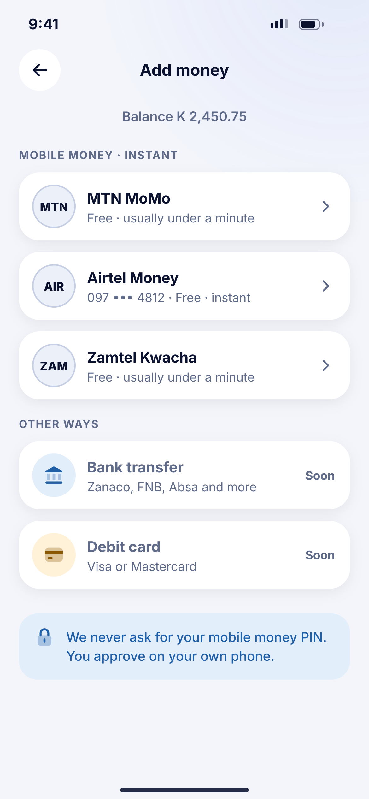
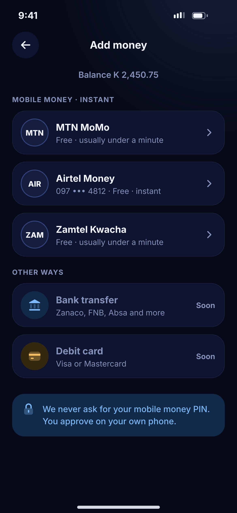

# F01 · Add money – method

**Flow:** Top up  
**Route:** `/topup`  
**Design files:** `light.png`, `dark.png` (3×, 1170 × 2532) and `light.svg`, `dark.svg` in this folder.

| Light | Dark |
|---|---|
|  |  |

## Purpose
Choose where to pull money from.

## Layout (top to bottom, 390 × 844 canvas, 20 side padding)
1. TopBar “Add money”; caption “Balance K 2,450.75”.
2. Overline “Mobile money · instant”; three provider cards (72 high): text badge MTN/AIR/ZAM, name 15.5/700, sub (saved number, fee, speed), chevron.
3. Overline “Other ways”; Bank transfer and Debit card rows greyed with “Soon”.
4. Info banner with lock: “We never ask for your mobile money PIN. You approve on your own phone.”

## Components used (see ../../../docs/COMPONENTS.md)
- NwProviderBadge
- NwCard row
- NwBanner

## States and behaviour
- Provider disabled by admin → row greyed with reason.
- Saved number shown in sub when known.

## Navigation
| When | Go to |
|---|---|
| Provider | F02 Amount |

## Data and backend
- NEW `GET /api/v1/payment-methods` (available providers + status).

## Rules and notes
- Text badges only, no telco logos.

## Done when
- Matches `light.png` and `dark.png` side by side at 390 × 844 (spacing within 2 px, same colours from theme tokens).
- Works at text scale 1.3× without clipping, and on a 360-wide Android phone.
- Every state listed above can be reached (use a debug menu or fake repository).
- TalkBack reads every button and field with a clear label.
- No hard-coded colours, strings (all in ARB files) or limits.

## Prompt to give opencode (paste as is)
```text
Build screen F01 "Add money – method" for the NovaWallet Flutter app (route /topup).
Read docs/COMPONENTS.md and this file (screens/.../F01_topup_method/BUILD.md) first, and open light.png and dark.png to match the design exactly.
Use only the shared components from lib/core/ui and colours from the theme extension; if a component is missing, build it in lib/core/ui first.
Put the screen in the feature folder for "Top up" following the existing architecture (presentation / application / data layers, Riverpod for state, go_router for navigation).
Implement every state listed under "States and behaviour", the navigation table, and the data calls listed under "Data and backend" through a repository interface with a fake implementation for now if the endpoint is marked NEW.
Add all text to the ARB localisation files. Add a widget test that pumps the screen in light and dark and a golden test for each.
Do not change other screens. When finished, list the files you created or changed and anything you could not complete.
```
