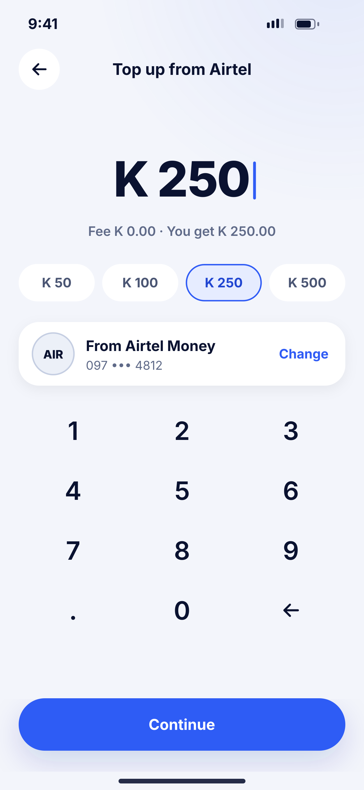
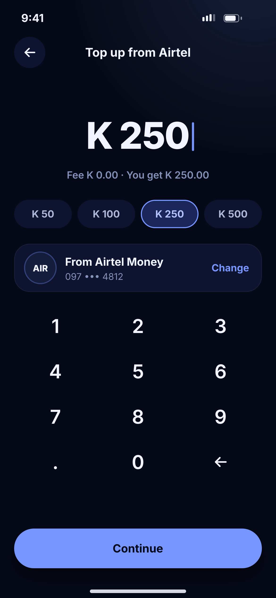

# F02 · Top up – amount

**Flow:** Top up  
**Route:** `/topup/amount?provider=AIRTEL`  
**Design files:** `light.png`, `dark.png` (3×, 1170 × 2532) and `light.svg`, `dark.svg` in this folder.

| Light | Dark |
|---|---|
|  |  |

## Purpose
Enter how much to add.

## Layout (top to bottom, 390 × 844 canvas, 20 side padding)
1. TopBar “Top up from Airtel”.
2. Big amount 52/800 centred with primary caret.
3. Caption “Fee K 0.00 · You get K 250.00”.
4. Four quick chips (K 50, K 100, K 250, K 500); selected chip primarySoft with primary border.
5. Source card: AIR badge, “From Airtel Money”, masked number, “Change” link.
6. NwKeypad with “.” bottom-left, no circles.
7. NwBottomCta “Continue”.

## Components used (see ../../../docs/COMPONENTS.md)
- Amount display
- NwChips (amount)
- NwKeypad
- NwBottomCta

## States and behaviour
- Fee updates live (debounced 300 ms).
- Min K 1, max per limits.
- Over limit → F03.

## Navigation
| When | Go to |
|---|---|
| Continue | F04 Review |
| Change | Number picker sheet |

## Data and backend
- `GET /api/v1/fees/estimate?type=DEPOSIT&amount=`.

## Rules and notes
- Amounts handled as integer ngwee (minor units), never double.

## Done when
- Matches `light.png` and `dark.png` side by side at 390 × 844 (spacing within 2 px, same colours from theme tokens).
- Works at text scale 1.3× without clipping, and on a 360-wide Android phone.
- Every state listed above can be reached (use a debug menu or fake repository).
- TalkBack reads every button and field with a clear label.
- No hard-coded colours, strings (all in ARB files) or limits.

## Prompt to give opencode (paste as is)
```text
Build screen F02 "Top up – amount" for the NovaWallet Flutter app (route /topup/amount?provider=AIRTEL).
Read docs/COMPONENTS.md and this file (screens/.../F02_topup_amount/BUILD.md) first, and open light.png and dark.png to match the design exactly.
Use only the shared components from lib/core/ui and colours from the theme extension; if a component is missing, build it in lib/core/ui first.
Put the screen in the feature folder for "Top up" following the existing architecture (presentation / application / data layers, Riverpod for state, go_router for navigation).
Implement every state listed under "States and behaviour", the navigation table, and the data calls listed under "Data and backend" through a repository interface with a fake implementation for now if the endpoint is marked NEW.
Add all text to the ARB localisation files. Add a widget test that pumps the screen in light and dark and a golden test for each.
Do not change other screens. When finished, list the files you created or changed and anything you could not complete.
```
