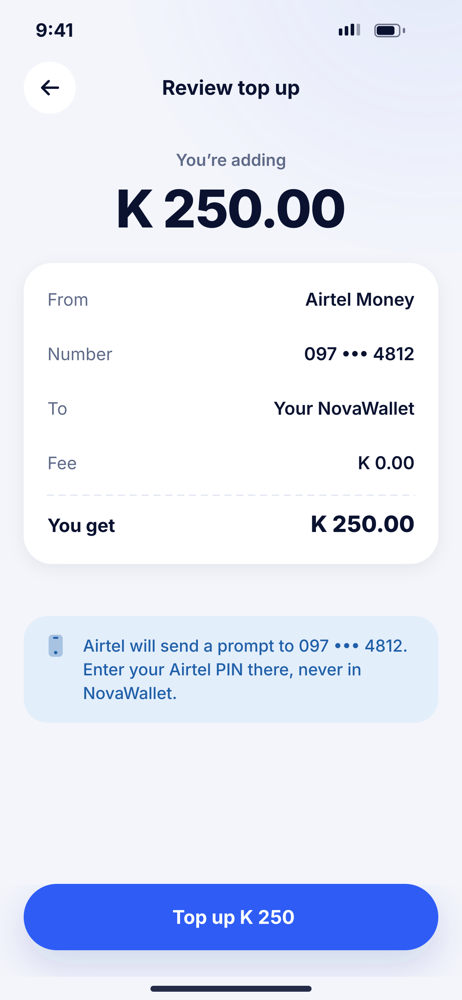
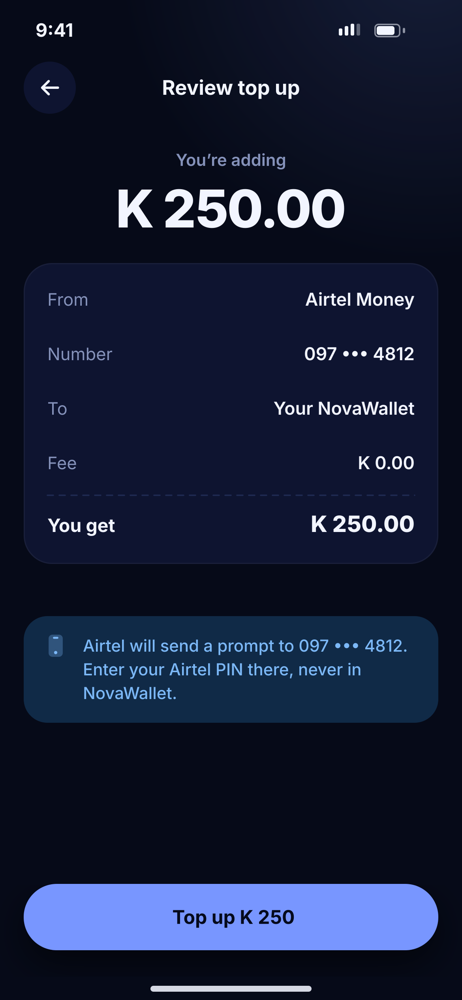

# F04 · Top up – review

**Flow:** Top up  
**Route:** `/topup/review`  
**Design files:** `light.png`, `dark.png` (3×, 1170 × 2532) and `light.svg`, `dark.svg` in this folder.

| Light | Dark |
|---|---|
|  |  |

## Purpose
Confirm before the provider prompt is sent.

## Layout (top to bottom, 390 × 844 canvas, 20 side padding)
1. TopBar “Review top up”.
2. “You’re adding” caption + 44/800 amount.
3. NwKeyValueCard: From, Number, To, Fee, dashed line, total “You get”.
4. Info banner (phone icon): Airtel will send a prompt, enter your Airtel PIN there, never in NovaWallet.
5. NwBottomCta “Top up K 250”.

## Components used (see ../../../docs/COMPONENTS.md)
- NwKeyValueCard
- NwBanner

## States and behaviour
- Button loading while creating the collection.

## Navigation
| When | Go to |
|---|---|
| Top up | F05 Approve on phone |

## Data and backend
- NEW `POST /api/v1/wallets/{walletId}/collections` {amount, provider, msisdn} with an `Idempotency-Key` header (UUID made once per review screen). The backend calls Lipila mobile-money collection and returns {reference, status:PENDING}. Do NOT use `/deposit`: the backend deliberately rejects direct deposits.

## Rules and notes
- Idempotency key is required so a double tap never charges twice.

## Done when
- Matches `light.png` and `dark.png` side by side at 390 × 844 (spacing within 2 px, same colours from theme tokens).
- Works at text scale 1.3× without clipping, and on a 360-wide Android phone.
- Every state listed above can be reached (use a debug menu or fake repository).
- TalkBack reads every button and field with a clear label.
- No hard-coded colours, strings (all in ARB files) or limits.

## Prompt to give opencode (paste as is)
```text
Build screen F04 "Top up – review" for the NovaWallet Flutter app (route /topup/review).
Read docs/COMPONENTS.md and this file (screens/.../F04_topup_review/BUILD.md) first, and open light.png and dark.png to match the design exactly.
Use only the shared components from lib/core/ui and colours from the theme extension; if a component is missing, build it in lib/core/ui first.
Put the screen in the feature folder for "Top up" following the existing architecture (presentation / application / data layers, Riverpod for state, go_router for navigation).
Implement every state listed under "States and behaviour", the navigation table, and the data calls listed under "Data and backend" through a repository interface with a fake implementation for now if the endpoint is marked NEW.
Add all text to the ARB localisation files. Add a widget test that pumps the screen in light and dark and a golden test for each.
Do not change other screens. When finished, list the files you created or changed and anything you could not complete.
```
