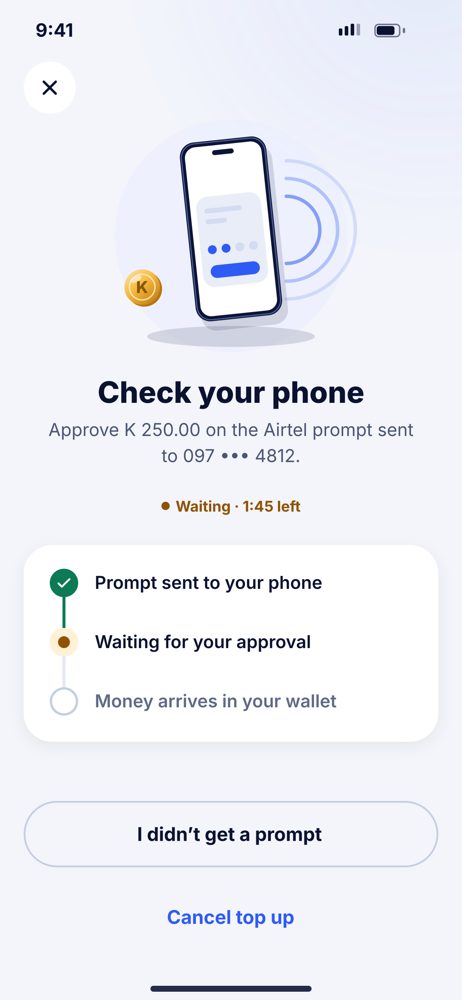
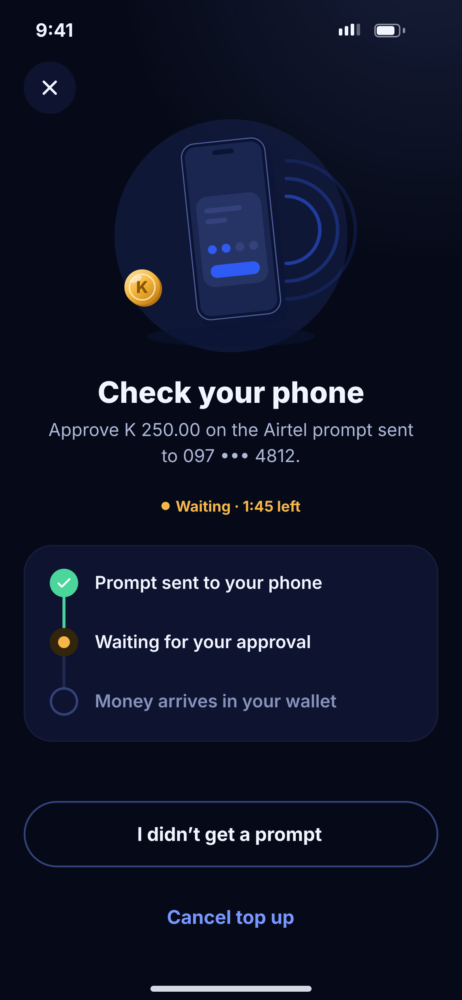

# F05 · Approve on your phone

**Flow:** Top up  
**Route:** `/topup/waiting`  
**Design files:** `light.png`, `dark.png` (3×, 1170 × 2532) and `light.svg`, `dark.svg` in this folder.

| Light | Dark |
|---|---|
|  |  |

## Purpose
Waiting while the user approves the USSD prompt.

## Layout (top to bottom, 390 × 844 canvas, 20 side padding)
1. Close button only.
2. Illustration `approve_on_phone`.
3. Title “Check your phone”, body with amount and number.
4. Warning pill “Waiting · 1:45 left” (countdown).
5. Timeline card: Prompt sent (done), Waiting for your approval (current), Money arrives (future).
6. Outline “I didn’t get a prompt” and ghost “Cancel top up”.

## Components used (see ../../../docs/COMPONENTS.md)
- Timeline card
- NwPill
- Pending Lottie

## States and behaviour
- Poll status every 3 s for 2 minutes, then every 10 s; also listen for push.
- Confirmed → F06. Failed → F07. Timeout with no answer → F08.

## Navigation
| When | Go to |
|---|---|
| Success | F06 |
| Failed | F07 |
| Timeout | F08 |
| Didn’t get prompt | Help sheet: dial *115# (Airtel) / *115# (MTN) to approve pending; verify codes |

## Data and backend
- `GET /api/v1/transactions/{reference}`. Server updates via `POST /api/v1/webhooks/lipila/collections` + reconciliation job.

## Rules and notes
- Never mark success from the app side. Only server status SUCCESS counts.

## Done when
- Matches `light.png` and `dark.png` side by side at 390 × 844 (spacing within 2 px, same colours from theme tokens).
- Works at text scale 1.3× without clipping, and on a 360-wide Android phone.
- Every state listed above can be reached (use a debug menu or fake repository).
- TalkBack reads every button and field with a clear label.
- No hard-coded colours, strings (all in ARB files) or limits.

## Prompt to give opencode (paste as is)
```text
Build screen F05 "Approve on your phone" for the NovaWallet Flutter app (route /topup/waiting).
Read docs/COMPONENTS.md and this file (screens/.../F05_topup_approve_on_phone/BUILD.md) first, and open light.png and dark.png to match the design exactly.
Use only the shared components from lib/core/ui and colours from the theme extension; if a component is missing, build it in lib/core/ui first.
Put the screen in the feature folder for "Top up" following the existing architecture (presentation / application / data layers, Riverpod for state, go_router for navigation).
Implement every state listed under "States and behaviour", the navigation table, and the data calls listed under "Data and backend" through a repository interface with a fake implementation for now if the endpoint is marked NEW.
Add all text to the ARB localisation files. Add a widget test that pumps the screen in light and dark and a golden test for each.
Do not change other screens. When finished, list the files you created or changed and anything you could not complete.
```
