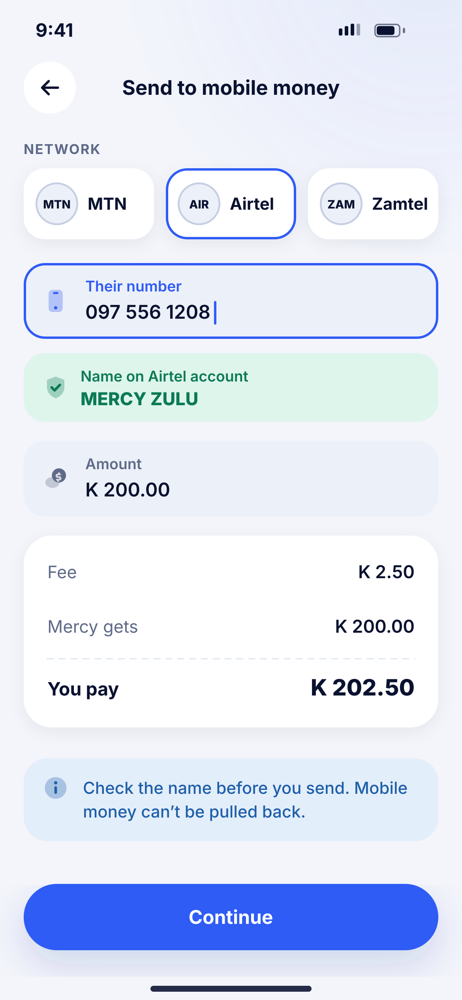
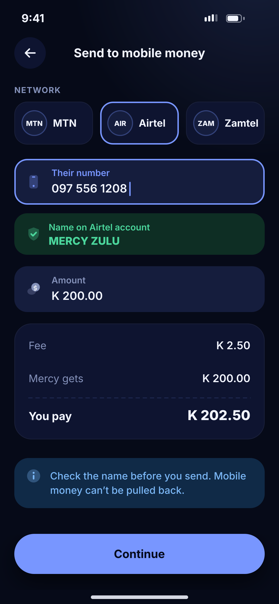

# G07 · Send to mobile money

**Flow:** Send money  
**Route:** `/send/mobile-money`  
**Design files:** `light.png`, `dark.png` (3×, 1170 × 2532) and `light.svg`, `dark.svg` in this folder.

| Light | Dark |
|---|---|
|  |  |

## Purpose
Pay out to any MTN, Airtel or Zamtel number.

## Layout (top to bottom, 390 × 844 canvas, 20 side padding)
1. TopBar “Send to mobile money”.
2. Overline “Network”; three selectable cards with text badges (selected has primary border).
3. NwField “Their number” focused.
4. Name check result (success soft box): shield icon, “Name on Airtel account”, name in caps.
5. NwField Amount.
6. NwKeyValueCard: Fee, “Mercy gets”, total “You pay”.
7. Info banner: check the name, mobile money can’t be pulled back.
8. NwBottomCta “Continue”.

## Components used (see ../../../docs/COMPONENTS.md)
- NwProviderBadge
- NwField
- NwKeyValueCard
- NwBanner

## States and behaviour
- Network auto-selected from the number prefix.
- Name lookup loading / not found (“We couldn’t check this name. Send only if you’re sure.”).

## Navigation
| When | Go to |
|---|---|
| Continue | Review + PIN (same pattern as G03–G05) → I03-style processing |

## Data and backend
- NEW `GET /api/v1/payouts/name-check?msisdn=&network=` (where the provider supports it); `POST /api/v1/wallets/{walletId}/payouts`.

## Rules and notes
- Payout uses the three-stage flow already in the backend (initiate → execute → finalize).

## Done when
- Matches `light.png` and `dark.png` side by side at 390 × 844 (spacing within 2 px, same colours from theme tokens).
- Works at text scale 1.3× without clipping, and on a 360-wide Android phone.
- Every state listed above can be reached (use a debug menu or fake repository).
- TalkBack reads every button and field with a clear label.
- No hard-coded colours, strings (all in ARB files) or limits.

## Prompt to give opencode (paste as is)
```text
Build screen G07 "Send to mobile money" for the NovaWallet Flutter app (route /send/mobile-money).
Read docs/COMPONENTS.md and this file (screens/.../G07_send_mobile_money/BUILD.md) first, and open light.png and dark.png to match the design exactly.
Use only the shared components from lib/core/ui and colours from the theme extension; if a component is missing, build it in lib/core/ui first.
Put the screen in the feature folder for "Send money" following the existing architecture (presentation / application / data layers, Riverpod for state, go_router for navigation).
Implement every state listed under "States and behaviour", the navigation table, and the data calls listed under "Data and backend" through a repository interface with a fake implementation for now if the endpoint is marked NEW.
Add all text to the ARB localisation files. Add a widget test that pumps the screen in light and dark and a golden test for each.
Do not change other screens. When finished, list the files you created or changed and anything you could not complete.
```
