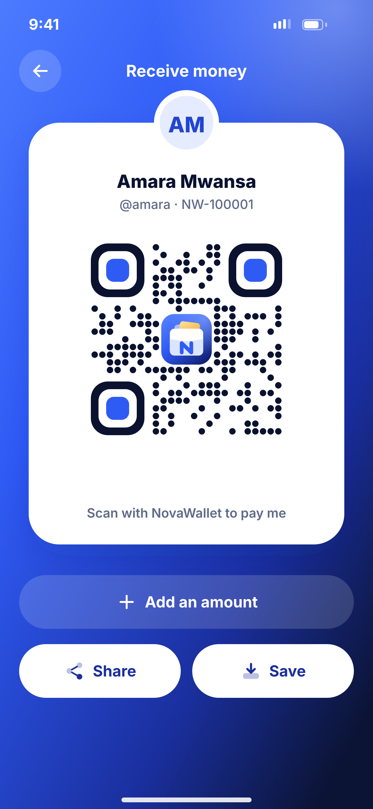
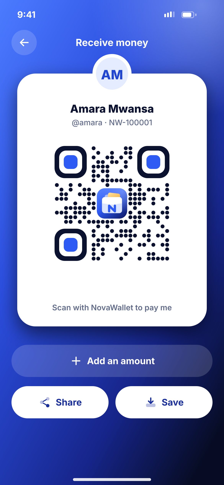

# H01 · Receive – my QR

**Flow:** Receive and pay  
**Route:** `/receive`  
**Design files:** `light.png`, `dark.png` (3×, 1170 × 2532) and `light.svg`, `dark.svg` in this folder.

| Light | Dark |
|---|---|
|  |  |

## Purpose
Show my QR code and handle to get paid.

## Layout (top to bottom, 390 × 844 canvas, 20 side padding)
1. Full-screen hero gradient, white TopBar “Receive money”.
2. White card (radius 32) with overlapping 68 avatar at the top edge, name 19/800, “@amara · NW-100001”.
3. QR 200: dot modules, rounded finders with blue centres, wallet logo in the middle.
4. Caption “Scan with NovaWallet to pay me”.
5. Glass button “Add an amount”, then two white buttons Share and Save.

## Components used (see ../../../docs/COMPONENTS.md)
- QR (qr_flutter with custom painter)
- NwButton glass + white

## States and behaviour
- With amount: amount shown under the name and QR encodes it.
- Brightness boosted while open.

## Navigation
| When | Go to |
|---|---|
| Add amount | Amount sheet |
| Share | Share image + link |

## Data and backend
- QR payload: `novawallet://pay?u=amara&amt=` signed by server — NEW `GET /api/v1/qr/me`.

## Rules and notes
- Card stays white in dark mode for scanning contrast.

## Done when
- Matches `light.png` and `dark.png` side by side at 390 × 844 (spacing within 2 px, same colours from theme tokens).
- Works at text scale 1.3× without clipping, and on a 360-wide Android phone.
- Every state listed above can be reached (use a debug menu or fake repository).
- TalkBack reads every button and field with a clear label.
- No hard-coded colours, strings (all in ARB files) or limits.

## Prompt to give opencode (paste as is)
```text
Build screen H01 "Receive – my QR" for the NovaWallet Flutter app (route /receive).
Read docs/COMPONENTS.md and this file (screens/.../H01_receive_qr/BUILD.md) first, and open light.png and dark.png to match the design exactly.
Use only the shared components from lib/core/ui and colours from the theme extension; if a component is missing, build it in lib/core/ui first.
Put the screen in the feature folder for "Receive and pay" following the existing architecture (presentation / application / data layers, Riverpod for state, go_router for navigation).
Implement every state listed under "States and behaviour", the navigation table, and the data calls listed under "Data and backend" through a repository interface with a fake implementation for now if the endpoint is marked NEW.
Add all text to the ARB localisation files. Add a widget test that pumps the screen in light and dark and a golden test for each.
Do not change other screens. When finished, list the files you created or changed and anything you could not complete.
```
