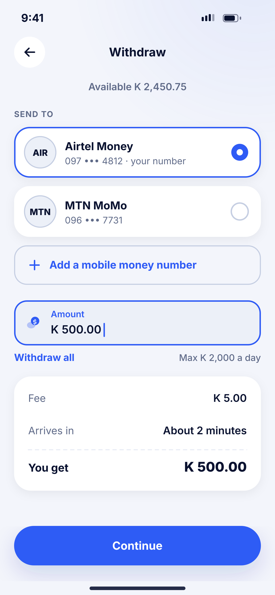
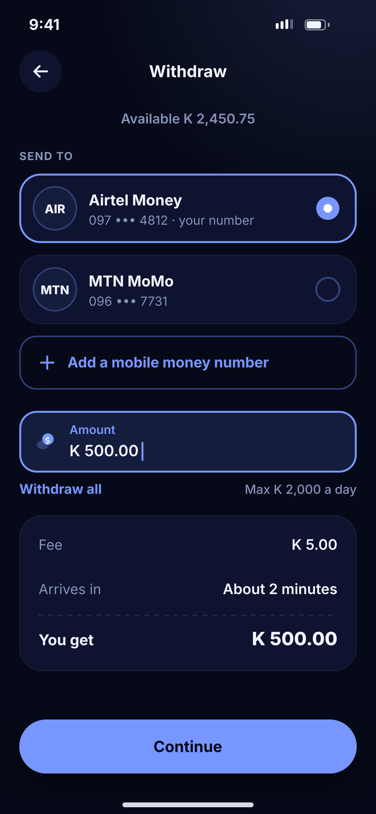

# I01 · Withdraw

**Flow:** Withdraw  
**Route:** `/withdraw`  
**Design files:** `light.png`, `dark.png` (3×, 1170 × 2532) and `light.svg`, `dark.svg` in this folder.

| Light | Dark |
|---|---|
|  |  |

## Purpose
Move money from the wallet to mobile money.

## Layout (top to bottom, 390 × 844 canvas, 20 side padding)
1. TopBar “Withdraw”; caption with available balance.
2. Overline “Send to”; radio provider cards (Airtel selected with primary border), MTN.
3. Outline dashed-feel row “+ Add a mobile money number”.
4. NwField Amount focused; under it “Withdraw all” link and “Max K 2,000 a day”.
5. NwKeyValueCard: Fee, Arrives in, total “You get”.
6. NwBottomCta “Continue”.

## Components used (see ../../../docs/COMPONENTS.md)
- Radio provider card
- NwField
- NwKeyValueCard

## States and behaviour
- Only numbers registered in the user’s name allowed for withdrawal (name check).
- Provider paused → card disabled with reason.

## Navigation
| When | Go to |
|---|---|
| Continue | I02 |
| Add number | Add number flow with OTP |

## Data and backend
- `GET /api/v1/fees/estimate?type=WITHDRAWAL`.

## Done when
- Matches `light.png` and `dark.png` side by side at 390 × 844 (spacing within 2 px, same colours from theme tokens).
- Works at text scale 1.3× without clipping, and on a 360-wide Android phone.
- Every state listed above can be reached (use a debug menu or fake repository).
- TalkBack reads every button and field with a clear label.
- No hard-coded colours, strings (all in ARB files) or limits.

## Prompt to give opencode (paste as is)
```text
Build screen I01 "Withdraw" for the NovaWallet Flutter app (route /withdraw).
Read docs/COMPONENTS.md and this file (screens/.../I01_withdraw/BUILD.md) first, and open light.png and dark.png to match the design exactly.
Use only the shared components from lib/core/ui and colours from the theme extension; if a component is missing, build it in lib/core/ui first.
Put the screen in the feature folder for "Withdraw" following the existing architecture (presentation / application / data layers, Riverpod for state, go_router for navigation).
Implement every state listed under "States and behaviour", the navigation table, and the data calls listed under "Data and backend" through a repository interface with a fake implementation for now if the endpoint is marked NEW.
Add all text to the ARB localisation files. Add a widget test that pumps the screen in light and dark and a golden test for each.
Do not change other screens. When finished, list the files you created or changed and anything you could not complete.
```
