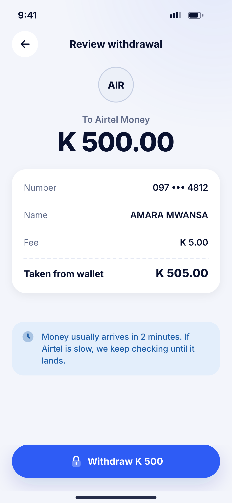
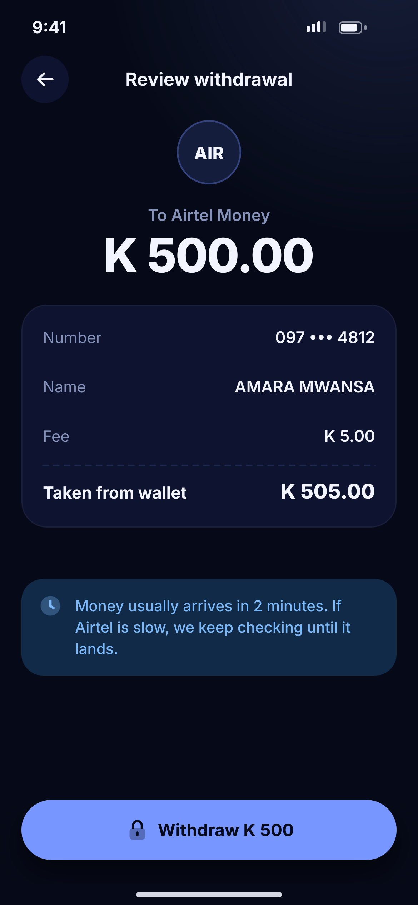

# I02 · Withdraw – review

**Flow:** Withdraw  
**Route:** `/withdraw/review`  
**Design files:** `light.png`, `dark.png` (3×, 1170 × 2532) and `light.svg`, `dark.svg` in this folder.

| Light | Dark |
|---|---|
|  |  |

## Purpose
Confirm withdrawal before PIN.

## Layout (top to bottom, 390 × 844 canvas, 20 side padding)
1. TopBar “Review withdrawal”.
2. 60 AIR badge, “To Airtel Money”, amount 44/800.
3. NwKeyValueCard: Number, Name, Fee, total “Taken from wallet”.
4. Info banner (clock): usually 2 minutes, we keep checking.
5. NwBottomCta “Withdraw K 500” with lock → PIN sheet.

## Components used (see ../../../docs/COMPONENTS.md)
- NwKeyValueCard
- NwBanner
- PIN sheet (as G04)

## States and behaviour

## Navigation
| When | Go to |
|---|---|
| After PIN | I03 |

## Data and backend
- `POST /api/v1/wallets/{walletId}/payouts` + Idempotency-Key.

## Done when
- Matches `light.png` and `dark.png` side by side at 390 × 844 (spacing within 2 px, same colours from theme tokens).
- Works at text scale 1.3× without clipping, and on a 360-wide Android phone.
- Every state listed above can be reached (use a debug menu or fake repository).
- TalkBack reads every button and field with a clear label.
- No hard-coded colours, strings (all in ARB files) or limits.

## Prompt to give opencode (paste as is)
```text
Build screen I02 "Withdraw – review" for the NovaWallet Flutter app (route /withdraw/review).
Read docs/COMPONENTS.md and this file (screens/.../I02_withdraw_review/BUILD.md) first, and open light.png and dark.png to match the design exactly.
Use only the shared components from lib/core/ui and colours from the theme extension; if a component is missing, build it in lib/core/ui first.
Put the screen in the feature folder for "Withdraw" following the existing architecture (presentation / application / data layers, Riverpod for state, go_router for navigation).
Implement every state listed under "States and behaviour", the navigation table, and the data calls listed under "Data and backend" through a repository interface with a fake implementation for now if the endpoint is marked NEW.
Add all text to the ARB localisation files. Add a widget test that pumps the screen in light and dark and a golden test for each.
Do not change other screens. When finished, list the files you created or changed and anything you could not complete.
```
