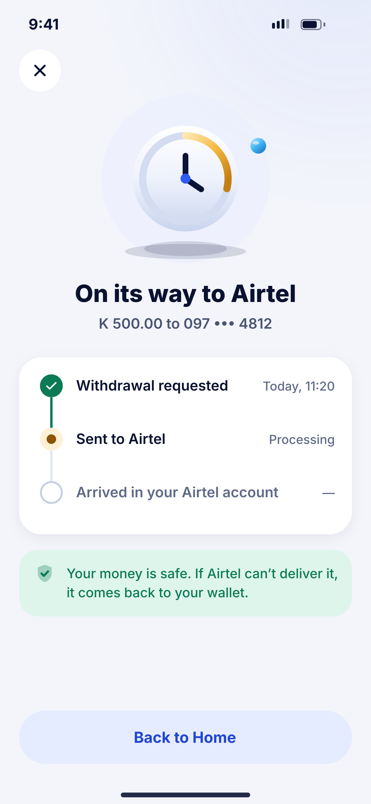
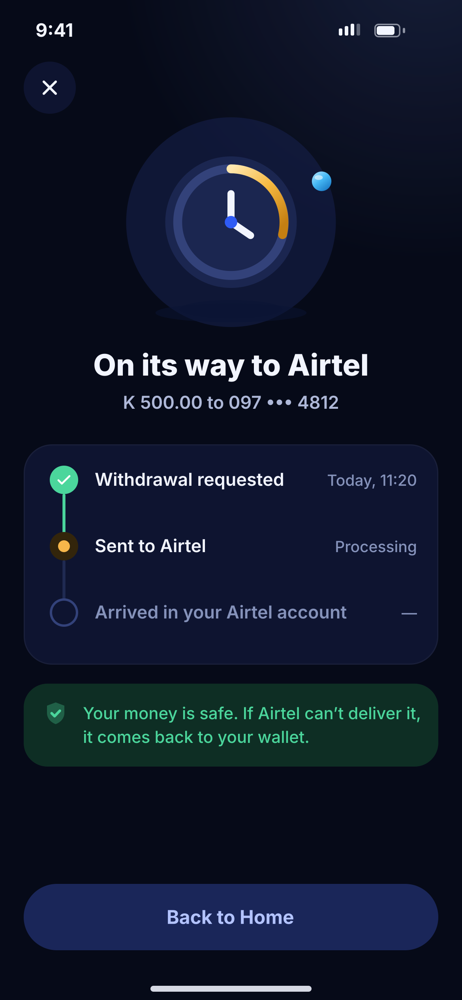

# I03 · Withdraw – processing

**Flow:** Withdraw  
**Route:** `/withdraw/status`  
**Design files:** `light.png`, `dark.png` (3×, 1170 × 2532) and `light.svg`, `dark.svg` in this folder.

| Light | Dark |
|---|---|
|  |  |

## Purpose
Live status of a payout, including the slow-provider case.

## Layout (top to bottom, 390 × 844 canvas, 20 side padding)
1. Close button. Illustration `payment_pending` 270.
2. Title “On its way to Airtel”, amount and number.
3. Timeline card: Requested (done, time), Sent to Airtel (Processing), Arrived (future).
4. Success banner: “Your money is safe. If Airtel can’t deliver it, it comes back to your wallet.”
5. Tonal “Back to Home”.

## Components used (see ../../../docs/COMPONENTS.md)
- Timeline card
- NwBanner

## States and behaviour
- Server status PENDING_RECONCILIATION is shown as “Checking with Airtel”, never as failed.
- Completed → success result; Failed+refunded → result “Money returned to your wallet”.

## Navigation
| When | Go to |
|---|---|
| Back to Home | E02 |

## Data and backend
- `GET /api/v1/transactions/{reference}`; backend reconciliation scheduler (Batch 3).

## Rules and notes
- Copy must match backend states 1:1 (see backend payout-lifecycle doc).

## Done when
- Matches `light.png` and `dark.png` side by side at 390 × 844 (spacing within 2 px, same colours from theme tokens).
- Works at text scale 1.3× without clipping, and on a 360-wide Android phone.
- Every state listed above can be reached (use a debug menu or fake repository).
- TalkBack reads every button and field with a clear label.
- No hard-coded colours, strings (all in ARB files) or limits.

## Prompt to give opencode (paste as is)
```text
Build screen I03 "Withdraw – processing" for the NovaWallet Flutter app (route /withdraw/status).
Read docs/COMPONENTS.md and this file (screens/.../I03_withdraw_processing/BUILD.md) first, and open light.png and dark.png to match the design exactly.
Use only the shared components from lib/core/ui and colours from the theme extension; if a component is missing, build it in lib/core/ui first.
Put the screen in the feature folder for "Withdraw" following the existing architecture (presentation / application / data layers, Riverpod for state, go_router for navigation).
Implement every state listed under "States and behaviour", the navigation table, and the data calls listed under "Data and backend" through a repository interface with a fake implementation for now if the endpoint is marked NEW.
Add all text to the ARB localisation files. Add a widget test that pumps the screen in light and dark and a golden test for each.
Do not change other screens. When finished, list the files you created or changed and anything you could not complete.
```
