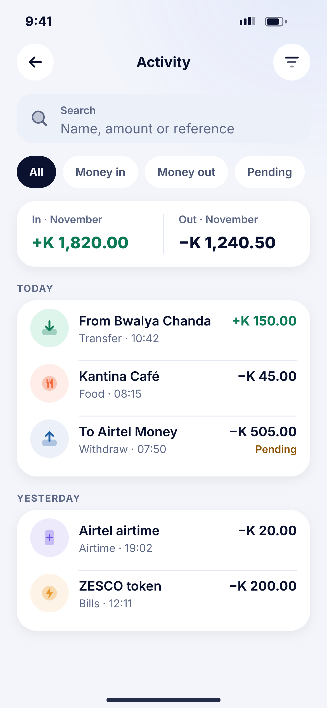
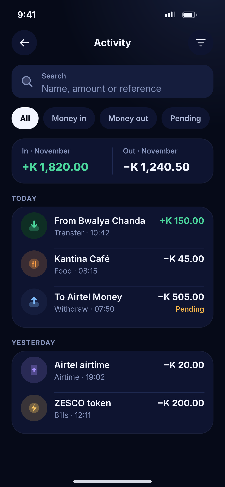

# J01 · Activity

**Flow:** Activity  
**Route:** `/activity`  
**Design files:** `light.png`, `dark.png` (3×, 1170 × 2532) and `light.svg`, `dark.svg` in this folder.

| Light | Dark |
|---|---|
|  |  |

## Purpose
Full transaction history with search, filters and monthly totals.

## Layout (top to bottom, 390 × 844 canvas, 20 side padding)
1. TopBar “Activity” with filter action (dot on it when filters are active).
2. NwField search 58 high.
3. NwChips: All, Money in, Money out, Pending.
4. Month summary card (78): “In · November” +K green and “Out · November” −K, split by a vertical divider.
5. Day groups: overline (TODAY / YESTERDAY / “Mon 9 Nov”) then a card of NwTxRow; pending rows show “Pending” in warning under the amount.

## Components used (see ../../../docs/COMPONENTS.md)
- NwField
- NwChips
- NwCard
- NwTxRow

## States and behaviour
- Infinite scroll (page size 20) with skeleton rows at the bottom.
- Sticky day headers while scrolling.
- Empty filter → J07.
- Offline → cached list + offline banner.

## Navigation
| When | Go to |
|---|---|
| Row | J03 Detail |
| Filter | J02 |
| Statements (menu) | J05 |

## Data and backend
- `GET /api/v1/wallets/{walletId}/transactions?page=&size=&type=&from=&to=&q=` (add q, category filters — backend doc).
- Monthly totals: NEW `GET /api/v1/insights/summary?month=`.

## Rules and notes
- Search runs on the server, debounced 400 ms.

## Done when
- Matches `light.png` and `dark.png` side by side at 390 × 844 (spacing within 2 px, same colours from theme tokens).
- Works at text scale 1.3× without clipping, and on a 360-wide Android phone.
- Every state listed above can be reached (use a debug menu or fake repository).
- TalkBack reads every button and field with a clear label.
- No hard-coded colours, strings (all in ARB files) or limits.

## Prompt to give opencode (paste as is)
```text
Build screen J01 "Activity" for the NovaWallet Flutter app (route /activity).
Read docs/COMPONENTS.md and this file (screens/.../J01_activity/BUILD.md) first, and open light.png and dark.png to match the design exactly.
Use only the shared components from lib/core/ui and colours from the theme extension; if a component is missing, build it in lib/core/ui first.
Put the screen in the feature folder for "Activity" following the existing architecture (presentation / application / data layers, Riverpod for state, go_router for navigation).
Implement every state listed under "States and behaviour", the navigation table, and the data calls listed under "Data and backend" through a repository interface with a fake implementation for now if the endpoint is marked NEW.
Add all text to the ARB localisation files. Add a widget test that pumps the screen in light and dark and a golden test for each.
Do not change other screens. When finished, list the files you created or changed and anything you could not complete.
```
