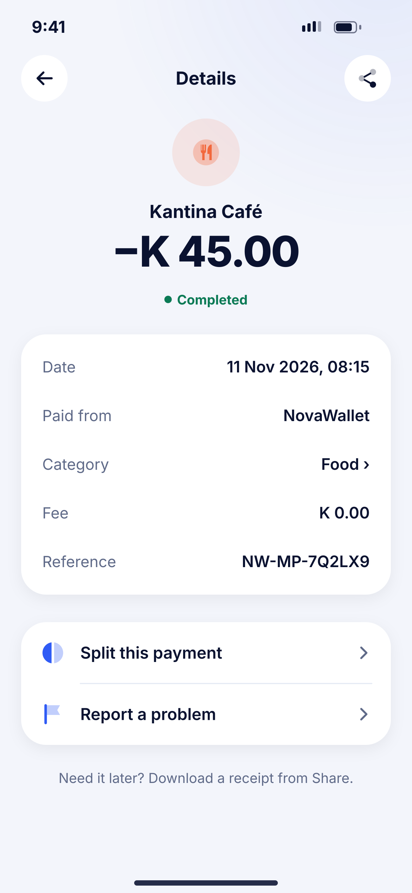
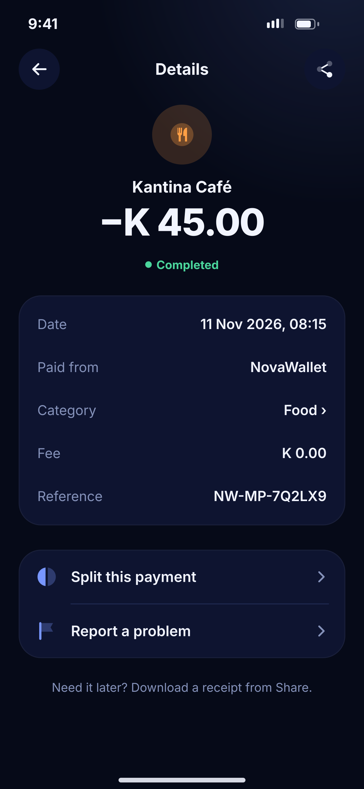

# J03 · Transaction detail

**Flow:** Activity  
**Route:** `/activity/:reference`  
**Design files:** `light.png`, `dark.png` (3×, 1170 × 2532) and `light.svg`, `dark.svg` in this folder.

| Light | Dark |
|---|---|
|  |  |

## Purpose
Everything about one transaction.

## Layout (top to bottom, 390 × 844 canvas, 20 side padding)
1. TopBar “Details” with share action.
2. NwCategoryTile 64, merchant/person name 17/700.
3. Amount 40/800, status pill under it (Completed / Pending / Failed / Reversed).
4. NwKeyValueCard: Date, Paid from, Category (tappable to change), Fee, Reference (long-press copies).
5. List group: Split this payment, Report a problem.
6. Caption about receipts.

## Components used (see ../../../docs/COMPONENTS.md)
- NwCategoryTile
- NwPill
- NwKeyValueCard
- NwListGroup

## States and behaviour
- Pending: timeline like I03 instead of the key-values.
- Failed: danger pill + reason line + “Try again”.
- Reversed: info banner “Money returned on …”.

## Navigation
| When | Go to |
|---|---|
| Share | J04 Receipt |
| Split | G09 prefilled |
| Report | J06 |
| Category | Category picker sheet |

## Data and backend
- `GET /api/v1/transactions/{reference}`; NEW `PATCH /api/v1/transactions/{reference}/category`.

## Done when
- Matches `light.png` and `dark.png` side by side at 390 × 844 (spacing within 2 px, same colours from theme tokens).
- Works at text scale 1.3× without clipping, and on a 360-wide Android phone.
- Every state listed above can be reached (use a debug menu or fake repository).
- TalkBack reads every button and field with a clear label.
- No hard-coded colours, strings (all in ARB files) or limits.

## Prompt to give opencode (paste as is)
```text
Build screen J03 "Transaction detail" for the NovaWallet Flutter app (route /activity/:reference).
Read docs/COMPONENTS.md and this file (screens/.../J03_transaction_detail/BUILD.md) first, and open light.png and dark.png to match the design exactly.
Use only the shared components from lib/core/ui and colours from the theme extension; if a component is missing, build it in lib/core/ui first.
Put the screen in the feature folder for "Activity" following the existing architecture (presentation / application / data layers, Riverpod for state, go_router for navigation).
Implement every state listed under "States and behaviour", the navigation table, and the data calls listed under "Data and backend" through a repository interface with a fake implementation for now if the endpoint is marked NEW.
Add all text to the ARB localisation files. Add a widget test that pumps the screen in light and dark and a golden test for each.
Do not change other screens. When finished, list the files you created or changed and anything you could not complete.
```
