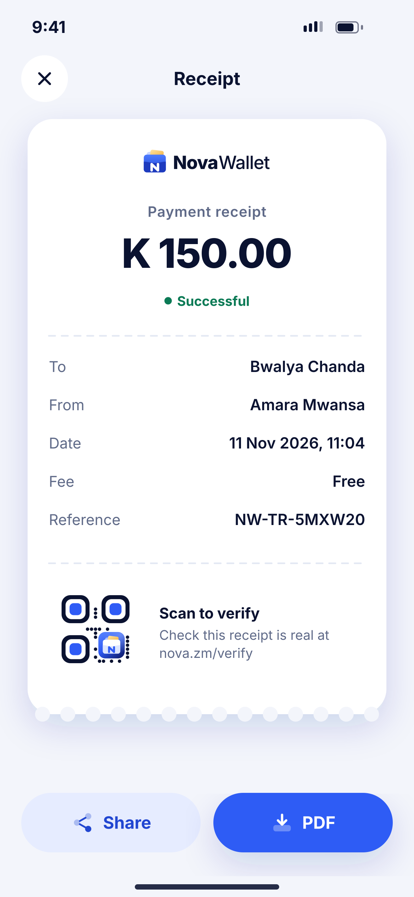
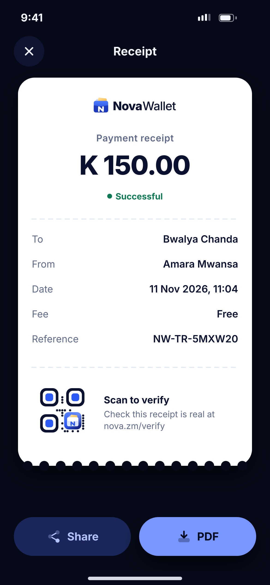

# J04 · Receipt

**Flow:** Activity  
**Route:** `/activity/:reference/receipt`  
**Design files:** `light.png`, `dark.png` (3×, 1170 × 2532) and `light.svg`, `dark.svg` in this folder.

| Light | Dark |
|---|---|
|  |  |

## Purpose
Shareable proof of payment.

## Layout (top to bottom, 390 × 844 canvas, 20 side padding)
1. TopBar with close “Receipt”.
2. White paper card (always white, also in dark mode) with a perforated bottom edge: logo, “Payment receipt”, amount 38/800, “Successful” pill, dashed divider, five key-value lines, dashed divider, small verify QR + “Scan to verify”.
3. Two buttons: tonal Share, primary PDF.

## Components used (see ../../../docs/COMPONENTS.md)
- Receipt card (RepaintBoundary for image capture)
- QR

## States and behaviour
- Share as PNG image; PDF generated by server.

## Navigation
| When | Go to |
|---|---|
| Share | System share sheet |
| PDF | Download + open |

## Data and backend
- NEW `GET /api/v1/transactions/{reference}/receipt.pdf` and a public verify page.

## Rules and notes
- Receipt shows full names but masked phone numbers.

## Done when
- Matches `light.png` and `dark.png` side by side at 390 × 844 (spacing within 2 px, same colours from theme tokens).
- Works at text scale 1.3× without clipping, and on a 360-wide Android phone.
- Every state listed above can be reached (use a debug menu or fake repository).
- TalkBack reads every button and field with a clear label.
- No hard-coded colours, strings (all in ARB files) or limits.

## Prompt to give opencode (paste as is)
```text
Build screen J04 "Receipt" for the NovaWallet Flutter app (route /activity/:reference/receipt).
Read docs/COMPONENTS.md and this file (screens/.../J04_receipt/BUILD.md) first, and open light.png and dark.png to match the design exactly.
Use only the shared components from lib/core/ui and colours from the theme extension; if a component is missing, build it in lib/core/ui first.
Put the screen in the feature folder for "Activity" following the existing architecture (presentation / application / data layers, Riverpod for state, go_router for navigation).
Implement every state listed under "States and behaviour", the navigation table, and the data calls listed under "Data and backend" through a repository interface with a fake implementation for now if the endpoint is marked NEW.
Add all text to the ARB localisation files. Add a widget test that pumps the screen in light and dark and a golden test for each.
Do not change other screens. When finished, list the files you created or changed and anything you could not complete.
```
