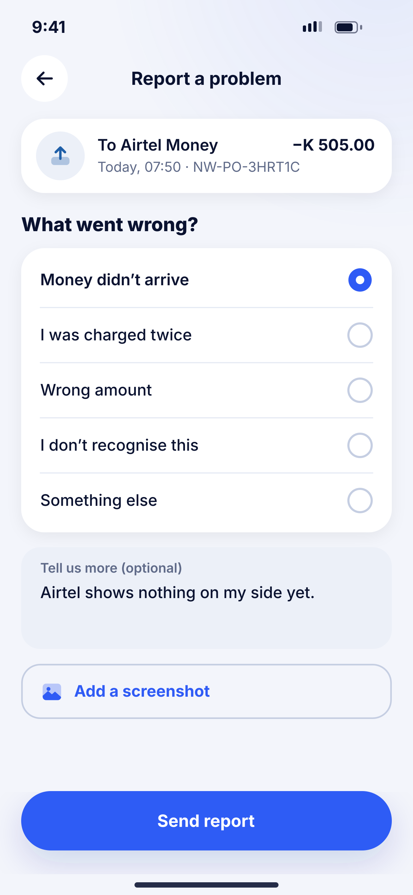
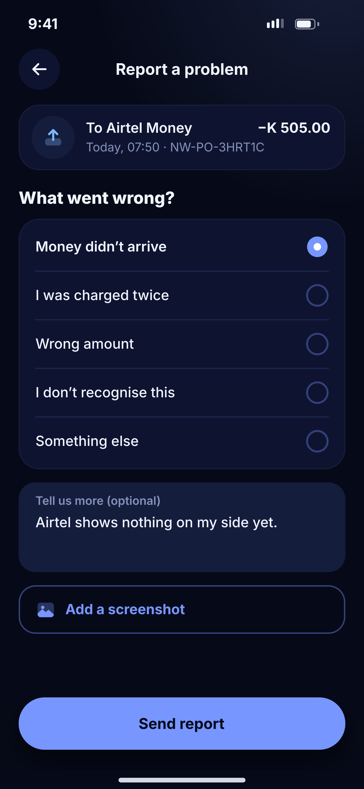

# J06 · Report a problem

**Flow:** Activity  
**Route:** `/activity/:reference/report`  
**Design files:** `light.png`, `dark.png` (3×, 1170 × 2532) and `light.svg`, `dark.svg` in this folder.

| Light | Dark |
|---|---|
|  |  |

## Purpose
Open a dispute or support case linked to a transaction.

## Layout (top to bottom, 390 × 844 canvas, 20 side padding)
1. TopBar “Report a problem”.
2. Transaction mini card.
3. “What went wrong?” + radio list in a card (5 options).
4. Text area (surface2) “Tell us more (optional)”.
5. Outline row “Add a screenshot”.
6. NwBottomCta “Send report”.

## Components used (see ../../../docs/COMPONENTS.md)
- Radio list
- Text area
- Image picker

## States and behaviour
- After sending: success sheet with case number and “We reply within 24 hours”.

## Navigation
| When | Go to |
|---|---|
| Sent | O11 Support chat thread for the case |

## Data and backend
- NEW `POST /api/v1/support/cases` {reference, reason, text, image}.

## Rules and notes
- One open case per transaction; show existing case instead of a new form.

## Done when
- Matches `light.png` and `dark.png` side by side at 390 × 844 (spacing within 2 px, same colours from theme tokens).
- Works at text scale 1.3× without clipping, and on a 360-wide Android phone.
- Every state listed above can be reached (use a debug menu or fake repository).
- TalkBack reads every button and field with a clear label.
- No hard-coded colours, strings (all in ARB files) or limits.

## Prompt to give opencode (paste as is)
```text
Build screen J06 "Report a problem" for the NovaWallet Flutter app (route /activity/:reference/report).
Read docs/COMPONENTS.md and this file (screens/.../J06_report_problem/BUILD.md) first, and open light.png and dark.png to match the design exactly.
Use only the shared components from lib/core/ui and colours from the theme extension; if a component is missing, build it in lib/core/ui first.
Put the screen in the feature folder for "Activity" following the existing architecture (presentation / application / data layers, Riverpod for state, go_router for navigation).
Implement every state listed under "States and behaviour", the navigation table, and the data calls listed under "Data and backend" through a repository interface with a fake implementation for now if the endpoint is marked NEW.
Add all text to the ARB localisation files. Add a widget test that pumps the screen in light and dark and a golden test for each.
Do not change other screens. When finished, list the files you created or changed and anything you could not complete.
```
