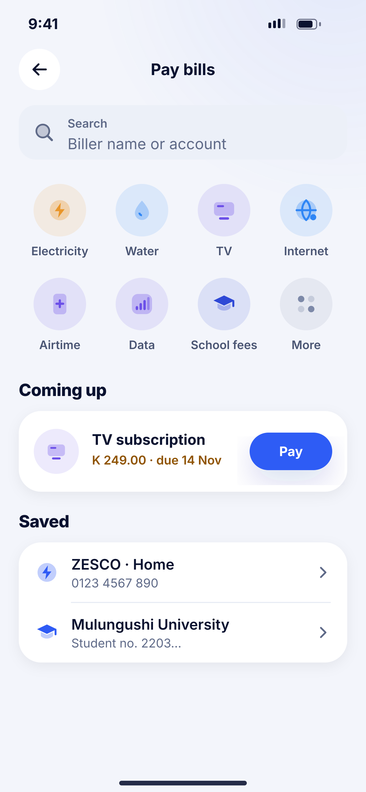
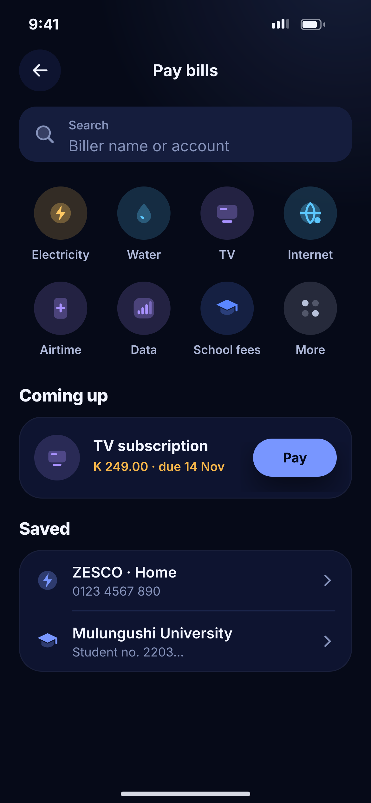

# K01 · Pay bills

**Flow:** Bills, airtime and store  
**Route:** `/bills`  
**Design files:** `light.png`, `dark.png` (3×, 1170 × 2532) and `light.svg`, `dark.svg` in this folder.

| Light | Dark |
|---|---|
|  |  |

## Purpose
Choose a biller category or a saved biller.

## Layout (top to bottom, 390 × 844 canvas, 20 side padding)
1. TopBar “Pay bills”; search field.
2. Grid 4 × 2 category tile (NwCategoryTile)s 56: Electricity, Water, TV, Internet, Airtime, Data, School fees, More.
3. Section “Coming up”: card with due bill and a small primary Pay button.
4. Section “Saved”: list rows.

## Components used (see ../../../docs/COMPONENTS.md)
- NwCategoryTile
- NwCard
- NwListGroup

## States and behaviour
- Categories come from the bill aggregator; hide empty ones.

## Navigation
| When | Go to |
|---|---|
| Electricity | K02 |
| Airtime/Data | K04 |

## Data and backend
- NEW `GET /api/v1/billers` (via Lenco/bill aggregator — see integration doc).

## Done when
- Matches `light.png` and `dark.png` side by side at 390 × 844 (spacing within 2 px, same colours from theme tokens).
- Works at text scale 1.3× without clipping, and on a 360-wide Android phone.
- Every state listed above can be reached (use a debug menu or fake repository).
- TalkBack reads every button and field with a clear label.
- No hard-coded colours, strings (all in ARB files) or limits.

## Prompt to give opencode (paste as is)
```text
Build screen K01 "Pay bills" for the NovaWallet Flutter app (route /bills).
Read docs/COMPONENTS.md and this file (screens/.../K01_bills/BUILD.md) first, and open light.png and dark.png to match the design exactly.
Use only the shared components from lib/core/ui and colours from the theme extension; if a component is missing, build it in lib/core/ui first.
Put the screen in the feature folder for "Bills, airtime and store" following the existing architecture (presentation / application / data layers, Riverpod for state, go_router for navigation).
Implement every state listed under "States and behaviour", the navigation table, and the data calls listed under "Data and backend" through a repository interface with a fake implementation for now if the endpoint is marked NEW.
Add all text to the ARB localisation files. Add a widget test that pumps the screen in light and dark and a golden test for each.
Do not change other screens. When finished, list the files you created or changed and anything you could not complete.
```
