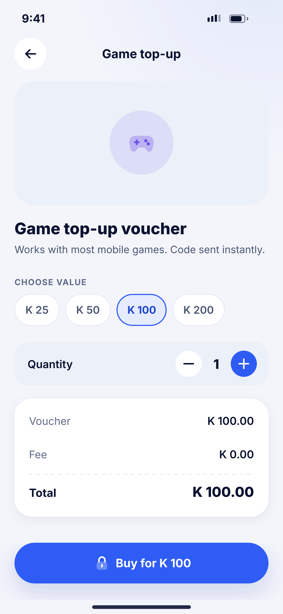
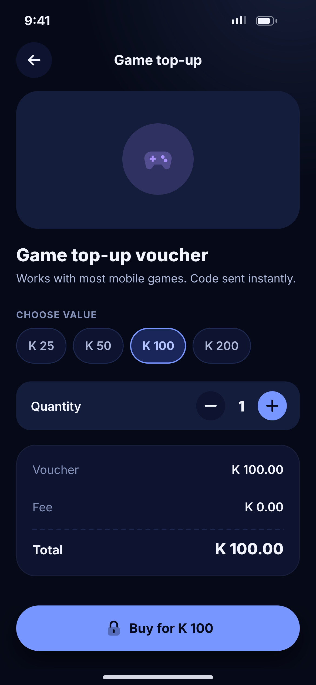

# K06 · Store product

**Flow:** Bills, airtime and store  
**Route:** `/store/:id`  
**Design files:** `light.png`, `dark.png` (3×, 1170 × 2532) and `light.svg`, `dark.svg` in this folder.

| Light | Dark |
|---|---|
|  |  |

## Purpose
Choose value and quantity, then buy.

## Layout (top to bottom, 390 × 844 canvas, 20 side padding)
1. TopBar with product name.
2. Large art panel (surface2, radius 28) with 88 bubble.
3. Title 22/800 + description.
4. Overline “Choose value” + chips.
5. Quantity row with − / + circle buttons.
6. NwKeyValueCard: Voucher, Fee, Total.
7. NwBottomCta “Buy for K 100” with lock.

## Components used (see ../../../docs/COMPONENTS.md)
- Chips
- Stepper
- NwKeyValueCard

## States and behaviour
- After purchase: code shown in a token-style box (like K03) with copy.

## Navigation
| When | Go to |
|---|---|
| After PIN | Code result |

## Data and backend
- NEW `POST /api/v1/store/orders`.

## Done when
- Matches `light.png` and `dark.png` side by side at 390 × 844 (spacing within 2 px, same colours from theme tokens).
- Works at text scale 1.3× without clipping, and on a 360-wide Android phone.
- Every state listed above can be reached (use a debug menu or fake repository).
- TalkBack reads every button and field with a clear label.
- No hard-coded colours, strings (all in ARB files) or limits.

## Prompt to give opencode (paste as is)
```text
Build screen K06 "Store product" for the NovaWallet Flutter app (route /store/:id).
Read docs/COMPONENTS.md and this file (screens/.../K06_store_product/BUILD.md) first, and open light.png and dark.png to match the design exactly.
Use only the shared components from lib/core/ui and colours from the theme extension; if a component is missing, build it in lib/core/ui first.
Put the screen in the feature folder for "Bills, airtime and store" following the existing architecture (presentation / application / data layers, Riverpod for state, go_router for navigation).
Implement every state listed under "States and behaviour", the navigation table, and the data calls listed under "Data and backend" through a repository interface with a fake implementation for now if the endpoint is marked NEW.
Add all text to the ARB localisation files. Add a widget test that pumps the screen in light and dark and a golden test for each.
Do not change other screens. When finished, list the files you created or changed and anything you could not complete.
```
