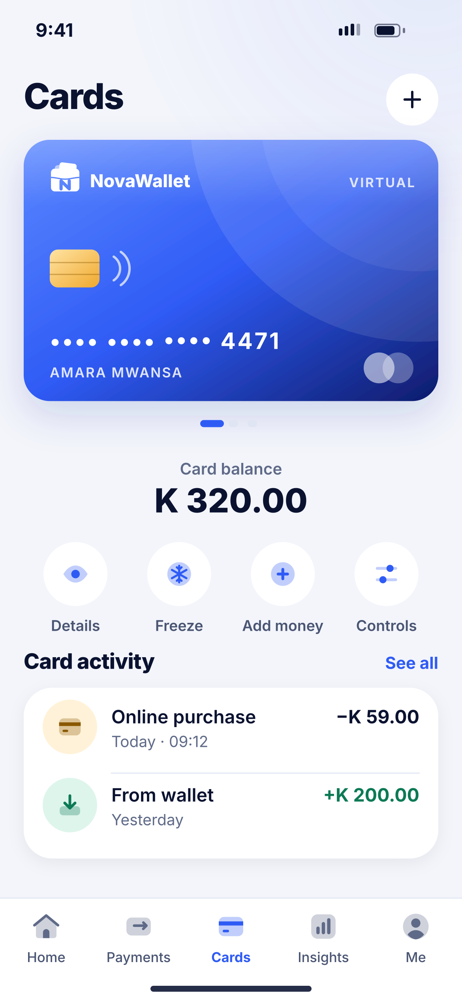
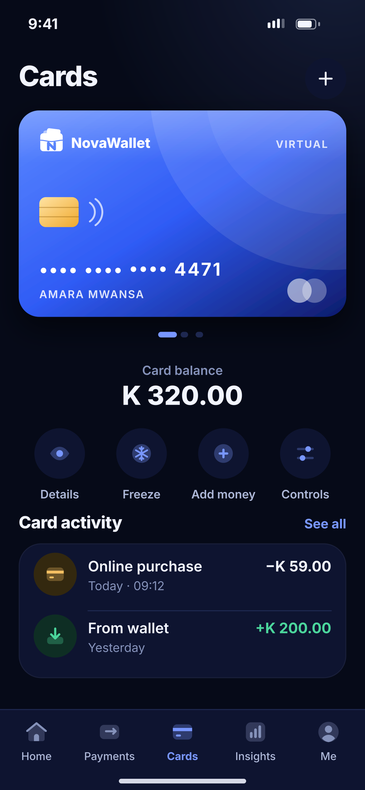

# L03 · Card home

**Flow:** Cards  
**Route:** `/cards (tab)`  
**Design files:** `light.png`, `dark.png` (3×, 1170 × 2532) and `light.svg`, `dark.svg` in this folder.

| Light | Dark |
|---|---|
|  |  |

## Purpose
Manage the virtual card.

## Layout (top to bottom, 390 × 844 canvas, 20 side padding)
1. Title “Cards” + plus button (add another card later).
2. NwVirtualCard full width; pager dots under it.
3. “Card balance” + amount 28/800.
4. Four circle actions: Details, Freeze, Add money, Controls.
5. Section “Card activity” + tx list.
6. NwTabBar Cards active.

## Components used (see ../../../docs/COMPONENTS.md)
- NwVirtualCard
- Circle action
- NwTxRow

## States and behaviour
- Swipe between cards.
- Card payment declined → row with Failed + reason.

## Navigation
| When | Go to |
|---|---|
| Details | L04 after PIN/biometric |
| Freeze | L06 (instant, undo snackbar) |
| Add money | L07 |
| Controls | L05 |

## Data and backend
- NEW `GET /api/v1/cards`, `GET /api/v1/cards/{id}/transactions`.

## Rules and notes
- Card balance model (separate balance vs. wallet-funded) depends on the issuer — see doc.

## Done when
- Matches `light.png` and `dark.png` side by side at 390 × 844 (spacing within 2 px, same colours from theme tokens).
- Works at text scale 1.3× without clipping, and on a 360-wide Android phone.
- Every state listed above can be reached (use a debug menu or fake repository).
- TalkBack reads every button and field with a clear label.
- No hard-coded colours, strings (all in ARB files) or limits.

## Prompt to give opencode (paste as is)
```text
Build screen L03 "Card home" for the NovaWallet Flutter app (route /cards (tab)).
Read docs/COMPONENTS.md and this file (screens/.../L03_card_home/BUILD.md) first, and open light.png and dark.png to match the design exactly.
Use only the shared components from lib/core/ui and colours from the theme extension; if a component is missing, build it in lib/core/ui first.
Put the screen in the feature folder for "Cards" following the existing architecture (presentation / application / data layers, Riverpod for state, go_router for navigation).
Implement every state listed under "States and behaviour", the navigation table, and the data calls listed under "Data and backend" through a repository interface with a fake implementation for now if the endpoint is marked NEW.
Add all text to the ARB localisation files. Add a widget test that pumps the screen in light and dark and a golden test for each.
Do not change other screens. When finished, list the files you created or changed and anything you could not complete.
```
