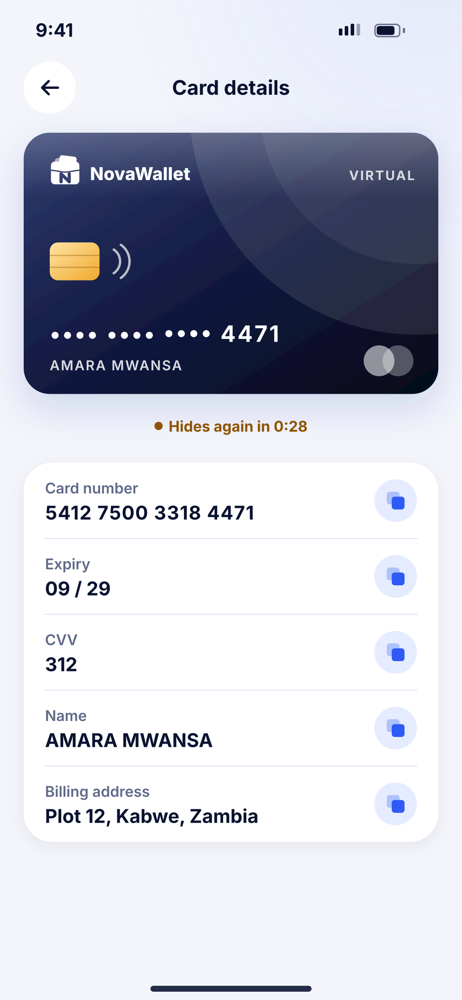
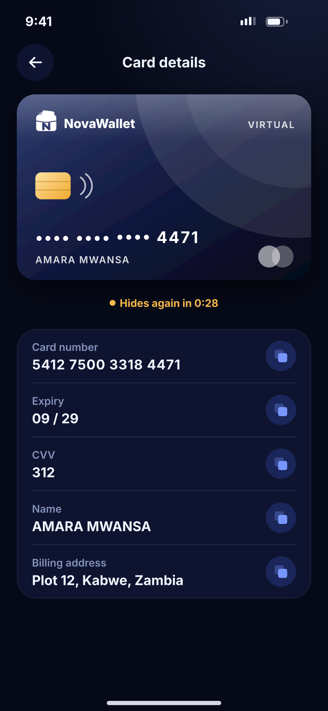

# L04 · Card details

**Flow:** Cards  
**Route:** `/cards/:id/details`  
**Design files:** `light.png`, `dark.png` (3×, 1170 × 2532) and `light.svg`, `dark.svg` in this folder.

| Light | Dark |
|---|---|
|  |  |

## Purpose
Reveal full card number, expiry and CVV for online shopping.

## Layout (top to bottom, 390 × 844 canvas, 20 side padding)
1. TopBar “Card details”.
2. Card (midnight style).
3. Warning pill countdown “Hides again in 0:28”.
4. Card with five rows: label 12.5, value 16/700, copy button (36 primarySoft circle).

## Components used (see ../../../docs/COMPONENTS.md)
- NwVirtualCard
- Copy rows

## States and behaviour
- Requires PIN or biometric before opening.
- Auto-close after 30 s or when app goes to background.
- Copy clears clipboard after 60 s.

## Navigation
| When | Go to |
|---|---|
| Timeout | L03 |

## Data and backend
- Sensitive data fetched via the issuer’s secure display (PCI); app never stores it.

## Rules and notes
- FLAG_SECURE on. No logging of card data.

## Done when
- Matches `light.png` and `dark.png` side by side at 390 × 844 (spacing within 2 px, same colours from theme tokens).
- Works at text scale 1.3× without clipping, and on a 360-wide Android phone.
- Every state listed above can be reached (use a debug menu or fake repository).
- TalkBack reads every button and field with a clear label.
- No hard-coded colours, strings (all in ARB files) or limits.

## Prompt to give opencode (paste as is)
```text
Build screen L04 "Card details" for the NovaWallet Flutter app (route /cards/:id/details).
Read docs/COMPONENTS.md and this file (screens/.../L04_card_details/BUILD.md) first, and open light.png and dark.png to match the design exactly.
Use only the shared components from lib/core/ui and colours from the theme extension; if a component is missing, build it in lib/core/ui first.
Put the screen in the feature folder for "Cards" following the existing architecture (presentation / application / data layers, Riverpod for state, go_router for navigation).
Implement every state listed under "States and behaviour", the navigation table, and the data calls listed under "Data and backend" through a repository interface with a fake implementation for now if the endpoint is marked NEW.
Add all text to the ARB localisation files. Add a widget test that pumps the screen in light and dark and a golden test for each.
Do not change other screens. When finished, list the files you created or changed and anything you could not complete.
```
