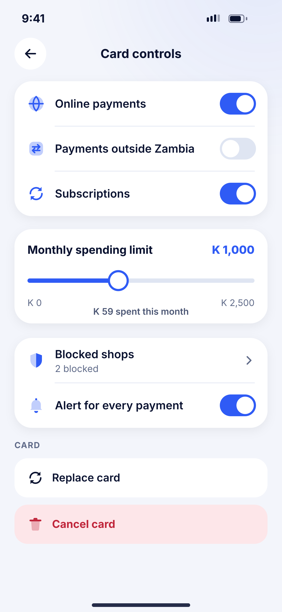
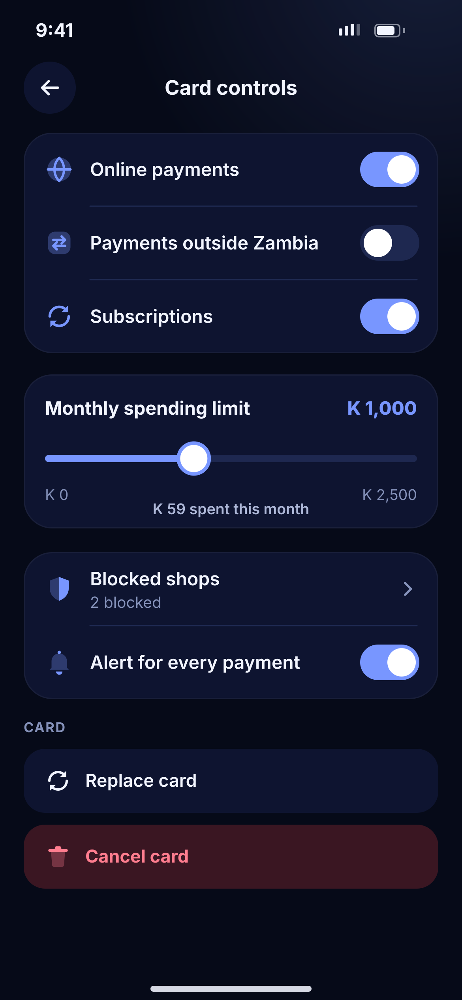

# L05 · Card controls

**Flow:** Cards  
**Route:** `/cards/:id/controls`  
**Design files:** `light.png`, `dark.png` (3×, 1170 × 2532) and `light.svg`, `dark.svg` in this folder.

| Light | Dark |
|---|---|
|  |  |

## Purpose
Turn card features on/off and set limits.

## Layout (top to bottom, 390 × 844 canvas, 20 side padding)
1. TopBar “Card controls”.
2. List group with toggles: Online payments, Payments outside Zambia, Subscriptions.
3. Limit card: title + current value primary, slider (track 6, thumb 26 white with 3 primary border), min/max labels, “K 59 spent this month”.
4. List group: Blocked shops (chevron), Alert for every payment (toggle).
5. Overline Card: “Replace card” row, “Cancel card” danger row.

## Components used (see ../../../docs/COMPONENTS.md)
- NwListGroup
- Slider
- Danger row

## States and behaviour
- Each change saved instantly with a small “Saved” toast; failure reverts the toggle.
- Cancel card → confirm sheet requiring PIN.

## Navigation
| When | Go to |
|---|---|
| Blocked shops | List screen |

## Data and backend
- NEW `PATCH /api/v1/cards/{id}/controls`.

## Done when
- Matches `light.png` and `dark.png` side by side at 390 × 844 (spacing within 2 px, same colours from theme tokens).
- Works at text scale 1.3× without clipping, and on a 360-wide Android phone.
- Every state listed above can be reached (use a debug menu or fake repository).
- TalkBack reads every button and field with a clear label.
- No hard-coded colours, strings (all in ARB files) or limits.

## Prompt to give opencode (paste as is)
```text
Build screen L05 "Card controls" for the NovaWallet Flutter app (route /cards/:id/controls).
Read docs/COMPONENTS.md and this file (screens/.../L05_card_controls/BUILD.md) first, and open light.png and dark.png to match the design exactly.
Use only the shared components from lib/core/ui and colours from the theme extension; if a component is missing, build it in lib/core/ui first.
Put the screen in the feature folder for "Cards" following the existing architecture (presentation / application / data layers, Riverpod for state, go_router for navigation).
Implement every state listed under "States and behaviour", the navigation table, and the data calls listed under "Data and backend" through a repository interface with a fake implementation for now if the endpoint is marked NEW.
Add all text to the ARB localisation files. Add a widget test that pumps the screen in light and dark and a golden test for each.
Do not change other screens. When finished, list the files you created or changed and anything you could not complete.
```
