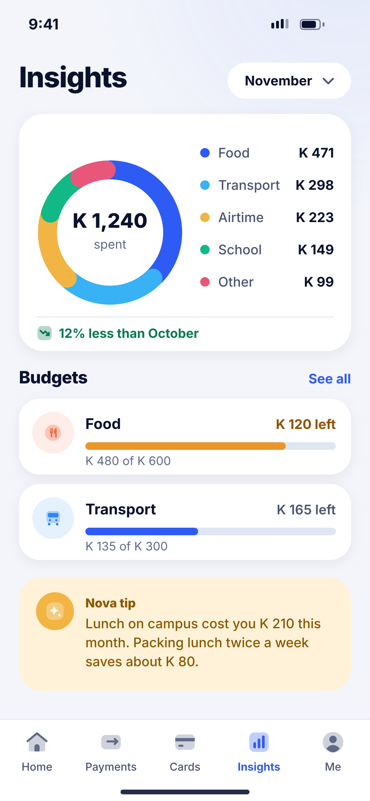
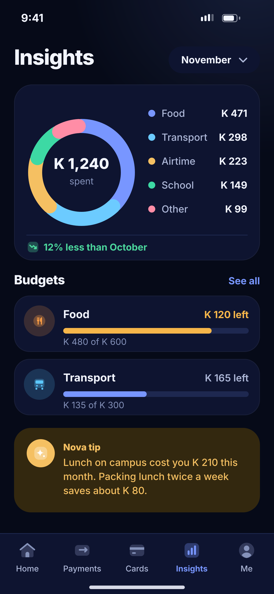

# M01 · Insights

**Flow:** Insights, budgets and goals  
**Route:** `/insights (tab)`  
**Design files:** `light.png`, `dark.png` (3×, 1170 × 2532) and `light.svg`, `dark.svg` in this folder.

| Light | Dark |
|---|---|
|  |  |

## Purpose
Fourth tab: where the money went this month, budgets and a personal tip.

## Layout (top to bottom, 390 × 844 canvas, 20 side padding)
1. Large title “Insights” + month picker pill (surface, chevron).
2. Card 250: donut chart (radius 66, stroke 20, rounded segment ends, 4px gaps) with total in the centre; legend list on the right (dot, category, amount); divider; trend line with icon “12% less than October” (success, or danger if more).
3. Section “Budgets” + See all: two budget rows (category tile (NwCategoryTile), name, “K 120 left”, 8-high progress bar, “K 480 of K 600”).
4. Gold “Nova tip” card with AI icon and a two-line tip.
5. NwTabBar Insights active.

## Components used (see ../../../docs/COMPONENTS.md)
- Donut chart (fl_chart PieChart or CustomPainter)
- Budget row
- NwTabBar

## States and behaviour
- Tap a donut segment or legend row → category transactions.
- No spending yet → empty illustration `onboarding_track` + “Your insights appear after your first payments.”
- Month picker: last 12 months.

## Navigation
| When | Go to |
|---|---|
| Category | J01 filtered by category |
| See all | M02 |
| Tip | N02 |

## Data and backend
- NEW `GET /api/v1/insights/summary?month=` (totals by category, trend, budgets).

## Rules and notes
- Chart colours come from the `chart` token list in order. Bar colour by status: primary under 75%, warning 75–100%, danger over 100%.

## Done when
- Matches `light.png` and `dark.png` side by side at 390 × 844 (spacing within 2 px, same colours from theme tokens).
- Works at text scale 1.3× without clipping, and on a 360-wide Android phone.
- Every state listed above can be reached (use a debug menu or fake repository).
- TalkBack reads every button and field with a clear label.
- No hard-coded colours, strings (all in ARB files) or limits.

## Prompt to give opencode (paste as is)
```text
Build screen M01 "Insights" for the NovaWallet Flutter app (route /insights (tab)).
Read docs/COMPONENTS.md and this file (screens/.../M01_insights/BUILD.md) first, and open light.png and dark.png to match the design exactly.
Use only the shared components from lib/core/ui and colours from the theme extension; if a component is missing, build it in lib/core/ui first.
Put the screen in the feature folder for "Insights, budgets and goals" following the existing architecture (presentation / application / data layers, Riverpod for state, go_router for navigation).
Implement every state listed under "States and behaviour", the navigation table, and the data calls listed under "Data and backend" through a repository interface with a fake implementation for now if the endpoint is marked NEW.
Add all text to the ARB localisation files. Add a widget test that pumps the screen in light and dark and a golden test for each.
Do not change other screens. When finished, list the files you created or changed and anything you could not complete.
```
