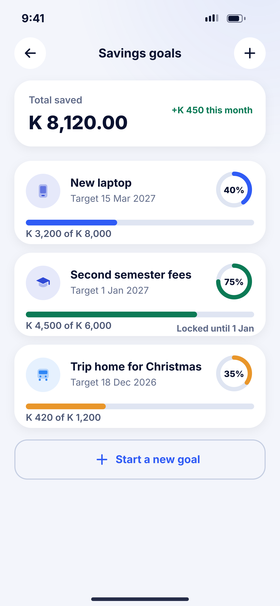
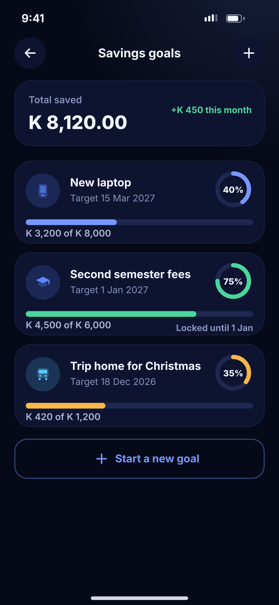

# M04 · Savings goals

**Flow:** Insights, budgets and goals  
**Route:** `/goals`  
**Design files:** `light.png`, `dark.png` (3×, 1170 × 2532) and `light.svg`, `dark.svg` in this folder.

| Light | Dark |
|---|---|
|  |  |

## Purpose
List of savings goals.

## Layout (top to bottom, 390 × 844 canvas, 20 side padding)
1. TopBar “Savings goals” with plus.
2. Total saved card + success pill “+K 450 this month”.
3. Goal cards (116): category tile (NwCategoryTile), name, target date, ring percentage at right (52), full-width progress bar, “K 3,200 of K 8,000”; locked goals show neutral pill “Locked until …”.
4. Outline “Start a new goal”.

## Components used (see ../../../docs/COMPONENTS.md)
- Goal card
- Ring progress

## States and behaviour
- Completed goal: success style + confetti once.

## Navigation
| When | Go to |
|---|---|
| Goal | M05 |
| New | M06 |

## Data and backend
- NEW `GET /api/v1/goals`.

## Rules and notes
- Goal money is held as a separate ledger sub-account (backend ledger phase), not just a label.

## Done when
- Matches `light.png` and `dark.png` side by side at 390 × 844 (spacing within 2 px, same colours from theme tokens).
- Works at text scale 1.3× without clipping, and on a 360-wide Android phone.
- Every state listed above can be reached (use a debug menu or fake repository).
- TalkBack reads every button and field with a clear label.
- No hard-coded colours, strings (all in ARB files) or limits.

## Prompt to give opencode (paste as is)
```text
Build screen M04 "Savings goals" for the NovaWallet Flutter app (route /goals).
Read docs/COMPONENTS.md and this file (screens/.../M04_goals/BUILD.md) first, and open light.png and dark.png to match the design exactly.
Use only the shared components from lib/core/ui and colours from the theme extension; if a component is missing, build it in lib/core/ui first.
Put the screen in the feature folder for "Insights, budgets and goals" following the existing architecture (presentation / application / data layers, Riverpod for state, go_router for navigation).
Implement every state listed under "States and behaviour", the navigation table, and the data calls listed under "Data and backend" through a repository interface with a fake implementation for now if the endpoint is marked NEW.
Add all text to the ARB localisation files. Add a widget test that pumps the screen in light and dark and a golden test for each.
Do not change other screens. When finished, list the files you created or changed and anything you could not complete.
```
