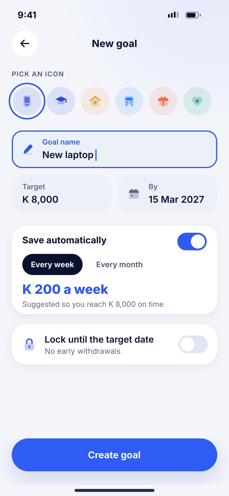
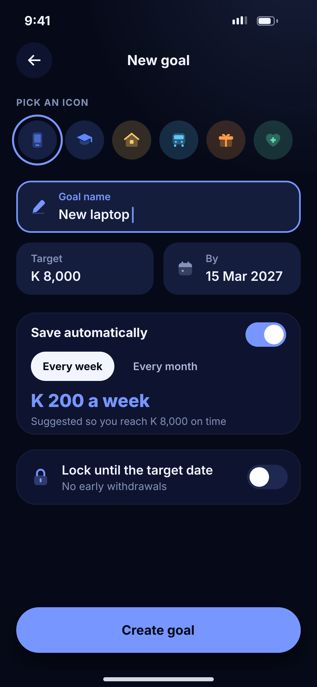

# M06 · New goal

**Flow:** Insights, budgets and goals  
**Route:** `/goals/new`  
**Design files:** `light.png`, `dark.png` (3×, 1170 × 2532) and `light.svg`, `dark.svg` in this folder.

| Light | Dark |
|---|---|
|  |  |

## Purpose
Create a savings goal with optional auto-save.

## Layout (top to bottom, 390 × 844 canvas, 20 side padding)
1. TopBar “New goal”.
2. Icon picker row (6 bubbles, selected ringed).
3. Goal name field focused.
4. Two half fields: Target, By (date).
5. Auto-save card: title + toggle, chips Every week | Every month, suggested amount 22/800 primary + explanation.
6. Row with toggle: Lock until the target date.
7. NwBottomCta “Create goal”.

## Components used (see ../../../docs/COMPONENTS.md)
- Icon picker
- NwField
- Chips
- NwToggle

## States and behaviour
- Suggested amount recalculates from target and date.

## Navigation
| When | Go to |
|---|---|
| Create | M05 |

## Data and backend
- NEW `POST /api/v1/goals`.

## Done when
- Matches `light.png` and `dark.png` side by side at 390 × 844 (spacing within 2 px, same colours from theme tokens).
- Works at text scale 1.3× without clipping, and on a 360-wide Android phone.
- Every state listed above can be reached (use a debug menu or fake repository).
- TalkBack reads every button and field with a clear label.
- No hard-coded colours, strings (all in ARB files) or limits.

## Prompt to give opencode (paste as is)
```text
Build screen M06 "New goal" for the NovaWallet Flutter app (route /goals/new).
Read docs/COMPONENTS.md and this file (screens/.../M06_create_goal/BUILD.md) first, and open light.png and dark.png to match the design exactly.
Use only the shared components from lib/core/ui and colours from the theme extension; if a component is missing, build it in lib/core/ui first.
Put the screen in the feature folder for "Insights, budgets and goals" following the existing architecture (presentation / application / data layers, Riverpod for state, go_router for navigation).
Implement every state listed under "States and behaviour", the navigation table, and the data calls listed under "Data and backend" through a repository interface with a fake implementation for now if the endpoint is marked NEW.
Add all text to the ARB localisation files. Add a widget test that pumps the screen in light and dark and a golden test for each.
Do not change other screens. When finished, list the files you created or changed and anything you could not complete.
```
