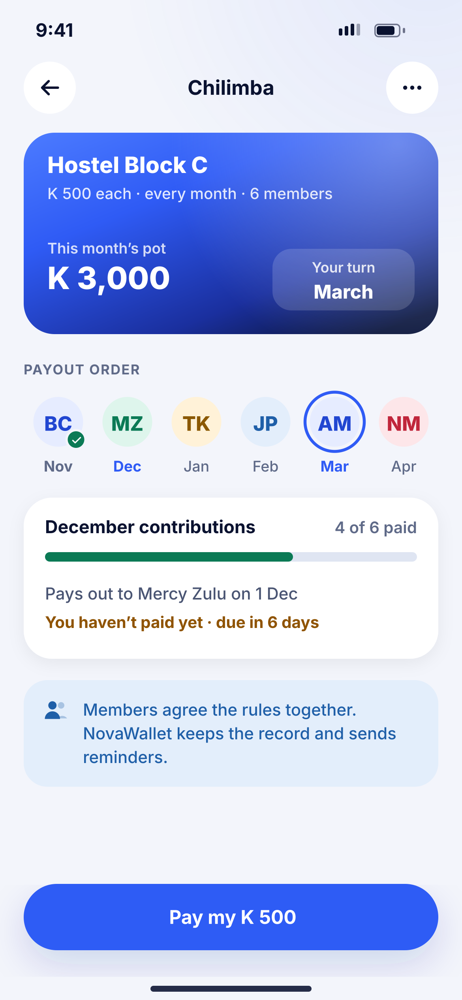
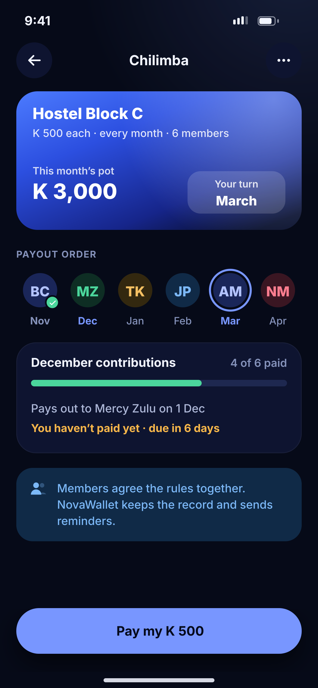

# M09 · Chilimba

**Flow:** Insights, budgets and goals  
**Route:** `/chilimba/:id`  
**Design files:** `light.png`, `dark.png` (3×, 1170 × 2532) and `light.svg`, `dark.svg` in this folder.

| Light | Dark |
|---|---|
|  |  |

## Purpose
Rotating savings group tracker (chilimba).

## Layout (top to bottom, 390 × 844 canvas, 20 side padding)
1. TopBar “Chilimba” + more.
2. Hero card: group name, rules line, “This month’s pot K 3,000”, glass box “Your turn · March”.
3. Overline Payout order: 6 avatars with month labels; paid-out member has a success tick; your avatar has a primary ring; next month label in primary.
4. Contributions card: “December contributions 4 of 6 paid”, success bar, payout line, your status in warning.
5. Info banner: members agree the rules, NovaWallet keeps the record.
6. NwBottomCta “Pay my K 500”.

## Components used (see ../../../docs/COMPONENTS.md)
- Hero card
- NwAvatar
- Progress bar
- NwBanner

## States and behaviour
- All paid → payout button for the organiser (with PIN).
- Late member → reminder button “Nudge”.

## Navigation
| When | Go to |
|---|---|
| Pay | PIN sheet → result |
| More | Members, rules, leave group |

## Data and backend
- NEW Chilimba service endpoints (groups, members, contributions, payouts).

## Rules and notes
- Pooled money is a regulated activity. Launch first as a tracker + reminders, collect money only with the licensed partner’s approval (see compliance doc).

## Done when
- Matches `light.png` and `dark.png` side by side at 390 × 844 (spacing within 2 px, same colours from theme tokens).
- Works at text scale 1.3× without clipping, and on a 360-wide Android phone.
- Every state listed above can be reached (use a debug menu or fake repository).
- TalkBack reads every button and field with a clear label.
- No hard-coded colours, strings (all in ARB files) or limits.

## Prompt to give opencode (paste as is)
```text
Build screen M09 "Chilimba" for the NovaWallet Flutter app (route /chilimba/:id).
Read docs/COMPONENTS.md and this file (screens/.../M09_chilimba/BUILD.md) first, and open light.png and dark.png to match the design exactly.
Use only the shared components from lib/core/ui and colours from the theme extension; if a component is missing, build it in lib/core/ui first.
Put the screen in the feature folder for "Insights, budgets and goals" following the existing architecture (presentation / application / data layers, Riverpod for state, go_router for navigation).
Implement every state listed under "States and behaviour", the navigation table, and the data calls listed under "Data and backend" through a repository interface with a fake implementation for now if the endpoint is marked NEW.
Add all text to the ARB localisation files. Add a widget test that pumps the screen in light and dark and a golden test for each.
Do not change other screens. When finished, list the files you created or changed and anything you could not complete.
```
