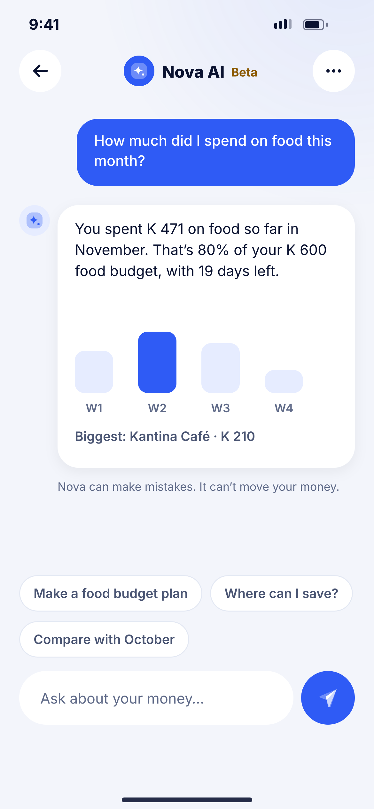
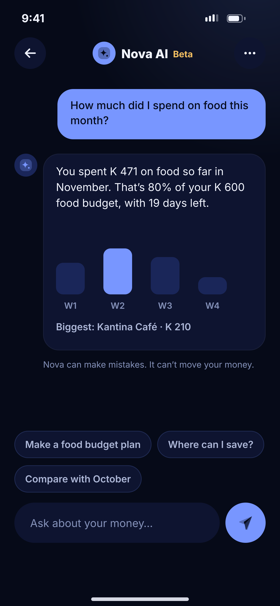

# N01 · Nova AI chat

**Flow:** Nova AI  
**Route:** `/nova`  
**Design files:** `light.png`, `dark.png` (3×, 1170 × 2532) and `light.svg`, `dark.svg` in this folder.

| Light | Dark |
|---|---|
|  |  |

## Purpose
Ask questions about your own money in plain language.

## Layout (top to bottom, 390 × 844 canvas, 20 side padding)
1. TopBar: back, centred AI icon + “Nova AI” + gold “Beta” pill, more menu.
2. User bubble right (primary, radius 22).
3. AI answer card left with small AI avatar: text, inline bar chart (4 weeks, highlighted max), one line of detail.
4. Disclaimer 12 text3.
5. Suggestion chips.
6. Input bar: rounded field “Ask about your money…” + 56 primary send button.

## Components used (see ../../../docs/COMPONENTS.md)
- Chat bubble
- Answer card with chart
- Chips
- Input bar

## States and behaviour
- Streaming answer with typing dots.
- Error: “Nova is unavailable right now”.
- Nova may only read data; any action (pay, transfer) opens the normal screen for the user to confirm.

## Navigation
| When | Go to |
|---|---|
| Chip | Sends that prompt |
| More | Clear chat, How Nova uses your data |

## Data and backend
- NEW AI service `POST /api/v1/ai/chat` (server calls the LLM with a tool that reads the user’s summaries only). Slot reserved for the AI features doc you will upload.

## Rules and notes
- Never send raw card numbers, PINs or NRC numbers to the AI provider.
- Respect the privacy toggle “Let Nova AI read my activity” (O12).

## Done when
- Matches `light.png` and `dark.png` side by side at 390 × 844 (spacing within 2 px, same colours from theme tokens).
- Works at text scale 1.3× without clipping, and on a 360-wide Android phone.
- Every state listed above can be reached (use a debug menu or fake repository).
- TalkBack reads every button and field with a clear label.
- No hard-coded colours, strings (all in ARB files) or limits.

## Prompt to give opencode (paste as is)
```text
Build screen N01 "Nova AI chat" for the NovaWallet Flutter app (route /nova).
Read docs/COMPONENTS.md and this file (screens/.../N01_nova_ai_chat/BUILD.md) first, and open light.png and dark.png to match the design exactly.
Use only the shared components from lib/core/ui and colours from the theme extension; if a component is missing, build it in lib/core/ui first.
Put the screen in the feature folder for "Nova AI" following the existing architecture (presentation / application / data layers, Riverpod for state, go_router for navigation).
Implement every state listed under "States and behaviour", the navigation table, and the data calls listed under "Data and backend" through a repository interface with a fake implementation for now if the endpoint is marked NEW.
Add all text to the ARB localisation files. Add a widget test that pumps the screen in light and dark and a golden test for each.
Do not change other screens. When finished, list the files you created or changed and anything you could not complete.
```
